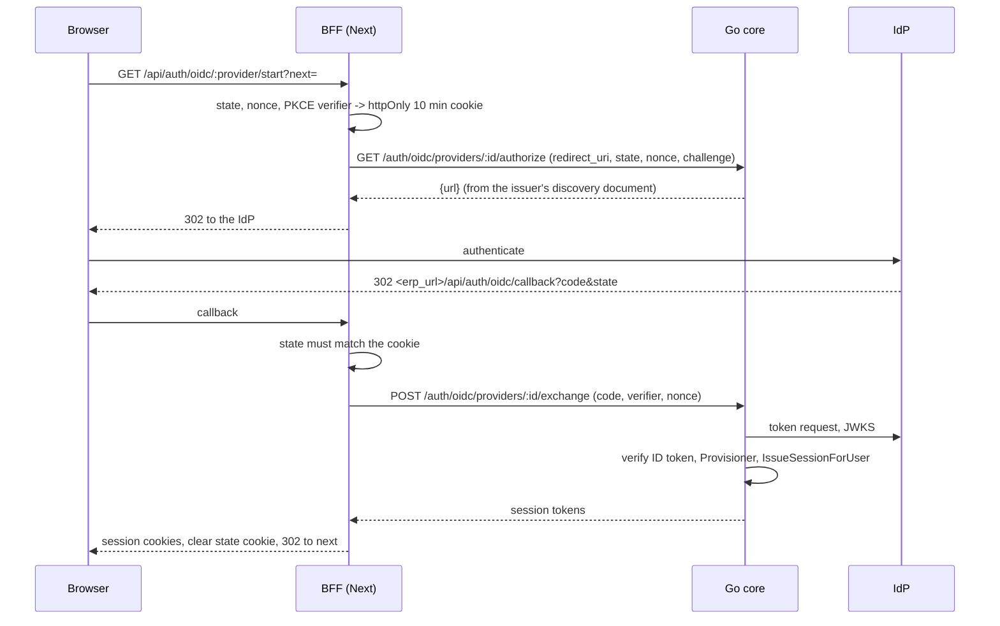

# ADR-030 — External authentication: LDAP and OIDC next to the local password

**Status:** accepted — design in [external-auth design](../superpowers/specs/2026-10-10-external-auth-design.md).
Builds on [ADR-025](ADR-025-website-routing-and-erp-base-path.md) (ERP base path, host mode).

## Problem
Staff already exist in a company directory (LLDAP, OpenLDAP, Active Directory) or an identity
provider (Authentik, Google, Microsoft). Making them keep a second ERP password is a security and
admin burden. But the ERP must never become unreachable because a directory or IdP is down or
misconfigured, and a sign-in method must never be a way to take over another account.

Scope: the **ERP staff login** (`/app/login`) only. Website visitor accounts are unchanged. No
SAML, no password change from the ERP, no background directory sync (roles are synced at login).

## Decision
1. **One pipeline for every method.** A method only *authenticates* and returns an
   `ExternalIdentity` (`Provider` = `ldap` or `oidc:<id>`, stable `Subject`, `Email`,
   `EmailVerified`, `DisplayName`, `Groups`). The shared `Provisioner` turns it into an ERP user in
   one transaction, then `IssueSessionForUser` (the same code as a password login) mints the
   tokens. Roles, groups, permissions, refresh and logout are therefore identical for every method.
2. **Identity links.** `auth_identity` links `(provider, subject)` to a user; a second unique
   index allows one link per provider per user. Provisioning order: the linked user; else an
   existing ERP user with the same email, **only for a verified email**, which is then linked; else
   a new user (locked local password, as for an admin-created user without one). **Creation also
   requires a verified email** — an unverified address must never create an account under someone
   else's email. A user already linked to another subject of the same provider is refused.
3. **Roles follow the directory.** At every login the user's roles become exactly the roles mapped
   from their groups (`role_mapping`), or the `default_role` when none match. Only *live* roles of
   the auth workspace are granted. A user left with no role, or a soft-deleted/disabled one, is
   refused. Roles assigned by hand to a provider-managed user are replaced at the next login.
4. **LDAP** (`POST /api/v1/auth/ldap/login {username, password}`): service-account bind, search
   with the configured filter (`{username}` escaped per RFC 4515), exactly one entry required, then
   bind as that entry; the entry DN is the subject. `ldaps://`, or `ldap://` + StartTLS; plain
   `ldap://` is refused outside loopback. LLDAP defaults are a preset, not a special case.
5. **OIDC** — authorization code + PKCE (S256) + nonce, bouncing through the Next BFF; the ID
   token is verified by `go-oidc` (signature, `iss`, `aud`, `exp`, nonce). Several providers can be
   configured. The redirect URI is built **server-side** from the setting `erp_url` (a bare https
   origin), never from a request header: register `<erp_url>/api/auth/oidc/callback` at the IdP.
6. **Settings** under `app_settings` key `auth.methods` (site-wide slot of the auth workspace):
   `default` method, `enabled` alternatives, `ldap`, `oidc[]`, `role_mapping`, `default_role`,
   `erp_url`. Secrets (LDAP bind password, OIDC client secrets) are AES-GCM encrypted under a key
   derived (HKDF) from `master_key` and are write-only: the API only reports `has_*` flags.
   `GET|PUT /api/v1/settings/auth` (`settings:auth:read|write`) and `POST …/auth/test` (LDAP
   service bind, OIDC discovery). The **auth workspace** is the website tenant
   (`website_tenant_id`, else the database's single tenant).
7. **Login screen.** Anonymous `GET /api/v1/auth/methods` lists the default and enabled
   alternatives (labels and kinds only, no URLs, no secrets). The default shows on top, alternatives
   below. `/app/login?method=local` **always** shows the local form, and a failing methods endpoint
   falls back to local, so a broken IdP can never lock administrators out.

## Consequences
- The directory/IdP is the source of truth for who belongs where; the ERP only caches it per login.
- A user removed from a directory group loses the role at the next login; their already-issued
  access token lives until its short TTL.
- Refused sign-ins are logged server-side (provider and subject, never secrets); clients only see
  the generic 401 "Invalid username or password.".
- Changing `master_key` makes stored secrets undecryptable: re-enter them.

## Pitfalls
- **LDAP requirement: users must not be able to write their own `mail` attribute.** A directory
  email is trusted as verified, so a user who could set an ERP administrator's address on their
  own entry would link to that account at their first LDAP login. Lock the attribute down in the
  directory ACLs. Likewise, OIDC links by email only when the IdP says `email_verified`.
- `email_verified` must be a JSON **boolean**; the string `"true"` counts as unverified. An IdP that
  omits it (or sends a string) needs the provider's **trust email** switch for first sign-in.
- **Secrets are bound to their destination.** An empty-secret save keeps the stored secret only
  while its destination is unchanged (LDAP `url` and `bind_dn`; OIDC `issuer` for the same id).
  Otherwise the save is refused until the secret is re-entered — this stops an admin-level edit from
  exfiltrating a credential by pointing the config at another server.
- The settings routes need the caller's workspace to equal the auth workspace (403) and answer 409
  when there is none (several tenants and no `website_tenant_id`).
- LDAP: an empty password is refused before any bind (an anonymous bind must never succeed); 3+
  matches and account-state bind errors give the same generic 401; a failing group search fails
  the login (500) instead of silently dropping roles. The subject is the entry DN: renaming a DN
  leaves a stale link that refuses the login until an admin removes it.
- Provisioning unique-violation races (two simultaneous first logins) end in the generic refusal;
  the user simply retries.
- Register the exact callback URL at each provider; in host mode (ADR-025) `erp_url` is the ERP host.
- Optional live LDAP test: set `LDAP_TEST_URL`, `LDAP_TEST_BIND_DN`, `LDAP_TEST_BIND_PASSWORD`,
  `LDAP_TEST_BASE_DN`, `LDAP_TEST_USER`, `LDAP_TEST_PASSWORD` (skipped otherwise; no LDAP
  container in compose).
