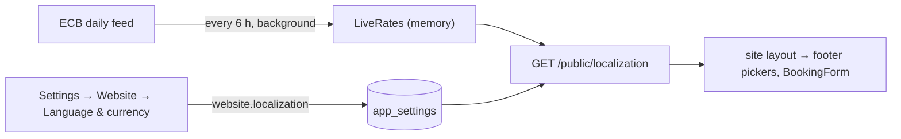

# ADR-034 — Website language and display currency

**Status:** accepted. Builds on [ADR-024](ADR-024-public-access-and-website-identities.md) (website
identities) and [ADR-026](ADR-026-booking-capacity.md) / [ADR-028](ADR-028-payment-providers.md)
(priced bookings).

## Context
The public site served one language (whatever the browser last used) and showed prices only in the
workspace currency. Visitors from abroad want to read prices in their own currency and pick the
site's language. An admin wants to choose what a first-time visitor sees. Prices, invoices and
payments, though, are all in one currency: the company's.

## Decision

### 1. Conversion is display-only
Prices stay stored, invoiced and charged in the **workspace currency** (the site company's, the one
`sale.WorkspaceCurrency` prices event sessions in). Any other currency is a conversion for display,
prefixed `≈` on the site. No booking, invoice or payment amount ever changes with it.

### 2. Live rate by default, admin override per currency
The admin lists the currencies the footer offers. Each converts at the **live rate** — the European
Central Bank's daily reference feed (free, keyless), fetched by `website.LiveRates.Run` from
`App.Run` every 6 hours, never on a request path — unless the admin types a rate (`1 base = x`),
which replaces it. A currency with neither rate is **not offered**: showing an unconverted amount
under another currency's symbol would show a wrong price. An override **below** the live rate
raises a warning in the settings form (prices would read lower than their market conversion).

### 3. The visitor's choice belongs to the visitor
The footer offers the language (every shipped translation plus the source) and the currency. A
signed-in website account stores both on its user row (`preferred_locale`, `preferred_currency`,
`PUT /api/v1/website/me/preferences`), so every device follows; an anonymous visitor keeps them in
cookies (`eerp_site_locale`, `eerp_site_currency`), which also seed an account's choice until it
saves its own. Absent or no longer valid → the admin's defaults (`website.localization`).

### 4. Short dates follow a workspace pattern
`format.date` (Settings → Formats, `PUT /api/v1/settings/format/date`, a closed set of
`dd`/`MM`/`yyyy` orders and separators) sits beside the number format. The site reads it through
`/public/localization`; compact layouts (the booking list on a phone) print dates with it instead of a
long text date. ERP widgets can adopt it through `useFormatStore().dateFormat` / `formatDatePattern`.

## Consequences
- One request (`GET /api/v1/public/localization`, anonymous, cached 60 s by the site, tag
  `site_localization`) gives the site everything: defaults, offered currencies, effective rates,
  date pattern.
- Rates live in process memory: after a restart the site offers only the base and overridden
  currencies until the first fetch (seconds). Several `core-back` replicas each fetch their own.
- Pitfall: the ECB quotes about 30 currencies against the euro; a workspace currency it doesn't
  quote gets no live rates at all — only overrides.
- Pitfall: on the public site the visitor's language wins over an ERP session's for the same browser
  tab until the ERP reloads its preferences.
