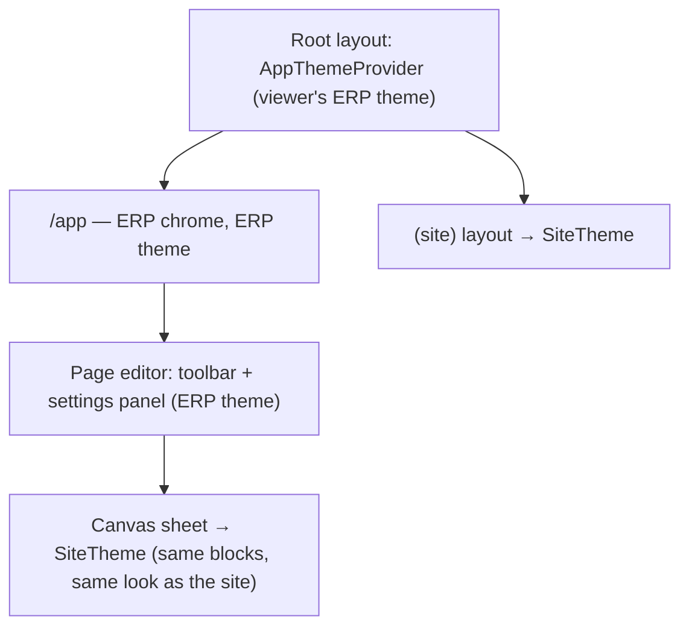

# ADR-035 — The website has its own theme

**Status:** accepted. Builds on [ADR-024](ADR-024-public-access-and-website-identities.md) (the public
site) and [ADR-025](ADR-025-website-routing-and-erp-base-path.md) (one Next app serving the site and
the ERP).

## Context
The public site (`app/(site)`) and the ERP (`app/app`) share one root layout, and that layout's
`AppThemeProvider` builds the MUI theme from the **viewer's** brand palette and light/dark choice,
kept in their browser (`useUiStore`, mirrored into the `eerp_theme` cookie). So the site looked
different per viewer: a staff member in dark mode saw the whole website dark, with their own
accent; an anonymous visitor got the default palette. The ERP type scale (14px body, a 20px `h3`)
is tuned for dense data entry, so a hero title was the size of a form label.

The page editor's preview had the same problem in reverse: it drew the site's blocks in the ERP
theme, so the builder never showed the page as visitors see it.

## Decision

### 1. One site theme, independent of the viewer
`src/website/SiteTheme.tsx` builds a fixed theme (`siteTheme`) and a `SiteTheme` wrapper:
`ThemeProvider` + `ScopedCssBaseline`, light color scheme, explicit background and text color. The
site layout wraps everything in it. The scoped baseline resets only that subtree, so nothing leaks
into the ERP (the editor mounts the same wrapper inside ERP chrome).

### 2. Monochrome by default
The site's identity is the owner's content: pictures, section colors, hero text. The default theme
is ink on white (`SITE_COLORS`), with a deep blue for links and focus only, so it never fights that
content. Body text is 16px; `h1`/`h2` scale with the viewport so a hero title fits a phone.

### 3. The editor accent stays outside the page
Inside the canvas sheet the site theme rules. The editor's own affordances (hover and selection
outlines, block tags, resize handles, the drop placeholder) take the ERP primary color, read
outside the sheet and passed in as a raw color — they never inherit from the site theme, and the
site never shows the ERP accent.

## Consequences
- What the editor shows is what visitors get, whoever is looking.
- Blocks use semantic variants (`h1` for a hero title, `h2` for a text heading); their size comes
  from `siteTheme`, not from per-block `sx`.
- A future "site appearance" setting (colors, typeface) has one place to feed: `siteTheme`.
  Until then the theme isn't configurable.

## Pitfalls
- Don't read `theme.palette.primary` inside a block expecting the ERP accent: there it is the
  site's ink.
- Don't add a plain `CssBaseline` under the site or editor: it restyles `<body>` for the whole
  page, the ERP included. `SiteTheme` already carries a scoped one.
- Something portaled out of the site subtree (a `Menu`, a `Dialog`) still gets the site theme from
  React context, but not the scoped baseline's font smoothing or box-sizing.
