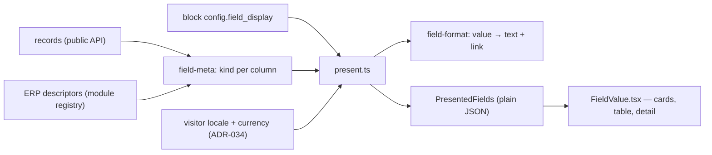

# ADR-036 — Website field display: smart defaults, labels and icons

**Status:** accepted. Builds on [ADR-024](ADR-024-public-access-and-website-identities.md) (the public
API), [ADR-034](ADR-034-website-language-and-currency.md) (visitor language and currency) and
[ADR-035](ADR-035-website-theme.md) (the site theme).

## Context
Record blocks (list, carousel, detail and its related rows) show the fields an editor ticks. They
printed each raw JSON value after the humanized column name: `Unit price: 1250`, `Phone: 0612345678`,
`Active: true`, a linked record as its UUID. Nothing could be relabeled, hidden or decorated.

Go's public API returns bare values, with no column types. The ERP's view descriptors do declare
each field's type and widget (`number`/`monetary`, `text`/`phone`, `date`/`datetime`,
`selection`, `relation`…), and the frontend's module registry holds them on the server.

## Decision

### 1. One pipeline, server-side, type-specific formatters



- **Kind** (`field-meta.ts`): the field's ERP declaration decides it (widget `monetary` → amount,
  `phone` → phone, `datetime`, `percent`, `stars` → rating, `duration`, `selection`, many2one →
  linked record…). A plain number or text whose column name says more (`unit_price`, `email`,
  `website`) and tables no module describes fall back to the name, then to the value's shape.
- **Format** (`field-format.ts`): pure functions over `Intl` and `libphonenumber-js` — locale-aware
  numbers, money in the currency's own precision and symbol placement, phones written nationally
  for the site's country and internationally otherwise, with `tel:` links; `mailto:` and web links;
  dates read in UTC when they have no time (they never shift a day); date-times with their zone;
  selection values translated or humanized; a linked record by its label, read through the public
  API (unpublished → nothing, never an id).
- **Present** (`present.ts`): runs once per block render, on the server, and hands client components
  plain JSON. The phone metadata and the icon sets never reach a browser.
- **Draw** (`blocks/FieldValue.tsx`): one renderer with no hooks, used by server cards and the client
  list alike.

Formatting never writes: the stored value stays as is, the text is derived for display.

### 2. Settings are presentation metadata on the block
`config.field_display[<column>]` (and `config.related.field_display` for a detail's related rows):

```json
{ "phone": {
    "hide_label": false,
    "custom_label": "Call us",
    "format": { "as": "auto", "country": "US" },
    "icon": { "name": "phone", "family": "solid", "position": "after", "spacing": "normal", "color": "muted" } } }
```

Every property is optional; `resolveDisplay` fills the defaults and ignores malformed parts. A block
saved before this existed has no `field_display` and reads as all-defaults, so **no migration**. Go
treats block config as opaque, so nothing changed server-side. `withFieldDisplay` stores only what
differs from the defaults. `format` holds the kind-specific options: `as` (force a kind), `country`,
`currency`, `currency_field`, `decimals`, `date_style`, `timezone`, `true_label`/`false_label`.

### 3. Labels: visible and spoken are separate

| hide_label | custom_label | shown | read by assistive tech |
|---|---|---|---|
| false | empty | column name | column name |
| false | set | custom label | custom label |
| true | either | none | custom label, else column name |

The default stays the humanized column name, as before. Module labels are written for staff
("Price override (excl. tax)"), so the editor offers them as a hint only.

### 4. Icons: Font Awesome Free, served as path data
Solid, Regular and Brands from the free npm packages (icons CC BY 4.0, code MIT — no Pro icon, no
kit). The sets live server-side (`field-icons.ts`); a page receives only the path data of the
icons it shows and draws them as inline SVG (`SiteIcon`): no icon font, no CSS. The stored value
is the icon's identifier (`family` + `name`); Font Awesome's former names resolve as aliases, and
an unknown name drops the icon instead of failing. Icons are always `aria-hidden`. Color is one of
the theme's (`inherit`, `muted`, `accent`), never a free hex.

### 5. The builder
Each record block lists its shown fields under *How each field shows*. A field opens a dialog:
*Label* (custom label, hide), *Format* (*Show as*, plus only the options its kind uses), *Icon*
(search, suggestions per kind, position, spacing, color) and a live *Preview*. The preview uses a
real published value when one exists, else a sample, and is drawn in `SiteTheme`. Server Actions:
`field-display-actions.ts`.

## Consequences
- A field reads the same in every record block, and the same on the server and in tests.
- Values changed look on existing sites: `1250` is now `€1,250.00`, `true` is now `Yes`. Labels
  didn't change.
- A new kind of field is one `FieldKind`, one case in `presentValue`, and one mapping in `field-meta`.

## Pitfalls
- A many2one is resolved only when the module declares it and its target table is published.
- Date-times default to the **server's** zone (UTC in Docker); set the field's zone in its settings.
  The zone is always printed, so the time is never ambiguous.
- `field-meta.ts` imports the generated module manifest; it exists after `pnpm generate` (CI runs
  it before typecheck/tests).
- Event list cards, image carousel captions and titles aren't configurable fields: they format
  themselves.
