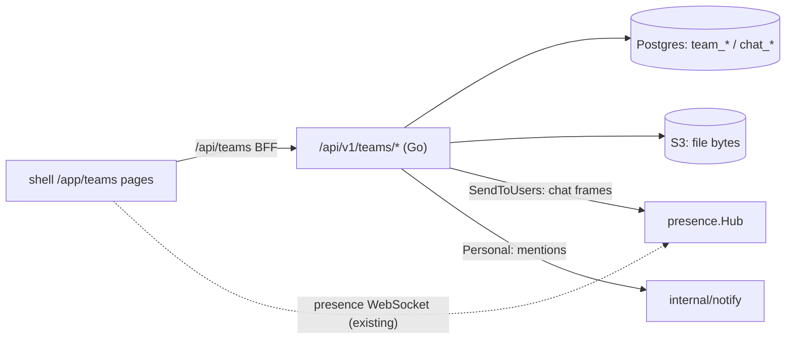
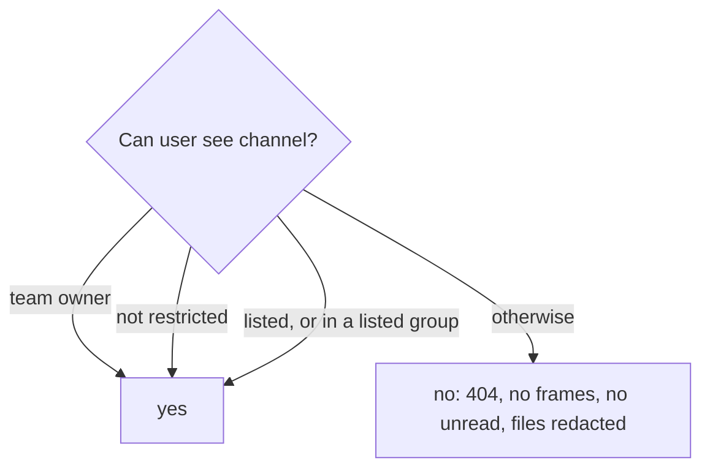

# ADR-037: Teams — staff chat and shared files

**Status:** Accepted · builds on [ADR-019](ADR-019-user-presence-websocket.md) (the presence
socket) and [ADR-031](ADR-031-notifications.md) (personal notifications)

## Context

Staff needed one everyday place to chat and pass files around inside the ERP, instead of a separate
chat tool and file share. It must be closed to website visitors and outsiders: nobody outside a team
may read its channels or files, and a private conversation is visible to its two participants only.

The ERP's usual building blocks don't fit as is:

- The **generic CRUD surface** filters by tenant and permission, not by "is this caller a member of
  the row's team". Exposing the chat tables there would let any holder of a read permission list
  every team's messages.
- The **permission DSL** (`module:resource:action`) is role-wide. Teams access is per team: the same
  user owns one team and is a guest in another.

## Decision

Teams is a core package, `core/internal/teams` (models, repository, handlers), registered by the
`core/modules/teams` module (`type: go`, `app_mode: true`), with its own pages in the shell.

- **Off the generic CRUD surface.** Every table (`team`, `team_member`, `chat_channel`,
  `chat_channel_member`, `chat_message`, `chat_attachment`, `chat_message_file`, `chat_reaction`,
  `chat_channel_access`, `team_group`, `team_group_member`, `team_folder`, `team_file`,
  `team_file_share`) is registered with `orm.WithExcluded()`. The unique indexes (one
  live membership per user and team, one direct conversation per pair of users, one reaction per
  user and emoji) are hand-written in the module's `Migrate()`.
- **JWT only, then team roles.** The `/api/v1/teams` group has `jwtMw` and no `permMw`, like
  notifications: every staff user may use Teams and create teams, and website tokens are refused
  by the JWT audience check. Each handler then resolves the caller's role in the team:
  *guest* reads and downloads; *member* also posts, reacts and uploads, and shares, renames, moves
  or deletes only what they created; *owner* does everything, including members, roles, channels
  and deleting the team. A team always keeps at least one owner (409). A non-member gets **404,
  never 403**, so team ids can't be probed. A file share lets its recipient see and download that
  one file, nothing else.
- **Module gate.** `ActiveGate` 404s every Teams route while the module is deactivated —
  `ActiveGateMiddleware` only covers the generic CRUD group.
- **One live channel.** Chat frames ride the existing presence socket: after a message or reaction
  is written, the handler sends `{type: "chat_message" | "chat_reaction", channel_id, …}` through
  `presence.Hub.SendToUsers` to exactly the channel's audience (the team's members, or the two
  participants). The browser fans them out with `onChatFrame`. No second socket, no new auth path.
- **Mentions** are user ids sent next to the message body. The server keeps only the ids that can
  read the channel and sends each one a personal notification (category `teams`) linking to the
  channel.
- **Files need S3.** Message attachments and team files go to the same object store as pictures,
  under `<tenant>/teams/<uuid>`. Without `s3_*`, the file-manager routes are not mounted (the UI
  hides the Files pane) and posting an attachment answers 503. Chat still works.
- **Uploads** bypass the global request body limit and are capped by `upload_body_limit`. The
  exempt prefixes include `/api/v1/teams/*/files`, so `BodyLimitExempt` gained a `*` segment
  wildcard.

### v2: private conversations, linked folders, per-user order

People wanted to talk with part of a team, keep a conversation's files with it, and arrange their
own sidebar ([v2 design](../superpowers/specs/2026-11-09-teams-v2-design.md)).

- **Private conversations.** A team channel carries an explicit `restricted` flag and an access
  list (`chat_channel_access`: users and **team groups**). Owners manage both with
  `GET|PUT /teams/:id/channels/:channel/access {user_ids, group_ids}` (the whole list); groups are
  per team, made by owners from team members (`GET|POST /teams/:id/groups`,
  `PUT|DELETE /teams/:id/groups/:group`). **One rule decides visibility everywhere** — listing,
  messages, read cursor, reactions, attachments, unread counts, mention audience, live-frame
  audience: an owner, or the channel isn't restricted, or the caller is listed directly or through a
  group. Anything else is a 404.
- **Only an access save changes privacy.** A non-empty save makes the channel private; deleting a
  group or a listed user leaving the team (which removes them from its groups and lists) never
  reopens it — an emptied private list leaves the channel **owners-only**. Reopening needs an owner
  to save an empty list and confirm "Open to the whole team".
- **Linked folder.** A team channel may link one folder (`chat_channel.folder_id`, one channel per
  folder), set by owners through `PUT /teams/:id/channels/:channel {folder_id}` (`""` unlinks; 422
  for another team's or an already-linked folder). Deleting the folder unlinks it; deleting the
  channel keeps the folder — files outlive the chat.
- **Files sent in a team channel are team files.** Each lands in the linked folder; with none, the
  first file creates `<conversation name>` at the team root (`<name> (n)` on a collision, the name
  trimmed so the suffix fits 200 characters) and links it, in the same transaction. The message
  points at its files through `chat_message_file`; their wire attachments have `kind: "file"` and
  read as deleted once the file is gone. Filenames over 200 characters are refused (422). Direct
  messages keep plain `chat_attachment`s. Images (JPEG, PNG, GIF, WebP — never SVG, which can carry
  scripts) show inline, loaded from the same authorized download route.
- **Folder privacy follows the channel.** A folder linked to a private channel, and everything below
  it, is visible only to people who can see that channel: listing, download (an explicit file share
  still passes), move targets on both sides, breadcrumbs and the Shares view. A file sent in a
  channel whose folder a reader can't see is **redacted for that reader** as a deleted file — in
  message lists and in live frames, which are built per viewer. A non-owner can't delete or move a
  folder whose subtree holds folders hidden from them (409), so nobody destroys what they can't see.
- **A private folder never opens by losing its channel.** When a private channel stops guarding its
  folder — the channel is deleted, unlinked, or relinked to another folder — that folder becomes
  `owners_only` (`team_folder.owners_only`, set in the same transaction): it and everything below
  it are visible to team owners only, exactly as if guarded by a private channel nobody else is
  listed on (an explicit file share still lets its recipient download). Without this, every file
  sent in a private conversation would become visible to the whole team the moment the
  conversation goes. An owner makes it visible again by linking it to a conversation: linking
  clears `owners_only` and the folder's privacy then follows that conversation (open channel →
  the whole team).
- **Per-user order.** `chat_channel_member.position` stores each user's own sidebar order:
  `PUT /teams/:id/channels/order` and `PUT /teams/direct/order {ids}` (422 for an id the caller can't
  see). Lists sort by position, nulls last.

## Consequences

- Teams has no admin override: an administrator who isn't a member can't read a team. Recovering a
  team that lost all its owners is impossible through the API (the last-owner rule prevents it).
- Messages are append-only: no edit, delete, threads or search in v1.
- **Single instance.** Live delivery inherits the presence hub's limit (ADR-019): with several
  `core-back` replicas, a frame only reaches users connected to the replica that handled the
  write. The others see the message on their next read.
- Deleting a folder or a team deletes its rows in one transaction, then its objects. A crash in
  between leaves orphan objects in the bucket, never rows pointing at missing objects.

## Pitfalls

- Never push a chat frame with `Hub.Broadcast` (tenant-wide); compute the audience.
- Never full-row `Update` a `Channel` (it writes back a stale `restricted`) and never clear a
  restricted channel's `folder_id` outside `LinkFolder`/`DeleteChannel`/`DeleteFolderTree`: the
  previous folder must become `owners_only` or it opens to the team.
- The `(users, <user>, avatar)` picture anchor is reserved to LDAP photo sync (ADR-030): the generic
  `POST /api/v1/pictures` and `DELETE /api/v1/pictures/:id` answer 403 on it.
- A new upload route under `/api/v1/teams` must match a `BodyLimitExempt` entry and take the upload
  limit, or it stays capped at `request_body_limit`.
- Every new handler must start with the role check; the route group itself authorizes nothing
  beyond "signed-in staff". A channel or folder route must also apply the visibility rule, and a new
  chat frame must be built per viewer (a hidden file is redacted), not once for the audience.
- Don't infer privacy from the access list's size: read `restricted`. An empty list on a restricted
  channel means owners-only, not open.
