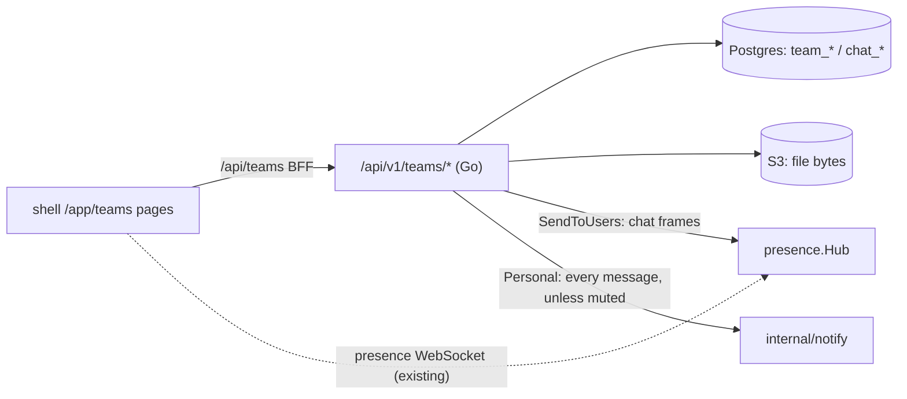
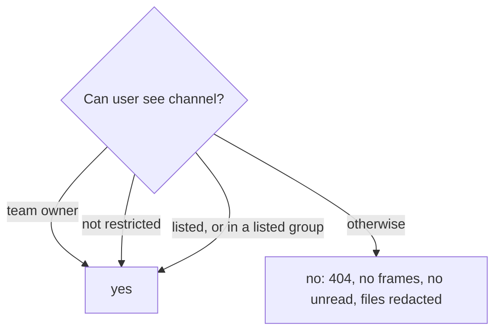
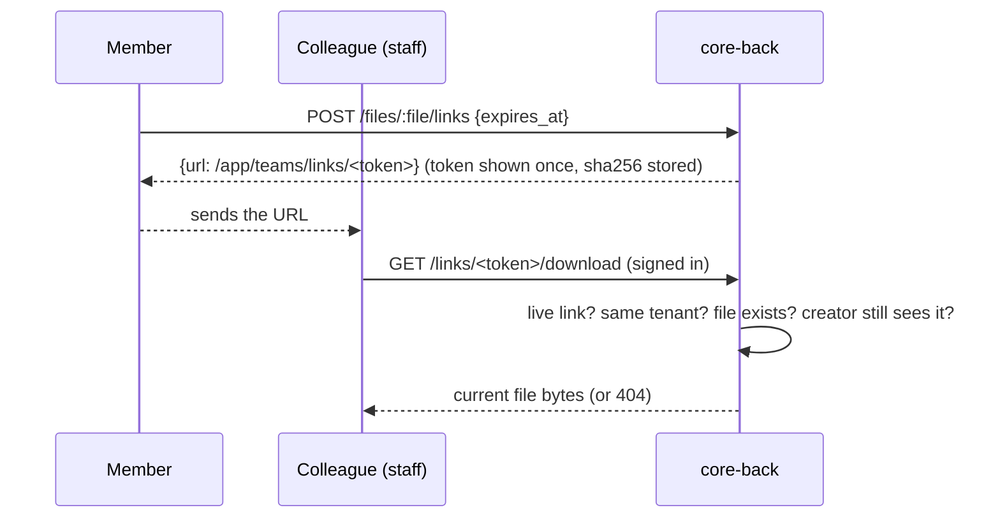

# ADR-037: Teams — staff chat and shared files

**Status:** Accepted · builds on [ADR-019](ADR-019-user-presence-websocket.md) (the presence
socket) and [ADR-031](ADR-031-notifications.md) (personal notifications)

## Context

Staff needed one everyday place to chat and pass files around inside the ERP, instead of a separate
chat tool and file share. It must be closed to website visitors and outsiders: nobody outside a team
may read its channels or files, and a private conversation is visible to its two participants only.

The ERP's usual building blocks don't fit as is:

- The **generic CRUD surface** filters by tenant and permission, not by "is this caller a member of
  the row's team". Exposing the chat tables there would let any holder of a read permission list
  every team's messages.
- The **permission DSL** (`module:resource:action`) is role-wide. Teams access is per team: the same
  user owns one team and is a guest in another.

## Decision

Teams is a core package, `core/internal/teams` (models, repository, handlers), registered by the
`core/modules/teams` module (`type: go`, `app_mode: true`), with its own pages in the shell.



- **Off the generic CRUD surface.** Every table (`team`, `team_member`, `chat_channel`,
  `chat_channel_member`, `chat_message`, `chat_attachment`, `chat_message_file`, `chat_reaction`,
  `chat_channel_access`, `team_group`, `team_group_member`, `team_folder`, `team_file`,
  `team_file_share`) is registered with `orm.WithExcluded()`. The unique indexes (one
  live membership per user and team, one direct conversation per pair of users, one reaction per
  user and emoji) are hand-written in the module's `Migrate()`.
- **JWT only, then team roles.** The `/api/v1/teams` group has `jwtMw` and no `permMw`, like
  notifications: every staff user may use Teams and create teams, and website tokens are refused
  by the JWT audience check. Each handler then resolves the caller's role in the team:
  _guest_ reads and downloads; _member_ also posts, reacts and uploads, and shares, renames, moves
  or deletes only what they created; _owner_ does everything, including members, roles, channels
  and deleting the team. A team always keeps at least one owner (409). A non-member gets **404,
  never 403**, so team ids can't be probed. A file share lets its recipient see and download that
  one file, nothing else.
- **Module gate.** `ActiveGate` 404s every Teams route while the module is deactivated —
  `ActiveGateMiddleware` only covers the generic CRUD group.
- **One live channel.** Chat frames ride the existing presence socket: after a message or reaction
  is written, the handler sends `{type: "chat_message" | "chat_reaction", channel_id, …}` through
  `presence.Hub.SendToUsers` to exactly the channel's audience (the team's members, or the two
  participants). The browser fans them out with `onChatFrame`. No second socket, no new auth path.
- **Mentions** are user ids sent next to the message body. The server keeps only the ids that can
  read the channel and sends each one a personal notification (category `teams`) linking to the
  channel.
- **Files need S3.** Message attachments and team files go to the same object store as pictures,
  under `<tenant>/teams/<uuid>`. Without `s3_*`, the file-manager routes are not mounted (the UI
  hides the Files pane) and posting an attachment answers 503. Chat still works.
- **Uploads** bypass the global request body limit and are capped by `upload_body_limit`. The
  exempt prefixes include `/api/v1/teams/*/files`, so `BodyLimitExempt` gained a `*` segment
  wildcard.
- **Office documents.** Files open in the self-hosted Euro-Office editor, with
  signed configurations, existing file/share permissions and atomic save callbacks.
  The file manager creates DOCX, XLSX and PPTX documents. Shared files and attachments
  use the same integrated viewer. See [Euro-Office](../euro-office.md) for deployment,
  supported formats, collaboration, PDF export and the save lifecycle.
- **Search and icons.** `GET /teams/:id/files/search?q=` searches folder and file names across the
  team's whole tree (case-insensitive contains, ≤ 200 results per kind, each with its root-first
  `path`), applying the same folder visibility rule as a listing, so a private folder's content
  never shows up for someone who can't open it. The file list shows the Euro-Office format icons
  (copied into `apps/shell/src/teams/file-icons/`) and sorts the current folder client-side
  (name, size, modified; folders always first).

### v2: private conversations, linked folders, per-user order

People wanted to talk with part of a team, keep a conversation's files with it, and arrange their
own sidebar ([v2 design](../superpowers/specs/2026-11-09-teams-v2-design.md)).

- **Private conversations.** A team channel carries an explicit `restricted` flag and an access
  list (`chat_channel_access`: users and **team groups**). Owners manage both with
  `GET|PUT /teams/:id/channels/:channel/access {user_ids, group_ids}` (the whole list); groups are
  per team, made by owners from team members (`GET|POST /teams/:id/groups`,
  `PUT|DELETE /teams/:id/groups/:group`). **One rule decides visibility everywhere** — listing,
  messages, read cursor, reactions, attachments, unread counts, mention audience, live-frame
  audience: an owner, or the channel isn't restricted, or the caller is listed directly or through a
  group. Anything else is a 404.
- **Only an access save changes privacy.** A non-empty save makes the channel private; deleting a
  group or a listed user leaving the team (which removes them from its groups and lists) never
  reopens it — an emptied private list leaves the channel **owners-only**. Reopening needs an owner
  to save an empty list and confirm "Open to the whole team".
- **Linked folder.** A team channel may link one folder (`chat_channel.folder_id`, one channel per
  folder), set by owners through `PUT /teams/:id/channels/:channel {folder_id}` (`""` unlinks; 422
  for another team's or an already-linked folder). Deleting the folder unlinks it; deleting the
  channel keeps the folder — files outlive the chat.
- **Files sent in a team channel are team files.** Each lands in the linked folder; with none, the
  first file creates `<conversation name>` at the team root (`<name> (n)` on a collision, the name
  trimmed so the suffix fits 200 characters) and links it, in the same transaction. The message
  points at its files through `chat_message_file`; their wire attachments have `kind: "file"` and
  read as deleted once the file is gone. Filenames over 200 characters are refused (422). Direct
  messages keep plain `chat_attachment`s. Images (JPEG, PNG, GIF, WebP — never SVG, which can carry
  scripts) show inline, loaded from the same authorized download route.
- **Folder privacy follows the channel.** A folder linked to a private channel, and everything below
  it, is visible only to people who can see that channel: listing, download (an explicit file share
  still passes), move targets on both sides, breadcrumbs and the Shares view. A file sent in a
  channel whose folder a reader can't see is **redacted for that reader** as a deleted file — in
  message lists and in live frames, which are built per viewer. A non-owner can't delete or move a
  folder whose subtree holds folders hidden from them (409), so nobody destroys what they can't see.
- **A private folder never opens by losing its channel.** When a private channel stops guarding its
  folder — the channel is deleted, unlinked, or relinked to another folder — that folder becomes
  `owners_only` (`team_folder.owners_only`, set in the same transaction): it and everything below
  it are visible to team owners only, exactly as if guarded by a private channel nobody else is
  listed on (an explicit file share still lets its recipient download). Without this, every file
  sent in a private conversation would become visible to the whole team the moment the
  conversation goes. An owner makes it visible again by linking it to a conversation: linking
  clears `owners_only` and the folder's privacy then follows that conversation (open channel →
  the whole team).
- **Per-user order.** `chat_channel_member.position` stores each user's own sidebar order:
  `PUT /teams/:id/channels/order` and `PUT /teams/direct/order {ids}` (422 for an id the caller can't
  see). Lists sort by position, nulls last.



### Message notifications, mute and per-user deletion (2026-11-18)

Every message notifies each reader of the conversation (team channel or direct) except its author,
so a direct message reaches its recipient without an @mention; a mention only changes the title.
Each user may **mute** a conversation (`chat_channel_member.muted`): no notification at all from it,
mentions included. The setting is per user and per conversation, kept on the read-cursor row the
user already has.

Deleting a direct conversation never touches the other participant's copy: it hides the
conversation for the caller and records `cleared_at`, the point before which messages are gone
for them. A new message un-hides it for both, so a deleted conversation comes back with the
reply, starting at that message. A full delete for both was rejected: either participant could
erase the other's history.

### Unique names per folder, folder menu (2026-11-18)

Creating a folder sometimes made two: the dialog's Save stayed clickable while the request ran, and
nothing in the database stopped a second identical row. Names are now unique **per folder, case
ignored**, in two separate namespaces (folders among folders, files among files):

- `uq_team_folder_name` / `uq_team_file_name` (`tenant_id, team_id, COALESCE(parent, nil uuid),
lower(name)` over live rows) enforce it. Their migration first renames older clashing rows (the
  oldest keeps its name, the others get ` (<id prefix>)`, before the extension for files), once.
- Every name write takes the folder's advisory lock (`teams.names:<team>[:<folder>]`) before its
  check, so concurrent writes can't both pass it (`internal/teams/names.go`).
- A new folder, a rename or a move onto a taken name is a **409 `NAME_TAKEN`**. An upload — from
  the files pane or a chat message into the linked folder — never fails on a name: it is stored as
  `<name> (n).<ext>` (as a desktop does). The conversation's auto-created folder follows the same rule.
- `GET /:id/folders/:folder/download` streams the folder as a zip: the subfolders the caller can
  see (a hidden one drops its subtree) and their files, names made safe zip segments.
- The sidebar's folders have a ⋮ menu (`FolderMenu.tsx`): New subfolder, Download, Rename, Move,
  Manage access, Delete — each following the caller's role. _Manage access_ edits the access of the
  conversation linked to that folder (owners), since a folder's privacy is that conversation's; an
  unlinked folder has no access list of its own, so it has no such entry. Dialogs send one request
  at a time.

### Files pane: drag and drop, icons, dates (2026-11-22)

The files pane (`FilesPane.tsx`, also the conversation's folder panel) works like a desktop file
manager, with no new route — every gesture calls the existing upload/update endpoints, so Go's role
rules still decide:

- **Drag and drop**: desktop files dropped on the pane upload into the open folder, dropped on a
  folder row into that folder. A row the caller may edit can be dragged onto a folder row or a
  breadcrumb (*All files* = the root) to move it. Guests can do neither.
- **Icons**: row and toolbar actions are icon buttons with a tooltip; every file row has a
  *Download* button, for every role.
- **Narrow layout**: on a phone and in the side panel, the actions fold into a ⋮ menu and only the
  name column is shown.
- **Dates**: folders and files carry `created_at` and `updated_at` (a rename, move or document save
  bumps it), shown as *Created* / *Last modified* columns.

### Download links (2026-11-26)

**Problem.** A member wants to hand one file to a colleague outside the team — without adding them
to it or picking them in the share list — by sending a link that always serves the latest version
and stops working at a chosen date.

**Decision: a link to the file itself, not a replica.** A `team_file_link` row points at the file
id. Edits (uploads, the office editor) replace the file's object but keep its id, so the link
always serves the current bytes with nothing to sync. A copy in a "public" folder was rejected: every
write path would have to re-copy it, a missed copy serves a stale file, and it needs a second
permission model. Serving bytes straight from S3 through a presigned URL is a possible later
improvement for very large files; Garage is not reachable through the gateway today.



- **Who manages**: the users who may share the file (an owner, or the member who uploaded it):
  `GET|POST /api/v1/teams/files/:file/links`, `DELETE /api/v1/teams/files/links/:link` (revoke =
  soft delete). The create answer is the only place the token appears; Go keeps its sha256.
- **Expiry is mandatory**: `now < expires_at ≤ now + 90 days` (422 otherwise). The Share dialog
  proposes 7 days and caps the picked day just under 90.
- **Who downloads**: any signed-in **staff** user of the link's tenant (website accounts are refused
  by the audience check), while the link's creator is still a live user, at `GET /api/v1/teams/links/:token/download`, rate-limited like the
  public routes. The token grants that one file only — no listing, no folder, no other route.
- **One answer for every failure**: unknown, revoked, expired, other tenant, deleted file, or a
  creator who can no longer read the file (left the team, or the file is now in a private folder
  they can't see) — all 404, so a token can't be probed and a link never outlives its creator's
  own access.
- **Response**: `Content-Disposition: attachment`, `ETag`, `Cache-Control: private, no-store`,
  `X-Content-Type-Options: nosniff`. Each download bumps the link's `download_count` and
  `last_download_at`, shown in the Share dialog.
- **Frontend**: the Share dialog's *Download links* section (create + copy, list, revoke), a Share
  button in the office viewer header (`OfficeDialog`'s `headerActions`), and the page
  `/app/teams/links/<token>`, which signs the visitor in and downloads through the Teams BFF.
- Deleting the file, its folder tree or the team deletes its links in the same transaction.

## Consequences

- Teams has no admin override: an administrator who isn't a member can't read a team. Recovering a
  team that lost all its owners is impossible through the API (the last-owner rule prevents it).
- No threads or search in v1. Deleting a message (added later, `DELETE /messages/:message`) follows the item rule above: its author, or a team owner. Editing one (added later, `PUT /messages/:message {body}`) is stricter: its author only, never a guest — a team owner may remove someone's message but never put words in it. The body follows the posting rules (trimmed, ≤ 4000 characters, empty only beside files), files and reactions stay, `edited_at` is stamped (an unchanged body isn't marked edited) and readers get a `chat_message_updated` frame, built per viewer like a new message; readers see _(edited)_. Mentions an edit adds notify no one. **Checkboxes** (added later, `PUT /messages/:message/checks {index, checked}`): a `- [ ] text` line of a message is a checkbox, and unlike its text anyone who may react to the message (not a guest) ticks or clears it — a shared checklist, not the author's words. Go rewrites only that box's mark in the stored body (the boxes counted in order, ``` code blocks skipped, the same rule the frontend draws them by), under a row lock so two people ticking different boxes both keep their tick; the message isn't marked edited, and readers get a `chat_message_updated` frame. Deleting a message: it's a soft delete that hides the message everywhere, while files it put in a team folder stay there, since they belong to the folder.
- **Single instance.** Live delivery inherits the presence hub's limit (ADR-019): with several
  `core-back` replicas, a frame only reaches users connected to the replica that handled the
  write. The others see the message on their next read.
- Deleting a folder or a team deletes its rows in one transaction, then its objects. A crash in
  between leaves orphan objects in the bucket, never rows pointing at missing objects.

## Pitfalls

- Never push a chat frame with `Hub.Broadcast` (tenant-wide); compute the audience.
- Never full-row `Update` a `Channel` (it writes back a stale `restricted`) and never clear a
  restricted channel's `folder_id` outside `LinkFolder`/`DeleteChannel`/`DeleteFolderTree`: the
  previous folder must become `owners_only` or it opens to the team.
- The `(users, <user>, avatar)` picture anchor is reserved to LDAP photo sync (ADR-030): the generic
  `POST /api/v1/pictures` and `DELETE /api/v1/pictures/:id` answer 403 on it.
- A new upload route under `/api/v1/teams` must match a `BodyLimitExempt` entry and take the upload
  limit, or it stays capped at `request_body_limit`.
- Every new handler must start with the role check; the route group itself authorizes nothing
  beyond "signed-in staff". A channel or folder route must also apply the visibility rule, and a new
  chat frame must be built per viewer (a hidden file is redacted), not once for the audience.
- Don't infer privacy from the access list's size: read `restricted`. An empty list on a restricted
  channel means owners-only, not open.
- A file and a folder may share a name in one folder (separate namespaces); a zip download then
  holds both `x` and `x/`, which some extractors refuse.
- A download link dies with its creator's access to the file: removing the uploader from the team
  silently breaks every link they made. Create a new one as an owner if it must keep working.
- Never return or log a link token after its creation answer; only its sha256 is stored. Go's
  request log redacts `/api/v1/teams/links/` (`ormserver.Config.LogRedact`) and nginx's failed-request
  log skips the three link paths (`$eerp_loggable` in `infra/nginx/nginx.conf`); a new route
  carrying a token in its path needs the same two entries.
