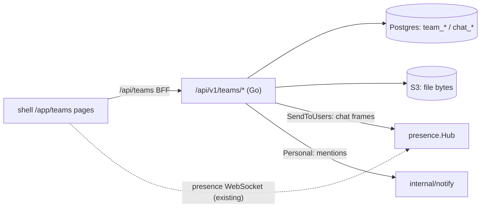

# ADR-037: Teams — staff chat and shared files

**Status:** Accepted · builds on [ADR-019](ADR-019-user-presence-websocket.md) (the presence
socket) and [ADR-031](ADR-031-notifications.md) (personal notifications)

## Context

Staff needed one everyday place to chat and pass files around inside the ERP, instead of a separate
chat tool and file share. It must be closed to website visitors and outsiders: nobody outside a team
may read its channels or files, and a private conversation is visible to its two participants only.

The ERP's usual building blocks don't fit as is:

- The **generic CRUD surface** filters by tenant and permission, not by "is this caller a member of
  the row's team". Exposing the chat tables there would let any holder of a read permission list
  every team's messages.
- The **permission DSL** (`module:resource:action`) is role-wide. Teams access is per team: the same
  user owns one team and is a guest in another.

## Decision

Teams is a core package, `core/internal/teams` (models, repository, handlers), registered by the
`core/modules/teams` module (`type: go`, `app_mode: true`), with its own pages in the shell.

- **Off the generic CRUD surface.** Every table (`team`, `team_member`, `chat_channel`,
  `chat_channel_member`, `chat_message`, `chat_attachment`, `chat_reaction`, `team_folder`,
  `team_file`, `team_file_share`) is registered with `orm.WithExcluded()`. The unique indexes (one
  live membership per user and team, one direct conversation per pair of users, one reaction per
  user and emoji) are hand-written in the module's `Migrate()`.
- **JWT only, then team roles.** The `/api/v1/teams` group has `jwtMw` and no `permMw`, like
  notifications: every staff user may use Teams and create teams, and website tokens are refused
  by the JWT audience check. Each handler then resolves the caller's role in the team:
  *guest* reads and downloads; *member* also posts, reacts and uploads, and shares, renames, moves
  or deletes only what they created; *owner* does everything, including members, roles, channels
  and deleting the team. A team always keeps at least one owner (409). A non-member gets **404,
  never 403**, so team ids can't be probed. A file share lets its recipient see and download that
  one file, nothing else.
- **Module gate.** `ActiveGate` 404s every Teams route while the module is deactivated —
  `ActiveGateMiddleware` only covers the generic CRUD group.
- **One live channel.** Chat frames ride the existing presence socket: after a message or reaction
  is written, the handler sends `{type: "chat_message" | "chat_reaction", channel_id, …}` through
  `presence.Hub.SendToUsers` to exactly the channel's audience (the team's members, or the two
  participants). The browser fans them out with `onChatFrame`. No second socket, no new auth path.
- **Mentions** are user ids sent next to the message body. The server keeps only the ids that can
  read the channel and sends each one a personal notification (category `teams`) linking to the
  channel.
- **Files need S3.** Message attachments and team files go to the same object store as pictures,
  under `<tenant>/teams/<uuid>`. Without `s3_*`, the file-manager routes are not mounted (the UI
  hides the Files pane) and posting an attachment answers 503. Chat still works.
- **Uploads** bypass the global request body limit and are capped by `upload_body_limit`. The
  exempt prefixes include `/api/v1/teams/*/files`, so `BodyLimitExempt` gained a `*` segment
  wildcard.

## Consequences

- Teams has no admin override: an administrator who isn't a member can't read a team. Recovering a
  team that lost all its owners is impossible through the API (the last-owner rule prevents it).
- Messages are append-only: no edit, delete, threads or search in v1.
- **Single instance.** Live delivery inherits the presence hub's limit (ADR-019): with several
  `core-back` replicas, a frame only reaches users connected to the replica that handled the
  write. The others see the message on their next read.
- Deleting a folder or a team deletes its rows in one transaction, then its objects. A crash in
  between leaves orphan objects in the bucket, never rows pointing at missing objects.

## Pitfalls

- Never push a chat frame with `Hub.Broadcast` (tenant-wide); compute the audience.
- A new upload route under `/api/v1/teams` must match a `BodyLimitExempt` entry and take the upload
  limit, or it stays capped at `request_body_limit`.
- Every new handler must start with the role check; the route group itself authorizes nothing
  beyond "signed-in staff".
