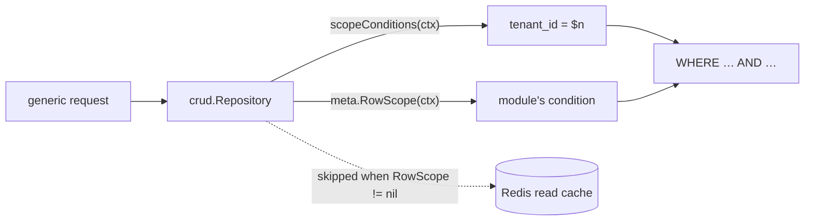

# ADR-038: Row-level access on the generic CRUD surface

**Status:** Accepted · builds on [ADR-013](ADR-013-field-level-group-gating.md) (field gating) and
[ADR-024](ADR-024-public-access-and-website-identities.md) (public read scope)

## Context

The generic CRUD surface (`GET|POST|PUT|DELETE /api/v1/<table>`) restricts rows by **tenant** only.
Permissions (`module:resource:action`) are role-wide: whoever may read `project_task` reads every
task of the tenant. Some apps need a per-caller row restriction for staff — a project visible only
to its members, its followers and the project admins — while keeping everything the generic surface
gives for free (List/Kanban/Calendar/Graph modes, filters, group-by, aggregation).

Taking such tables off the generic surface (as Teams does, [ADR-037](ADR-037-teams.md)) would mean
re-writing all of that by hand. Filtering in a module middleware wouldn't cover `?distinct=`,
`?aggregate=` or the total count, and would race the read cache.

## Decision

A module declares a **row scope** when it registers a table:

```go
type RowScopeFunc func(ctx context.Context) (cond query.Condition, ok bool, err error)

orm.Register[Task](orm.WithRowScope(func(ctx context.Context) (query.Condition, bool, error) { … }))
```

Per request, the function returns the WHERE condition limiting the caller to the rows it may see.

| Return | Meaning |
|---|---|
| `cond, true, nil` | the condition is ANDed into the query |
| `_, false, nil` | no restriction (e.g. an admin) |
| `_, _, err` | fail closed: the query is not run, the generic layer answers 500 |

The ORM never knows who the caller is: the module's function reads its identity from the context
(the same way `core/orm/access` carries tenant and groups), so `core/orm` keeps importing nothing
from `core/internal/auth`.



### Choke points

The scope is applied wherever the tenant condition is — `crud.Repository.scopeConditions` returns
both, and every generic statement uses it: list (page **and** total), `?distinct=`, `?aggregate=`,
get by id, update, restore, soft and hard delete. A row outside the scope therefore reads exactly
like a missing row: **404, never 403** — the caller can't tell "not yours" from "doesn't exist".
Creates aren't scoped (there is no row yet); a module that must refuse some creates does it in its
own create middleware.

### No caching

Read-cache keys are built from the SQL and its arguments, generation-bumped per table
([ADR-022](ADR-022-optional-redis-query-cache.md)). A scope's result depends on who asks and on
other tables (membership), so a row-scoped table is **never** read from or written to the cache.

### Geo references

A geo reference (`inside[]`, `GET /api/v1/geo/distance`, [ADR-029](ADR-029-geographic-fields.md))
reads another table's record in a subquery that has no scope. A reference to a row-scoped table is
refused (404) rather than leaking an invisible record's geometry.

### `orm.CanSeeRecord`

Services anchored on another table's record — chatter, notebook pages, pictures, attachments —
don't go through that table's repository. They ask
`orm.CanSeeRecord(ctx, db, table, id)`: true when the table is unregistered or has no scope
(today's behavior for every other table), else whether the row is live, in the caller's tenant
and inside the scope. An error from the scope is returned, not swallowed.

## Consequences

- One option makes a table per-caller without leaving the generic surface.
- Row-scoped lists always hit Postgres; the scope's condition should be index-friendly
  (e.g. `EXISTS` on an indexed membership table).

## Pitfalls

- **Bind every value.** The condition's SQL is pasted into the query; caller-derived values must be
  `$n` parameters (`orm.Cond("owner_id = $1", userID)`), never formatted into the string. The `$n`
  placeholders are renumbered like any other condition.
- **Typed repositories are not scoped.** `orm.Repository[T]` reads, `Query()`, raw SQL and
  hand-written handlers bypass it. Module code that serves a row-scoped table outside the generic
  surface must check visibility itself (`orm.CanSeeRecord`, or the same condition).
- **Fail closed.** When the caller's identity is missing from the context, return an error, not
  `ok=false` — `ok=false` means "sees everything".
