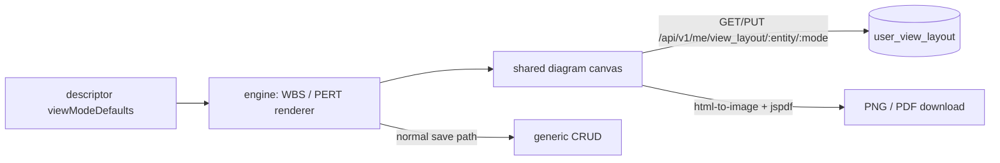

# ADR-039: WBS and PERT diagram view modes

**Status:** Accepted · builds on [ADR-006](ADR-006-runtime-configurable-view-fields.md) (view fields)
and [ADR-010](ADR-010-pdf-report-generation.md) (server-side PDF reports)

## Context

The Project app's task lists need two planning views: a **WBS** (work breakdown structure, tasks
nested by parent) and a **PERT** chart (dependency network with a critical path). Both are
node-and-arrow diagrams users arrange by hand, and the arrangement must survive a reload without
being shared with colleagues. Nothing about them is specific to tasks: any entity with a parent
link or a dependency table could use them.

## Decision

### Generic engine modes, enabled by descriptor keys

WBS and PERT are view modes of the core-front engine, like Kanban or Gantt. An entity opts in through
its `viewModeDefaults`:

| Key | Mode | Meaning |
|---|---|---|
| `wbsParentField` | WBS | field holding the parent record (tree edges) |
| `wbsGroupField` | WBS | one tree per value (e.g. `project_id`) |
| `pertDependencies` | PERT | `{entity, fromField, toField}` dependency table, same shape as `ganttDependencies` |
| `pertHoursField` | PERT | estimate in hours (duration) |

PERT start and end dates reuse `ganttStartField`/`ganttEndField`. The Project task lists set all four keys.

### Per-user layouts

Box positions and folded branches are stored per user in `user_view_layout`, through
`GET|PUT /api/v1/me/view_layout/:entity/:mode` (`mode` is `wbs` or `pert`). A second user sees their own
layout, never the first one's. Edits to the records themselves (hours, parent, dependency arrows) are not
layout: they go through the normal save path and follow the caller's write permission (an arrow, the
dependency entity's). A saved layout keeps the positions of boxes not drawn right now (a folded branch, a
narrower filter), so they come back where they were.

### Client-side export

PNG and PDF are produced in the browser (`html-to-image` + `jspdf`, loaded on the first export), not through
`internal/reports`. That pipeline renders a server-known print route; the server cannot see the
user's arrangement, which lives in their layout and the current viewport.

### PERT conventions

- 8 hours = 1 day; durations and dates are in calendar days.
- A task with no estimate counts as 1 day and carries a "No estimate" badge.
- Time zero is the earliest start among the drawn tasks.
- Critical = slack < 1e-6 days.
- Dependency rows are read from both ends (`in[toField]` and `in[fromField]`), so a link whose other end is filtered out is counted as a hidden link and not drawn (over the cap, nothing is drawn at all).
- A record whose `closed` field is `true` is drawn faded — the one column name the engine assumes; it still counts in the critical path.
- A dependency cycle disables the critical path, with a warning.

### Cap

A diagram draws at most 2000 records; beyond that it shows a notice asking to narrow the filters.

## Consequences

- Any entity gets the modes by adding descriptor keys, no new code.
- The diagram code (and the export libraries) is lazy-loaded, so lists that never open it pay nothing.

## Pitfalls

- A box drag only changes the user's layout; a re-parent or arrow change is a real record write and fails for a user without write permission.
- The layout row is replaced whole on each PUT (≤ 5000 ids, finite coordinates within ±10⁶, else 400).
- Hidden-end links silently shrink the critical path; the hidden count is the only hint.
- Export captures the DOM canvas, so it needs the diagram chunk loaded first.
