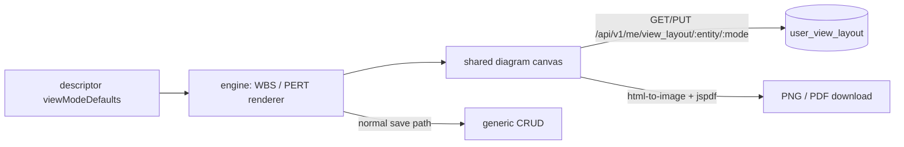

# ADR-039: WBS and PERT diagram view modes

**Status:** Accepted · builds on [ADR-006](ADR-006-runtime-configurable-view-fields.md) (view fields)
and [ADR-010](ADR-010-pdf-report-generation.md) (server-side PDF reports)

## Context

The Project app's task lists need two planning views: a **WBS** (work breakdown structure, tasks
nested by parent) and a **PERT** chart (dependency network with a critical path). Both are
node-and-arrow diagrams users arrange by hand, and the arrangement must survive a reload without
being shared with colleagues. Nothing about them is specific to tasks: any entity with a parent
link or a dependency table could use them.

## Decision

### Generic engine modes, enabled by descriptor keys

WBS and PERT are view modes of the core-front engine, like Kanban or Gantt. An entity opts in through
its `viewModeDefaults`:

| Key | Mode | Meaning |
|---|---|---|
| `wbsParentField` | WBS | field holding the parent record (tree edges) |
| `wbsGroupField` | WBS | one tree per value (e.g. `project_id`) |
| `pertDependencies` | PERT | `{entity, fromField, toField}` dependency table, same shape as `ganttDependencies` |
| `pertHoursField` | PERT | estimate in hours (duration) |
| `wbsOrderField` | WBS, PERT | dotted order number (`3.1.2`), optional — see below |

PERT start and end dates reuse `ganttStartField`/`ganttEndField`. The Project task lists set all five keys.

### Order numbers (2026-11-13)

A task's order number says where it sits in the tree: top-level tasks are `1`, `2`, `3`…, the
children of `3` are `3.1`, `3.2`… It exists so the PERT chart can be laid out from the plan's own
order, and so people can name tasks by number.

- **Stored and maintained by Postgres**, not the client: `project_task.sequence` is the position
  among live siblings (kept `1..n`), `wbs_number` the dotted path. Triggers append a new task last,
  shift siblings when a task is placed at a position, close the gap on delete, and renumber the
  descendants. A moved top-level task goes last in its new project.
- **Writing a number moves the task**: a PUT with `wbs_number: "2.4"` makes it the 4th child of the
  task numbered `2` in the same project (`"3"` = 3rd top-level task); an unknown parent number or a
  malformed one is a 422. A re-parent without a number goes last.
- **WBS**: siblings are drawn in number order; a box dropped on a parent, or on empty space among its
  siblings, writes the number for where it landed (one past the siblings left of it) and the diagram
  re-reads every record, since siblings renumber too.
- **WBS lines are the parent links**, edited like PERT arrows (write permission only): drawing a
  line from a box's bottom to another box's top makes the first the parent of the second (a task is
  parent, child or both); deleting a line clears the child's parent (it hangs under its project
  root); dragging a line's end moves the link — the parent end changes the parent, the child end
  gives the parent to the new box and clears the old child's. Each is a plain parent write, so the
  task goes last under its new parent and the diagram re-reads the renumbered records. A project
  root's lines can't be edited; cycles and links across projects are refused before any write.
- **List, Kanban, Calendar, Gantt** show it with the task's name, `1.2 - Design`: a number alone names
  nothing. Display only; the stored value and its sort stay the bare number.
- **PERT** only reads it: within a linked group the auto-layout puts each task at least in the
  column of its top-level number (lowest numbers first, highest last), dependencies still placing a
  blocker left of what it blocks; unlinked tasks get one column per top-level number (see *PERT
  conventions*). Moving a PERT box never changes a number.

Pitfalls: the number is text, so the list's sort on it is lexical (`10` before `2`); the update's
answer can carry the pre-renumber number when the move also renumbered the new parent — re-read.

### Per-user layouts

On both canvases, Shift+click adds a box to the selection and Shift+drag on empty space draws a
selection rectangle (React Flow's own keys); dragging a selected box moves the whole selection, each
box landing on the nearest free spot. A group move changes only the layout, never a WBS parent.

Box positions and folded branches are stored per user in `user_view_layout`, through
`GET|PUT /api/v1/me/view_layout/:entity/:mode` (`mode` is `wbs` or `pert`). A second user sees their own
layout, never the first one's. Edits to the records themselves (hours, parent, dependency arrows) are not
layout: they go through the normal save path and follow the caller's write permission (an arrow, the
dependency entity's). A saved layout keeps the positions of boxes not drawn right now (a folded branch, a
narrower filter), so they come back where they were.

### Zoomed-out boxes

Below zoom 0.6 (`DETAIL_ZOOM`) a task box draws only its title (`<order> - <name>`, large type) at
its usual size, and a WBS project root only its name: the form widgets are unreadable there and are
what makes a zoomed-out diagram of hundreds of boxes slow. The box size and handles don't change, so
the layout and the arrows don't move; double-click still opens the record. Each box selects only
"near or far" from React Flow's store, so it re-renders when the zoom crosses the threshold, not on
every zoom step. An export always draws the full boxes. The website workflow map drops its arrow
labels below the same zoom.

### Client-side export

PNG and PDF are produced in the browser (`html-to-image` + `jspdf`, loaded on the first export), not through
`internal/reports`. That pipeline renders a server-known print route; the server cannot see the
user's arrangement, which lives in their layout and the current viewport.

### PERT conventions

- 8 hours = 1 day; durations and dates are in calendar days.
- A task with no estimate counts as 1 day and carries a "No estimate" badge.
- Time zero is the earliest start among the drawn tasks.
- Critical = slack < 1e-6 days.
- Dependency rows are read from both ends (`in[toField]` and `in[fromField]`), so a link whose other end is filtered out is counted as a hidden link and not drawn (over the cap, nothing is drawn at all).
- A record whose `closed` field is `true` is drawn faded — the one column name the engine assumes; it still counts in the critical path.
- A dependency cycle disables the critical path, with a warning.
- **Auto-layout** (new boxes and *Re-arrange*, `layoutPert`): linked tasks on the left, each
  connected group of dependencies laid out on its own and the groups stacked top to bottom so
  independent chains never interleave.
  - *Columns*: a blocker sits left of what it blocks; a task with more dependents than blockers
    moves right, next to its nearest dependent, so arrows stay one column long where possible;
    empty columns are dropped. Columns are 100px apart (5 dots of the canvas grid).
  - *Rows*: each task is placed inline with its blockers' mean height (a task nothing blocks, with
    its dependents'), so chains draw as straight lines; a column whose tasks want the same height
    is packed around it with the least total move (a fork centers on its blocker).
  - *Hidden lines*: an arrow spanning several columns is traced as React Flow draws it, and a box
    it would pass behind moves up or down its column to the nearest clear height (a few passes,
    best effort).
  - Unlinked tasks go to their right, after one empty column, one column per top-level order
    number, wrapped into the next column every 10 tasks, centered on the linked part's middle line.
  - Boxes are then separated so none overlap.

### Cap

A diagram draws at most 2000 records; beyond that it shows a notice asking to narrow the filters.

## Consequences

- Any entity gets the modes by adding descriptor keys, no new code.
- The diagram code (and the export libraries) is lazy-loaded, so lists that never open it pay nothing.

## Pitfalls

- A box drag only changes the user's layout; a re-parent or arrow change is a real record write and fails for a user without write permission.
- The layout row is replaced whole on each PUT (≤ 5000 ids, finite coordinates within ±10⁶, else 400).
- Hidden-end links silently shrink the critical path; the hidden count is the only hint.
- Export captures the DOM canvas, so it needs the diagram chunk loaded first.
