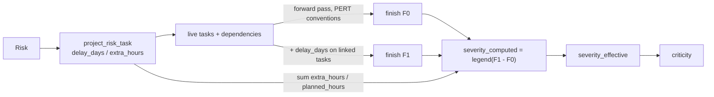

# ADR-040: Project risk analysis

Status: accepted · 2026-11-16 · Spec: `docs/superpowers/specs/2026-11-16-project-risk-analysis-design.md`

## Context

Project managers keep an AMDEC (FMEA) risk register in a spreadsheet next to the ERP. Most of what a
risk's severity depends on already lives in the Project app: the task network, planned hours and
dates. Keeping the register elsewhere means its scores are estimates of a plan that moves.

## Decision

Risks are records of the project (`project_risk`, `project_risk_task`, `project_risk_category`),
riding the generic CRUD surface with the same row scope as milestones, so they follow the project's
visibility. Any viewer may raise or edit a risk; delete and restore are manager/admin only (a restore
keeps dead references).

### Scoring legend (fixed)

| Score | Points |
|---|---|
| Likelihood | 1 unlikely, 2 likely, 3 very likely |
| Detectability | 1 easy, 2 difficult, 3 impossible |
| Severity, delay | critical-path impact: 1 none, 2 under 7 days, 3 7-14 days, 4 over 14 days |
| Severity, cost | extra hours / project planned hours: 1 at 0 %, 2 under 5 %, 3 5-10 %, 4 over 10 % |
| Severity, quality | typed only: 1 to 4 |

Scores are int number fields (selection options are string-only); the legend words live in labels.
Besides the scores, a risk carries two free texts: `remediation` (what lowers the risk beforehand,
scored by the residual fields) and `if_it_happens` (the response plan once the risk occurs, which no
score depends on).
`criticity` = likelihood x severity x detectability (1 to 36), a stored generated column, like the
residual criticity. Bands: up to 4 green, up to 12 amber, above 12 red.

### Severity per `impact_on`

A manual `severity` overrides `severity_computed`; `severity_effective` is the coalesce of both.
`delay` risks use the critical path, `cost` risks the extra hours, `quality` is never computed. A
severity that can't be computed is null with a `severity_note` (`no_estimate`, `cycle`,
`no_planned_hours`), never 1.

### Recompute on read

`severity_computed` is recomputed on every `GET /api/v1/project_risk` (list or `/:id`) and after every
risk or link write; there is no recompute endpoint, so the register and the Risk mode are never stale.
Only rows whose value changed are updated, and writes answer with the stored derived values patched in.
Deleted tasks' links are hidden by the link scope and ignored; moving a task soft-deletes its risk
links and clears `phase_task_id`.

### One critical path, two languages

The delay severity is computed in Go (`risk_calc.go`) while the PERT view computes it in TS
(`pert.ts`). Both follow the PERT conventions of [ADR-039](ADR-039-diagram-views.md). A shared fixture
(`core/modules/project/testdata/risk_pert_fixture.json`) runs through both so they cannot drift.

### Frontend

A **Risk** display mode on the task lists (`viewModeDefaults.risk`, pinned to one project like OBS)
holds a criticity matrix (before and residual), an Ishikawa and a register, plus a *New risk* button (the risk form as a dialog, its project preset). Both diagrams fill the view: the matrix stretches, the Ishikawa scales to fit and cuts long labels (full text as tooltip). The register's *Temperature* toggle tints each row by its criticity (before remediation), a continuous green-to-red scale relative to the rows listed: the lowest listed criticity is blue and the highest is always red, so the most dangerous risk stands out even when no risk is near the maximal 36 (a fixed 1-36 scale left a typical register all blue and green). While it is on, the XLSX export fills each row with the same color, lightened for legibility (CSV carries no colors). The PDF and PNG exports always print a presentation sheet instead of the full table — #, risk, remediation, if it happens, criticity and residual, colored on the same relative scale with the residual by band and a legend — always in light colors, since an exported register is read on paper or in a slide, not in the viewer's dark theme. Every register export (XLSX, CSV, PDF, PNG) first asks which risks to include, all ticked by default, and recomputes the colors over that selection. A matrix cell holding at most three risks names them (`6 - Budget cut`); a busier one shows only the criticity. Hovering a matrix chip shows a tile above it with the risk's title, its scores for the side shown (likelihood, severity, detectability, criticity — current or after remediation), its remediation and its *If it happens* plan. The matrix export (PNG/PDF) holds both versions side by side, *Current* and *After remediation*, whichever one is on screen (`risk-renderer.tsx` draws them off screen, at desktop layout, only while exporting). Pitfall: that box turns animations off — the ERP fades every chip in from opacity 0 (`ErpUiStyle`), and a capture taken right after mounting would copy the risks as transparent, leaving empty matrices. The risk form's header is a
read-only mind-map (`text/mindmap` widget, exportable to PNG through the plain-element export in
`views/diagram/export.ts`); its centre box fits the risk name (`centreBox`: 14px in 180×56 up to 40 characters, then a smaller font and a wider, then taller box, capped at 320×220), so a long name neither overflows nor dwarfs the satellites.

## Pitfalls

- An unpinned `GET /api/v1/project_risk` recomputes every project with live risks in the tenant: costly
  on large tenants. Pin `filter[project_id]`.
- Anything reading `project_risk` outside that GET (raw SQL, exports) may see severities as old as the
  last read or write.
- The risk form's linked-task grid shows raw task ids and its task picker is not limited to the risk's
  project (the one2many grid has no child descriptor to resolve many2one labels); Go still refuses a
  task of another project. Known v1 limit.
- Never write `severity_computed`, `severity_note` or the generated columns by hand.
