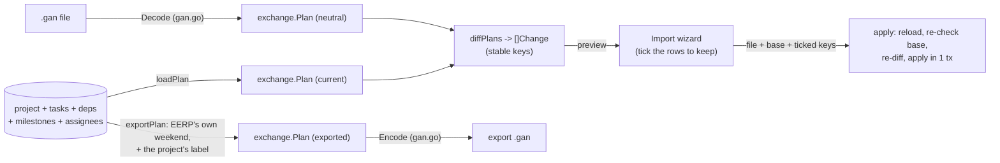

# ADR-042: Project plan exchange with GanttProject (.gan)

Status: accepted · 2026-11-20 · Spec:
`docs/superpowers/specs/2026-11-18-project-gantt-exchange-design.md` · builds on
[ADR-041](ADR-041-project-analytics-views.md) (the Gantt schedule and baselines) and
[ADR-006](ADR-006-runtime-configurable-view-fields.md) (view fields)

## Context

Project managers plan in EERP; the partners who work with them plan in GanttProject. The
only way to hand a plan over was a PNG or a PDF, and the partner's edits came back as a
picture or an email to retype. The round trip this ADR fixes: export the pinned project as
a `.gan` file, the partner edits it in GanttProject and sends it back, the manager imports
it and reviews **every change the file would make, before -> after, one checkbox each**,
then applies only the ticks they accept.

Three requirements pick the architecture:

- A half-applied import is a corrupted plan. Applying must be one transaction, and it must
  never be able to do what the task form cannot.
- An untouched round trip must show **zero** rows. Spurious rows train people to tick
  everything, which is exactly how a task deletion with its timesheets slips through.
- Nothing may be matched on a task's name. A file exported from project A and imported into
  project B must read as a wholesale import, never as a rename of similar-looking tasks.

A second plan adds MS Project (MSPDI XML) on top of this: everything below except the
file reader and writer is reused, so the exchange stays format-neutral.

## Decision

### A neutral `Plan`, one `Format` registry (`core/modules/project/exchange.go`)

Go owns the files. Every format decodes into, and encodes from, one format-neutral
`exchange.Plan`: the project's name and weekend mask, its tasks (EERP id or a file-local id
for new ones, name, parent, position, start, duration in working days, planned hours,
completion, is-milestone), its finish-to-start dependencies, and its assignments (email,
display name). A format family is one `Format` implementation (`Key`, `Ext`, `Encode`,
`Decode`) added to the registry with `registerFormat` from its `init()`; the routes resolve
`:format` against that registry. `gan.go` is the first (and so far only) family. A decode
that means "this is not this format" is an error and the route answers 422 `INVALID_FILE`;
a file that *is* the format but carries something EERP cannot hold decodes and returns
`[]Warning` instead (an unknown `eerp_id`, a dependency type EERP has no column for, a lag,
an email with no staff user, holidays in the file's calendar): the value is dropped or
degraded, the import is never blocked by a warning.

### Routes (`exchange_handler.go`, mounted by `MountExchange`)

| Route | Who | Answer |
|---|---|---|
| `GET /api/v1/project/:id/exchange/:format/export[?collapsed=<ids>]` | anyone who sees the project, else 404 | the file as `application/xml`, `Content-Disposition: attachment; filename="<project name>.gan"`; the comma-separated task ids in `collapsed` are written folded (`expand="false"`) |
| `POST …/exchange/:format/preview` (multipart `file`) | the project's manager or an admin; invisible 404, others 403 | `{base, changes, warnings}` |
| `POST …/exchange/:format/apply` (multipart `file`, `base`, repeated `keys`) | manager or admin | 200 `{applied}`, 409 `PROJECT_CHANGED` on a stale `base`, 422 with `fields` = the refused change keys |

The permission is the pattern's own (`project:project:read` for the download,
`project:project:write` for the two uploads); *who* may read or change the project is the
handler's gate, because the exchange reads the schedule through the tenant rather than
through the row scope, so the route is the only place that gate can live. An unknown
`:format` is a 404: the file was never read, so there is nothing about it to refuse.
`base` is `planHash` of the very current `Plan` the rows were computed from.

The two POSTs are upload routes: `/api/v1/project/*/exchange` is in `app.go`'s
`BodyLimitExempt` and they carry `uploadLimit` (`upload_body_limit`, 20 MB by default), so
a few thousand tasks is not stopped by the 1 MB JSON cap. The cap that actually bites is
the format's own: over 5000 tasks is 422 `TOO_MANY_TASKS` (`ganMaxTasks`), which also
bounds the work a hostile file can ask for.

### Matching: the identity the file carries

Export writes two GanttProject custom task columns: **`eerp_id`** (the task's uuid, or
`milestone:<uuid>` for a milestone) and **`planned_hours`**. GanttProject keeps custom
columns across a save, so the id survives the partner's edit. On import a file task whose
`eerp_id` names a task of *this* project updates it; one with no `eerp_id` is a create; one
naming something that is not in this project (another project, deleted, invisible) is a
create with an `UNKNOWN_ID` warning; a repeated `eerp_id` (copy-paste in GanttProject)
matches the first row and creates the others, with `DUPLICATE_ID`. A name is never an
identity, in either direction.

### Comparing in the file's terms

The diff never compares a raw EERP column with a parsed file value. It **loads the current
EERP task in the file's terms** (`loadPlan` on the file's own weekend mask, no project label)
and compares that with the file; a field is a change only when the two differ, and only then is
the file's value converted back to EERP form. That is what makes a round trip silent:

- a deadline on a Saturday exports as some duration over the file's weekend mask, and the
  same duration coming back is no change, even though converting it again would land on a
  Friday;
- an undated task exports with a deterministic placeholder (start = the project's
  `date_start`, else the task's `created_at` day, duration 1) and the same placeholder
  recomputed at import is no change; when the partner does move it, the row is marked
  `was_unscheduled` so it reads as what it is;
- hours compare at 0.01, and completion compares as exported; the side being compared is
  the current task as `loadPlan` loaded it, **in the file's terms**: a whole 0 or 100 off
  EERP's `closed` column, never a `progress` percentage, so only 100 <-> closed maps.

A task that has children **in the file** has its dates and completion ignored: GanttProject
derives them, and EERP parents keep their own.

### The review list: keys, ticks, removals

`diffPlans` answers `[]Change`, one row per `before -> after`, with keys that are stable for
the same file and the same project state (`task:<uuid>:<field>`, `task:<uuid>:move`,
`task:<uuid>:delete`, `new:<file id>`, `dep:<pred>:<succ>[:delete]`,
`assign:<task>:<email>[:delete]`, `milestone:<uuid>:<field>`, `new-milestone:<file id>`,
`milestone:<uuid>:delete`). A move row appears only when a matched task's parent, or its
order among the matched siblings, changed: the minimal set is the siblings outside the
longest run kept in order, so inserting one task near the top creates no rows for the tasks
below it, and the absolute position is computed at apply time from the rows actually ticked.

That list is the plan's, and it is kept whole. The one deviation the code sanctions is
`uniqueNewKey`: when a file gives two of its own rows the same file id (a decoded `.gan`
numbers its rows 1..n, so only a hand-written one does this), the second row's key gains a
`#<n>` suffix (`new:<file id>#<n>`) because two rows sharing a key would let one tick
answer for both, and a `DUPLICATE_ID` warning says so in the review list. It is a suffix on
an existing key, not a new key shape, and it is the only one.

**Nothing destructive arrives ticked.** Every removal (`…:delete`, and a `milestone_id`
change to null) has `default_selected: false`, "Select all" leaves removals alone, and a
separate "Select all removals" checkbox owns them. A removal row says what goes with it from
the preview itself (`Dependents`: live subtasks, timesheets, risk links). `Requires` carries
what a row needs (a create under a new parent, a dependency on a new task, a parent's delete
requiring its children's deletes); the wizard ticks and unticks along it, and Go re-checks
the closure anyway.

### One transaction through the shared rules

Apply reloads the project, re-hashes it (a mismatch is 409 `PROJECT_CHANGED`, and the wizard
offers *Preview again*), re-diffs, and applies the ticked keys in one transaction, in this
order: task creates (parents first), moves, field updates, milestone changes, dependency and
assignment creates, then deletes (dependencies, assignments, tasks deepest-first,
milestones). **Every write goes through the same validation the generic CRUD runs**
(`validate.go`'s rules, reached through the in-transaction `check`), so an import cannot do
what a form cannot: visibility, cycles, stage and milestone belonging, the manager rules.
That is why the plan's first task was making those guards runnable on any executor instead of
only as Echo middleware over the pool: run on the transaction, they see the tasks the import
has just created, and the middleware keeps calling the same functions with no second copy of
the rules. Read-only and trigger-maintained columns are never written directly; a move goes
through the same shared rules writing `parent_id` and `sequence`, and `wbs_number` stays
trigger-maintained. Deletes are the normal soft deletes, so they stay restorable. The
transaction ends with a `kind: "log"` chatter message on the project naming the file and the
count.

### Frontend (engine + one descriptor key)

The project module declares the exchange the way it declares every other Gantt overlay:
`viewModeDefaults.ganttExchange = { scopeField, scopeEntity, formats, canImport }`. Plan 2
adds a `formats` entry and nothing else. The engine's Gantt toolbar shows **Export** (a menu
of the formats, a plain `<a download>` through the BFF, so the browser names the file after
the project, with the rows folded in the Gantt passed as `?collapsed=` so the file opens
folded the same way — a display hint only: every task is still in the file, so a round trip
never proposes removals) and **Import** while one project is pinned — the formats as entries of the Gantt's single Export menu,
beside its PNG/PDF image exports, Import in the More menu on a phone;
Import appears only when the `canImport` guard (`project.canEditStages`, an async server
check) passes. The wizard is a three-step dialog (file, review, result) whose fetches keep
the status code, because the status code *is* the control flow: 413 explains the size, 409
offers *Preview again*, 422 returns to the review with the refused rows highlighted.

## Consequences

- **Dropped on the way in**: dependency types other than finish-to-start, lags, resource
  costs, calendars and holidays, task notes, colors, custom columns that are not ours. Each
  is a warning, never a silent loss and never a blocked import. Stages, tags, color groups,
  timesheets, risks, RACI, PBS and OBS are out of the exchange entirely.
- **No link between a task and its own summary task**, at any depth and either way round.
  A summary spans its subtasks, so such a link is a loop: GanttProject refuses it on open
  ("Dependency=… is looping") and MS Project does too. EERP refuses to create one (422), the
  exporter leaves out the ones an older project still holds, and the import diff neither
  offers to remove those (no file can carry them) nor imports one a file names (warning
  `DEP_NESTED`).
- **"Before" is the project as EERP holds it now**, not the version the file was exported
  from: there is no three-way merge and no conflict detection. A concurrent EERP edit shows
  up as an ordinary row, and leaving it unticked keeps the EERP value.
- **Summary-task dates and completion are ignored** on import, and successors pushed past a
  finish-to-start dependency appear as ordinary date rows: they reveal a real conflict in the
  EERP plan, so the manager reads them rather than not seeing them.
- Import always targets the pinned project. Importing a `.gan` as a brand-new project is not
  offered (it is the same pipeline with an empty current `Plan`, if it is ever wanted).
- The file is uploaded twice (preview, then apply), and again after a 409. It is a plan file,
  so this is negligible; the alternative, holding a session between the two calls, is not
  worth the state.

## Alternatives rejected

- **B. Browser only**: parse, diff and apply in TypeScript through generic CRUD calls.
  Hundreds of requests, no transaction, and the ordering of creates and dependencies has to
  be reconstructed client-side. Rejected: a half-import is a corrupted plan.
- **C. Browser parse, server apply**: the changeset is built in TypeScript and applied in
  Go. The diff then lives in TS and the rules in Go, so the two must be kept right in two
  places, and a preview that Go would refuse is possible. Rejected.

## Testing

The automated suite pins what Go can check on its own: decode of a genuine GanttProject
3.3.3316 save (`TestGanDecode_RealGanttProjectFile`; the fixture is anonymised, generic task
names over GanttProject's own attributes, dates, dependencies and ten default task
properties), the shape `Encode` writes (`TestGanEncode_Shape`), the apply path, and the EERP
round trips (`TestGanRoundTrip`, `TestApply_ThenPreviewIsEmpty`).

Not covered automatically: what GanttProject itself rewrites when a user opens an
EERP-exported `.gan` and saves it unchanged, and the re-import of that re-saved file. The
suite never runs GanttProject, so **GanttProject 3.3 open/save/re-import is a pending manual
check owned by the project owner**: export a real project from EERP, open the `.gan` in
GanttProject 3.3, verify the hierarchy, the WBS, the links and the milestones, save the file
unchanged from GanttProject, re-import it into EERP, and check that the preview is empty.
`TestGanDecode_OpenedSaved` is parked as the automated version of that check, waiting on a
committed `opened_saved.gan` from that manual run. Until it lands, only the manual pass
catches an encoder change GanttProject would rewrite on save.

## Pitfalls

- A new format is **one** `Format` implementation, one `registerFormat` call, and one
  `formats` entry in the `ganttExchange` descriptor. Nothing in the diff, the apply, the
  routes or the wizard changes. A format family that skips the descriptor entry is invisible
  in the UI; one that registers a `Key()` already taken silently replaces it (init order, so
  it is a bug rather than a race).
- The two POSTs are **useless without the upload exemption**: `/api/v1/project/*/exchange`
  must stay in `BodyLimitExempt` *and* they must carry `uploadLimit` themselves
  (`MountExchange`'s `upload` middleware). Drop the exemption and every import over the JSON
  cap dies with a 413 the wizard can only explain; drop the middleware and they inherit the
  small cap.
- The **5000-task cap** (`ganMaxTasks`) is the real bound on an import, and it is enforced
  while decoding: it is what keeps a 6000-task or a billion-laughs file from pinning the
  server. Raising it means raising the decode guard, the handler's refusal and the tests
  together.
- Round-trip stability is a property of the **encoder**, not of the diff: apply must write
  values that re-encode identically (dates included), or re-importing a file nobody touched
  shows rows. Any change to the placeholder, the weekend mask or the completion mapping must
  keep `TestApply_ThenPreviewIsEmpty` true.
- `base` must be the hash of the same `Plan` the rows were computed from. Handing out the
  hash of a differently read plan makes every apply answer 409.
- A parent delete **requires** its children's deletes. Ticking only the parent is refused
  with both keys named; the same closure the wizard walks is re-checked server-side.
- Export reads through the tenant, not the row scope, so the route itself must gate
  visibility (404 for an invisible project). Forgetting it leaks a members-only project's
  whole plan to anyone with `project:project:read`.
