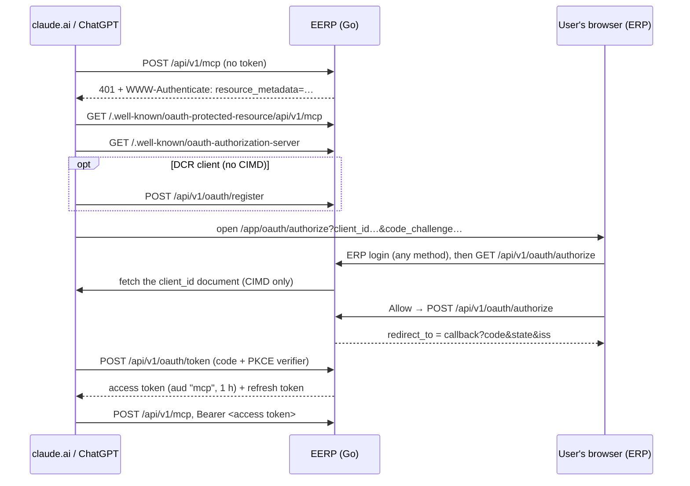

# ADR-043: OAuth sign-in for MCP clients

Status: accepted · 2026-11-20 · builds on [ADR-024](ADR-024-public-access-and-website-identities.md)
(token audiences) and the [MCP server](../mcp.md)

## Context

EERP's MCP endpoint (`/api/v1/mcp`) accepted one credential: an ERP access token in an
`Authorization: Bearer` header. That works for Claude Code or a script, which can set a
header, but not for the hosted assistants people actually use:

- **claude.ai** custom connectors offer no header field. They connect without credentials
  or through OAuth, identifying themselves by a **Client ID Metadata Document** (CIMD, an
  https `client_id` URL Anthropic hosts) or by **dynamic client registration** (DCR,
  RFC 7591).
- **ChatGPT** connectors do the same (DCR or CIMD).

Both follow the MCP authorization spec: a 401 from the MCP endpoint names its protected
resource metadata (RFC 9728), which names an authorization server (RFC 8414), which runs
the authorization code flow with PKCE.

An ERP access token handed out for this would also have been the wrong credential: it is
an ERP session, valid on every route for six hours, and it can't be revoked per app.

## Decision

**EERP is its own OAuth authorization server for its MCP endpoint.** No external identity
provider is needed in front of it: the user signs in on the ERP's normal login page, so any
method EERP already supports (password, LDAP, OIDC, see
[ADR-030](ADR-030-external-authentication.md)) works.

1. **Discovery.** Go serves both metadata documents; the frontend relays them at the site
   root (`/.well-known/oauth-protected-resource[/api/v1/mcp]`,
   `/.well-known/oauth-authorization-server`), where clients look. The authorization
   server metadata advertises `client_id_metadata_document_supported: true` and the
   `none` token endpoint auth method, which is what makes claude.ai pick CIMD.
2. **Trusted hosts.** A client is accepted only if its metadata URL (CIMD) and **every**
   redirect URI are https URLs on a host listed in `mcp_oauth_trusted_hosts` (default
   `claude.ai`, `chatgpt.com`). DCR is open to anyone, but can only ever send a code back
   to a trusted host, after the user approved it. The CIMD fetch dials public addresses
   only (checked on the resolved IP), follows no redirect, reads at most 64 KiB in 5 s,
   requires the document to name its own URL as `client_id`, and is cached an hour.
3. **Consent.** `/app/oauth/authorize` is an ERP page: a signed-out user goes through the
   login (with `next` back to the request), then sees the app's claimed name **and the host
   it comes from**, with Allow and Deny. Go re-validates the whole request on both the read
   and the answer; an error goes back to the app only once its redirect URI is known good.
4. **Codes** are 256-bit random, stored as a sha256 hash, valid 2 minutes, single use, and
   bound to the client, redirect URI and S256 PKCE challenge. Spending commits before the
   checks, so a wrong verifier burns the code. A code presented twice revokes the grant the
   first exchange created (RFC 6749 §4.1.2).
5. **Grants and tokens.** An exchange creates an `oauth_grant` (user, tenant, client). The
   access token is a normal EERP JWT with audience **`mcp`**, the grant id (`gid`), and the
   user's current roles; it lives at most an hour. The refresh token is opaque, stored
   hashed on the grant, rotated on every use with a sliding `refresh_ttl_seconds` expiry; a
   spent refresh token presented again revokes the grant. Grants are kept apart from ERP
   refresh tokens: signing in to the ERP doesn't log the assistant out, and the reverse.
6. **Audience gate.** `middleware.authenticate` accepts an `mcp` token only on a request
   marked by `auth.WithMCPRequest`, which the MCP route sets before its JWT middleware. The
   API calls MCP makes on the user's behalf derive their context from that request, so they
   accept it too; every other route answers 403. An MCP token therefore can't open the ERP,
   approve another app or manage grants. ERP tokens keep working on MCP, unchanged.
7. **Revocation.** Every MCP request with a `gid` checks the grant is live (not revoked,
   not expired) and answers 401 otherwise. Settings → Account lists the user's apps
   (`GET /api/v1/oauth/grants`) and revokes one (`DELETE /api/v1/oauth/grants/:id`).
8. **Authorization stays where it was.** Roles, tenant isolation, field groups, row scopes,
   active modules and `mcp_allow_writes` apply to OAuth tokens exactly as to ERP tokens:
   MCP still goes through the HTTP router.

Configuration: `mcp_oauth_issuer` (the public origin, e.g. `https://erp.example.com`;
empty = OAuth off) and `mcp_oauth_trusted_hosts`. OAuth requires `mcp_enabled`.

## Consequences

- claude.ai and ChatGPT connect with nothing to configure on their side but the MCP URL.
- A user who is disabled, deleted or moved out of the tenant stops working at the next
  refresh (at most an hour); revoking the app is immediate.
- Role changes reach an MCP client at its next refresh, like an ERP session.
- The issuer must be the URL users reach EERP at: discovery documents and the
  authorization endpoint are built from it, not from request headers.
- Registered clients accumulate (anyone may register). They grant nothing by themselves;
  a cleanup of clients without grants can come later.
- Not implemented: scopes beyond the single `mcp`, token introspection and revocation
  endpoints, confidential clients, OpenID Connect discovery.
