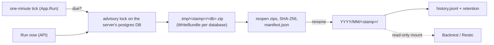

# ADR-044: Automated backups as files for Backrest

Status: accepted · 2026-11-22 · builds on [ADR-021](ADR-021-database-management.md)
(database extract/restore) · design: [2026-11-22 automated backups](../superpowers/specs/2026-11-22-automated-backups-design.md)

## Context

The database manager ([ADR-021](ADR-021-database-management.md)) can extract any EERP
database of the server as one zip (`dump.dump` from `pg_dump -Fc`, a `manifest.json` and
its S3 objects under `s3/`) and restore that zip. Doing it by hand gives no regular
backups.

Off-site copies, encryption, snapshots and their retention are what
**Backrest/Restic** is for. It snapshots a folder on its own schedule and ships it, for
example to a Garage S3 instance. What it needs from EERP is a folder that only ever
holds **complete, consistent** bundles.

Two facts shaped the design:

- A backup can cover **several databases**, but every EERP table lives inside one
  database, and dbmanage switches, deletes and restores those. A schedule kept in the
  active database would vanish or change when that database is switched, deleted or
  restored.
- No one needs to query backup metadata. It's a schedule, a run history and the
  bundles themselves.

## Decision

**EERP writes scheduled bundles into one folder (`backup_dir`) and keeps everything about
them as files in that same folder.** No table, no extra database, no Restic code.



```text
<backup_dir>/
├── backup-config.json      settings (written temp file + rename)
├── history.jsonl           one line per finished run, newest 500 kept
├── .tmp/<stamp>/           a run in progress, never published
└── 2026/11/2026-11-22T020000Z/
    ├── poc.zip             the ADR-021 extract format: restorable from /database/management
    ├── client_a.zip
    └── manifest.json       run id, app version, times, per database: file, size, sha256, S3 object count
```

- **Bundle format:** `dbmanage.Manager.WriteBundle` is the same code behind the HTTP
  extract, writing to any `io.Writer`, so a backup restores through the existing UI.
  S3 objects are included unless the settings turn them off. A database selected but
  since deleted is skipped with a warning, and a run where none remains fails.
- **Atomic publication:** a run is built under `.tmp/` on the same filesystem, every zip
  is fsync'd, reopened and checked for `dump.dump`, then the whole folder is renamed into
  `YYYY/MM/<stamp>`. A published folder is never modified afterwards. A failed or
  cancelled run removes its temp folder and publishes nothing.
- **One run at a time:** a session advisory lock (key `7311990003`) taken on the
  server's `postgres` database, which no database switch touches, covers several
  `core-back` processes too. A second start answers `409 BACKUP_RUNNING`. At boot,
  `.tmp` leftovers of a dead process are removed only while holding that lock.
- **Schedule:** every X hours, daily, weekly (chosen days) or monthly (day 1–28), at a
  time in an IANA timezone (`time/tzdata` is embedded). The next run counts from the
  later of the last scheduled slot and the last settings save. Slots missed while the
  server was down collapse into one run at the next tick, never a burst.
- **Retention:** after each run and on demand, published runs older than
  `retention_days` are deleted. The newest is always kept and `.tmp` is never touched.
  Restic's own retention is separate.
- **Statuses:** a run's status (success, failed, cancelled) means EERP generated the
  bundle. Whether Restic uploaded it is Backrest's status, never reported here.
- **Access:** `GET|PUT /api/v1/backups`, `GET …/databases`, `GET …/runs`,
  `POST …/run|cancel|cleanup`, with route-derived `backups:backups:read|write`. Only
  `*:*:*` holds them by default, since they act on every database of the server. A
  manual run notifies the caller, and a scheduled run notifies whoever last saved the
  settings (category `backup`). No download route: a bundle holds whole databases,
  which the master-key-gated extract already covers. The UI is Settings → Developer
  → Automated backups.

## Consequences

- Development needs nothing: `backup_dir` is `backups` in the dev configs (gitignored),
  and an unset `backup_dir` mounts neither routes nor scheduler. Production mounts the
  `eerp-backups` volume at `/app/backups` (`compose.prod.yml`), and Backrest mounts the
  same volume read-only.
- Backrest also snapshots `backup-config.json` and `history.jsonl`, so a rebuilt server
  gets its schedule back with the data.
- **Pitfalls:**
  - Retention deletes old runs, and a deletion while Backrest is reading them drops
    them from that snapshot. Keep `retention_days` well above Backrest's interval.
  - *Cancel* only reaches a run in the process that answers the request (one
    `core-back` replica today, [ADR-019](ADR-019-user-presence-websocket.md)).
  - Restoring needs the same `pg_restore` major version as the extract (the
    `core/Dockerfile` pins it).
  - A module storing S3 objects under a new table must be added to dbmanage's
    `manifestSources`, or its files are missing from every backup.

## Alternatives considered

- **A hidden `eerp_backups` database on the same server:** real SQL history, but a
  database to provision for data nobody queries.
- **A dedicated Postgres container (production only):** one more service to run and
  upgrade, plus a second code path for development.
- **Storing the settings in the active database's `app_settings`:** breaks on every
  database switch, delete or restore.
- **Uploading bundles to S3 from EERP:** duplicates what Backrest already does, with
  retention and encryption it does better.
