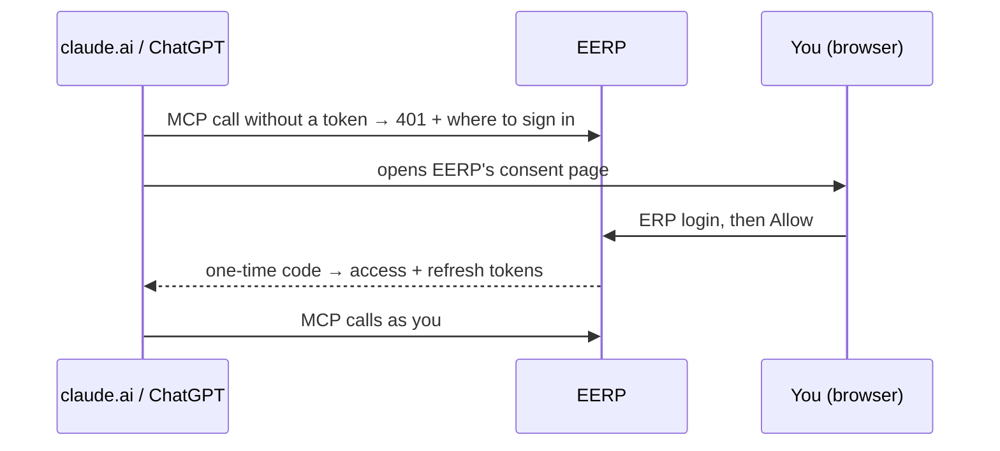

# EERP MCP Server

EERP exposes its business features to MCP clients at **`/api/v1/mcp`**, directly
in the Go backend. The server uses the [official MCP Go SDK](https://github.com/modelcontextprotocol/go-sdk),
version 1.8.0, with stateless Streamable HTTP and JSON responses. It requires no
additional process or direct client connection to PostgreSQL.

## Enabling the server

Add these options to the backend configuration file, then restart the backend.
Rebuild its image first if you have just installed the implementation:

```json
{
  "mcp_enabled": true,
  "mcp_allow_writes": false,
  "mcp_allowed_origins": [],
  "mcp_rate_limit_per_minute": 120,
  "mcp_oauth_issuer": "https://erp.example.com",
  "mcp_oauth_trusted_hosts": ["claude.ai", "chatgpt.com"]
}
```

All options are optional. MCP is disabled by default, and writes are
disabled independently. Setting `mcp_allow_writes: true` makes the create,
update, delete, restore and business action tools available. Existing EERP
permissions are still required for every action.

An empty origin list allows native clients that do not send an `Origin` header.
For a web client, add its exact origin, such as `https://assistant.example.com`,
to both `mcp_allowed_origins` and EERP's general CORS `allowed_origins` setting.
Wildcards, paths, embedded credentials and `null` origins are rejected. Origin
validation also applies to CORS preflight requests.

`mcp_oauth_issuer` turns on OAuth sign-in for hosted assistants (claude.ai,
ChatGPT, see [Connect claude.ai or ChatGPT](#connect-claudeai-or-chatgpt)). It
must be the public origin users open EERP at, `https://` with no path; leave it
empty to keep Bearer tokens only. `mcp_oauth_trusted_hosts` lists the hosts an
OAuth client may come from (default `claude.ai` and `chatgpt.com`).

The existing nginx proxy already forwards `/api/v1/*` to the backend. In
production, use the same server's public HTTPS URL:
`https://erp.example.com/api/v1/mcp`.

## Authentication and connection

MCP accepts two credentials, both carried as **`Authorization: Bearer <token>`**:

| Credential | For | How it is obtained |
| --- | --- | --- |
| OAuth access token (audience `mcp`) | claude.ai, ChatGPT and other OAuth MCP clients | The client runs the sign-in itself, see below |
| ERP access token | Claude Code, scripts, clients that let you set a header | `POST /api/v1/auth/login` or the LDAP/OIDC flow |

Either way the token acts as one ERP user, with that user's roles. Use a
dedicated ERP account with the appropriate roles when the assistant is shared.
There is no shared MCP token, automatic privilege elevation or cookie
authentication. Website visitor tokens, refresh tokens and identities without a
user or tenant are rejected. Accounts required to change their password must do
so in EERP before using MCP.

### Connect claude.ai or ChatGPT

EERP is its own OAuth authorization server for MCP ([ADR-043](adr/ADR-043-mcp-oauth.md)):
no identity provider is needed in front of it, and the user signs in with any
ERP method (password, LDAP, OIDC).



Prerequisites on the server: `mcp_enabled: true`, `mcp_oauth_issuer` set to the
public HTTPS origin (for example `https://erp.example.com`; `make bootstrap-prod`
writes `https://<ERP_HOST>` there, and `MCP_ENABLED=true make bootstrap-prod` turns
`mcp_enabled` on and restarts the backend), the backend restarted, and EERP reachable from the internet over HTTPS with a valid
certificate (the assistant's servers call it). Check it with:

```bash
curl https://erp.example.com/.well-known/oauth-authorization-server
curl -i -X POST https://erp.example.com/api/v1/mcp   # 401 with a WWW-Authenticate header
```

**claude.ai** (Settings → Connectors → *Add custom connector*; on Team and
Enterprise plans an owner adds it under organization settings first):

1. Name: `EERP`; Remote MCP server URL: `https://erp.example.com/api/v1/mcp`.
2. Leave *OAuth Client ID* and *Secret* empty, and keep the recommended
   *Use Claude's published identity* option (CIMD). Dynamic registration also
   works.
3. *Connect*: claude.ai opens EERP. Sign in if asked, check that the page names
   the app and **claude.ai** as its host, then *Allow*.

**Claude Desktop** uses the same connectors as claude.ai: add it once in
claude.ai (or in the desktop app's Settings → Connectors) and it is available in
both, signed in with the same consent. A server declared instead in Desktop's
local `claude_desktop_config.json` through the `mcp-remote` bridge also works: the
bridge registers itself and receives the code on `http://localhost:<port>`.

**Claude Code** runs the same sign-in from the terminal, with its own published
identity and a `http://localhost:<port>/callback` callback:

```bash
claude mcp add --transport http eerp https://erp.example.com/api/v1/mcp
# then, in Claude Code: /mcp → eerp → Authenticate (opens EERP's consent page)
```

Loopback callbacks (`http://localhost`, `127.0.0.1`, `[::1]`) are accepted for any
app, on any port (RFC 8252): a code sent there only reaches a program on the
user's own computer, after they approved it.

**ChatGPT** (Settings → Apps & Connectors → *Create*; developer mode may have to
be enabled first, and workspace admins may restrict custom connectors):

1. Name: `EERP`; MCP server URL: `https://erp.example.com/api/v1/mcp`;
   Authentication: *OAuth*, with no client ID or secret (ChatGPT registers itself).
2. Create, then connect: sign in to EERP and *Allow* (host **chatgpt.com**).

The consent page always shows the host an app comes from: its name is whatever it
claims. Only hosts in `mcp_oauth_trusted_hosts` are accepted, for the app's
metadata document and for every callback URL, so a code can only ever go back to
them.

**Tokens and revocation.** The access token lives at most an hour and works only
on `/api/v1/mcp` (any other route answers 403). The client renews it with a
refresh token that rotates on each use; reusing an old one revokes the
connection. Each user lists and revokes their connected apps in **Settings →
Account → Authorized apps**; a revoked app's next call gets a 401 at once.
Disabling the ERP user stops the app at its next refresh.

**Troubleshooting.** *This application is not allowed to connect to EERP*: the
app's metadata or callback host is not in `mcp_oauth_trusted_hosts`, or its
metadata document can't be a public client (the backend log line
`mcp oauth: client refused` names the client and the reason). ChatGPT's document
(`https://chatgpt.com/oauth/client.json`) prefers `private_key_jwt` but supports
`none`, which EERP uses. *Connecting apps to EERP is not enabled on this server*:
`mcp_oauth_issuer` is empty or MCP is disabled. The assistant says it can't reach
the server: EERP must be publicly reachable over HTTPS with a certificate a
public client trusts, and `mcp_oauth_issuer` must be exactly that origin.

### Claude Code and header-capable clients

The client must support Streamable HTTP and a configurable Bearer header.
For clients that accept the following `mcpServers` format, use a configuration
like this. Adapt the keys and secret storage mechanism to your client:

```json
{
  "mcpServers": {
    "eerp": {
      "type": "http",
      "url": "https://erp.example.com/api/v1/mcp",
      "headers": {
        "Authorization": "Bearer <ERP access token>"
      }
    }
  }
}
```

Obtain an access token through the existing ERP sign-in flow
(`POST /api/v1/auth/login`, or the configured LDAP/OIDC flow). The client renews
its token through EERP's existing refresh mechanism and updates its header when
the token expires. Keep passwords, the master key and refresh tokens out of
tool arguments, URLs and version-controlled configuration files.

To check the protocol with an access token already stored in the
`EERP_ACCESS_TOKEN` environment variable:

```bash
curl --fail-with-body https://erp.example.com/api/v1/mcp \
  -H "Authorization: Bearer ${EERP_ACCESS_TOKEN}" \
  -H 'Content-Type: application/json' \
  -H 'Accept: application/json, text/event-stream' \
  --data '{"jsonrpc":"2.0","id":1,"method":"initialize","params":{"protocolVersion":"2025-11-25","capabilities":{},"clientInfo":{"name":"eerp-check","version":"1"}}}'
```

The SDK negotiates supported protocol versions. Tests cover version
`2025-11-25` and interoperability with the official SDK client. The endpoint
does not retain user sessions: there is no `Mcp-Session-Id`, persistent SSE
stream or asynchronous notification channel. `GET` and `DELETE` on the MCP
endpoint return `405`; JSON-RPC methods use `POST`.

## Tools

| Tool | Purpose |
| --- | --- |
| `eerp_list_models` | List active models the caller can read, with pagination |
| `eerp_describe_model` | Inspect API fields, Go types, nullability and computed/read-only fields |
| `eerp_list_records`, `eerp_get_record` | Search and read records |
| `eerp_create_record`, `eerp_update_record` | Create and update records with business validation |
| `eerp_delete_record`, `eerp_restore_record` | Delete and restore records according to model rules |
| `eerp_list_operations` | Browse registered business API methods and routes, with pagination |
| `eerp_read_operation` | Execute a GET operation from the catalog |
| `eerp_write_operation` | Execute a JSON or multipart mutation from the catalog |
| `eerp_list_projects` | List projects visible to the caller |
| `eerp_get_project` | Read a project, its metrics, schedule, indicators or management capabilities |
| `eerp_list_project_tasks` | List a project's tasks and subtasks, with filters and pagination |

In read-only mode, the five write tools are absent from `tools/list`, and write
operations are removed from the catalog. MCP annotations identify read tools
and potentially destructive mutations. These annotations inform the client;
enforcement happens on the server.

The **`eerp://guide`** resource provides usage instructions, and the
**`eerp://models/{model}`** resource template provides the authorized model
schema. The **`eerp_review_project`** prompt accepts a `project_id` argument
and prepares a project review.

## Business and project coverage

Generic tools automatically cover models registered on the CRUD surface:
contacts, CRM, sales, invoices, product catalog, inventory, property management,
events, website pages and workflows, and all project entities. The operation
catalog also includes dedicated routes for teams, conversations, notes,
attachments, images, PDF reports, mail, filters, preferences, settings, users,
roles, module management and automated backups (`/api/v1/backups`: status,
settings, history, run, cancel and clean-up, [ADR-044](adr/ADR-044-automated-backups.md);
only `*:*:*` holds `backups:backups:*` by default), depending on the services
available in the deployment.

Schemas respect field exclusions and group restrictions. Accounts and roles
use their dedicated administration routes; their internal tables remain
excluded from generic CRUD. Catalog entries describe server capabilities.
Executing an advertised operation still requires authorization and may be
denied to the caller or rejected when its module is disabled.

Project access covers members, stages, tasks and subtasks, assignments,
dependencies, milestones, timesheets, colors and tags, OBS, PBS, RACI, capacity,
risks and categories, baselines and baseline tasks. Counters, history and other
computed data retain EERP's business rules. History tables excluded from CRUD
remain internal; metrics use them through dedicated business endpoints.

Example arguments for `eerp_list_projects`:

```json
{"query":{"search[name]":"Migration","page":"1","page_size":"50"}}
```

For `eerp_get_project`:

```json
{"id":"<project UUID>","section":"metrics"}
```

`section` accepts `record` (the default), `metrics` (burndown, EVM, flow and
risk), `schedule` (the computed schedule), `indicators` (progress ratios, the
critical path length, and task and OBS breakdowns — what the task list's Graph
tiles show) or `can_manage`.

For `eerp_list_project_tasks`:

```json
{"id":"<project UUID>","query":{"page":"1","page_size":"50","order":"sequence","assigned_to_me":"1"}}
```

Other project entities use the same query format with `eerp_list_records`:

```json
{"model":"project_risk","query":{"filter[project_id]":"<project UUID>","page_size":"50"}}
```

Create a baseline with `eerp_write_operation`:

```json
{
  "operation":"POST /api/v1/project/:id/baseline",
  "path_params":{"id":"<project UUID>"},
  "body":{"name":"Approved baseline"}
}
```

A members-only project remains hidden from other users. Project managers and
administrators retain their additional permissions, and task assignees retain
the access granted by EERP's existing rules.

## Filters, results and files

`query` is an object of strings, forwarded as encoded API parameters: `page`,
`page_size`, `order`, `filter[column]`, `search[column]`, `in[column]`, `gt[]`,
`gte[]`, `lt[]`, `lte[]`, and so on. Endpoints retain their own validation and
limits. A first page is never a complete export. MCP additionally restricts
`page_size` to values between 1 and 200.

Discovery tools accept `search`, `offset` and `limit` (50 by default, 200
maximum), and return `data`, `total`, `next_offset` and `has_more`.

Business responses use the form `{"status":200,"data":...}`. The `data` field
preserves the original API envelope, such as `{data:[...],total:42}` for a list.
A business `4xx` response preserves its status and message and sets `isError`
in the MCP result. Internal `5xx` errors are masked; details remain in the
server logs. Binary downloads return `mime_type` and `base64`. Cookies are not
forwarded, and redirects are not followed.

For multipart uploads, replace `body` with `form` and `files`:

```json
{
  "operation":"POST /api/v1/attachments",
  "form":{"table_name":"project","record_id":"<project UUID>","field":"documents"},
  "files":[{"field":"file","name":"report.pdf","mime_type":"application/pdf","base64":"<base64 content>"}]
}
```

The server limits an MCP request to **1 MiB**, an API response to **4 MiB**, an
operation to **30 seconds**, and encoded API query parameters to **16 KiB**.
Each process allows at most 16 concurrent MCP business operations. Additional
operations are rejected before execution.

Base64 encoding increases file size. Use the regular EERP HTTP endpoints for
large files, and reduce page sizes when a response exceeds the limit. A
mutation may have completed before a timeout, cancellation or response limit
error: check its outcome before retrying it.

## Security and maintenance

- Operations re-enter the final HTTP router. JWT authentication, permissions,
  tenant isolation, field groups, row visibility, active module checks and
  business overrides apply as they do in the application.
- MCP arguments cannot set a remote URL, request headers or the authenticated
  tenant. Paths are built from known operation IDs, with segment validation
  and verification of the resolved route. Raw SQL execution is not exposed.
- Internal requests do not forward cookies, proxy headers or WebSocket upgrade
  requests. Presence provides its HTTP snapshot only.
- Origins are checked before CORS processing. Requests are limited per IP
  (120 per minute by default, per process), in addition to existing API checks.
- MCP audit logs record the operation, user, tenant, status and duration.
  They do not record tokens or argument bodies.
- Authentication, public and visitor routes, webhooks, database administration
  and development data seeding are excluded. New families of dedicated routes
  require explicit admission in `mcpbridge.New`; new CRUD models are discovered
  automatically.
- OAuth (when `mcp_oauth_issuer` is set) adds the `/.well-known/oauth-*`
  metadata, `/api/v1/oauth/register` and `/api/v1/oauth/token` (limited per IP
  like MCP itself, since every user of one assistant comes from its servers) and
  the consent calls (limited like sign-in). An OAuth token is refused on every
  route but MCP, and none of these routes is in MCP's own operation catalog.
- Business content and files are untrusted data. Clients must retain control
  over tool calls and obtain the user's consent for mutations.

Permissions and groups follow EERP's existing session and cache mechanisms.
Revocation is subject to those mechanisms' guarantees and must not be assumed
to take effect immediately, except for revoking an OAuth app, which every MCP
request checks. MCP adds no authorization cache of its own.

The implementation is in `core/internal/mcpbridge` (OAuth: `core/internal/mcpoauth`,
the consent page `core-front/apps/shell/app/app/oauth/authorize`), with final route wiring in
`core/internal/app/app.go` and schema projection in `core/orm/server/catalog.go`.
The [MCP transport specification](https://modelcontextprotocol.io/specification/2025-11-25/basic/transports)
and SDK define JSON-RPC negotiation and the protocol lifecycle.

## Verification

From `core/`, using Go 1.27.3 (the repository's pinned version):

```bash
go test -race ./internal/mcpbridge ./orm/server
go test ./internal/types ./internal/app ./internal/middleware
CONFIG=$PWD/../eerp-config.json go test ./modules/project -run MCP   # absolute: tests run from their package dir
CONFIG=$PWD/../eerp-config.json go test ./internal/mcpoauth ./internal/app -run 'MCP|OAuth|Test'   # OAuth flows
```

Tests that do not require a database cover the protocol, tools, resources,
prompts, official client interoperability, origins, JWT authentication,
read-only mode, permissions, concurrent identity isolation, files, errors and
limits. PostgreSQL project tests verify access for managers, members,
non-members and other tenants through the actual MCP endpoint. They use an
isolated test tenant and clean up only the rows created by the test. The OAuth
tests cover discovery, CIMD fetch refusals (http, untrusted host, private
address, redirect, oversized or self-inconsistent documents), dynamic
registration, wrong redirect URIs, missing or wrong PKCE verifiers, code reuse,
refresh rotation and reuse, audience separation, revocation, disabled users and
tenant isolation, and one full flow through the real MCP endpoint.
