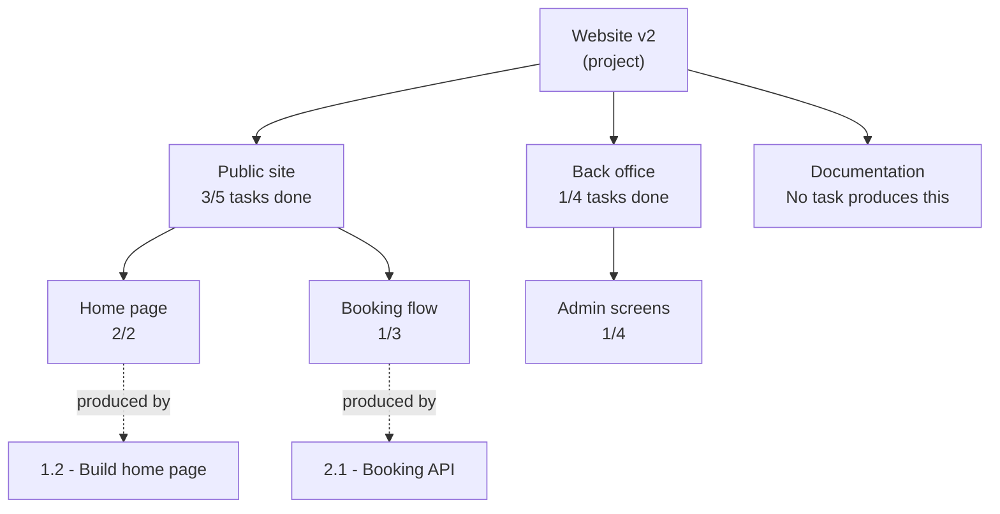
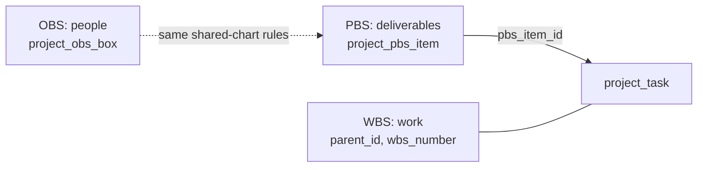
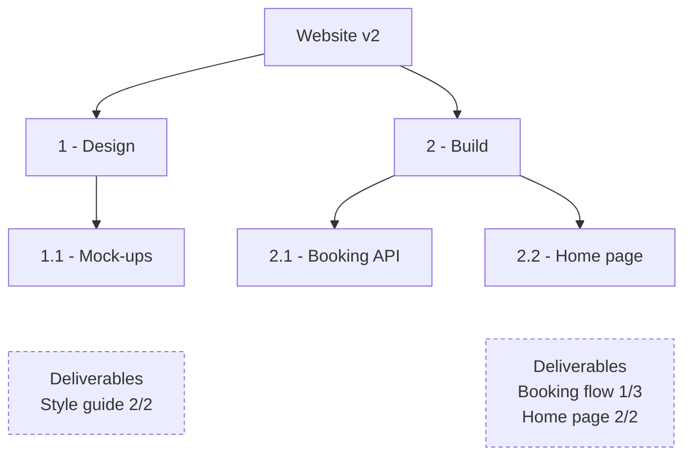

# Project Analytics & Planning Views Implementation Plan

> **For agentic workers:** REQUIRED SUB-SKILL: Use superpowers:subagent-driven-development (recommended) or superpowers:executing-plans to implement this plan task-by-task. Steps use checkbox (`- [ ]`) syntax for tracking.

**Goal:** Add the 16 validated Project views: critical path and baseline on Gantt, Kanban swimlanes, an **Insights** mode (burndown/burnup, cumulative flow, earned value, milestone roadmap, risk trend), a **Matrix** mode (Eisenhower, RACI, dependency matrix), a **PBS** diagram mode (product breakdown structure) with a deliverables footer on the WBS, and four pages (My day, Timesheet week, Workload, Portfolio).

**Architecture:**
- **Backend** (`core/modules/project`):
  - New data, all maintained by triggers: a task's `closed_at`, a stage-history table, a risk-history table.
  - New tables: baselines, RACI, capacities, PBS items (plus a task's `pbs_item_id`).
  - Two read endpoints on one project: `GET /api/v1/project/:id/metrics` and `GET /api/v1/project/:id/schedule`. Their permission derives as `project:project:read`, like `can_manage`, and each checks `orm.CanSeeRecord` (404 otherwise).
- **Frontend, single-project views:** inside the task lists, following the Risk mode's pattern. They are engine display modes configured by `viewModeDefaults` and offered while the list is pinned to one project (`views/insights/`, `views/matrix/`, `views/diagram/pbs-renderer.tsx`), plus opt-in Gantt and Kanban options.
- **Frontend, cross-project views:** hand-built shell pages (Teams' pattern, `apps/shell/app/app/project/*`). They read only through the generic list API, so row scope and field gating apply with no new endpoint or permission.

**Tech Stack:** Go (Echo, core/orm, pgx, Postgres 18), Next.js App Router + React 19 + MUI 7, Vitest, Go `testing` with `newFixture`.

**Spec:** this document plus the validated idea table in `docs/superpowers/plans/2026-11-16-project-phone-mode.md` (Appendix).
**Prerequisite:** execute `2026-11-16-project-phone-mode.md` first. This plan uses its `usePhone()`, `setViewportWidth()` and phone mode picker.

## Global Constraints

- Every view must be usable on phone (< 600px, `usePhone()`). Each frontend task has at least one 390px test. No action may exist only behind HTML5 drag.
- **Hours-based earned value:**
  - PV(t) = Σ planned_hours × clamp((t − date_start) / (deadline − date_start), 0, 1), over live tasks with both dates (a task where `deadline <= date_start` counts fully from its deadline).
  - EV(t) = Σ planned_hours of tasks with `closed_at <= t`.
  - AC(t) = Σ live timesheet `hours` with `date <= t`.
  - SPI = EV/PV and CPI = EV/AC at today, `null` when the denominator is 0.
- **Burndown:**
  - scope(t) = Σ planned_hours (and the count) of tasks with `created_at <= t` and (`deleted_at` NULL or `> t`).
  - done(t) = the same, restricted to `closed_at <= t`.
  - remaining = scope − done.
  - The ideal line runs from scope(from) at `from` to 0 at the project's `date_end` (none when `date_end` is NULL).
- **Metrics window:** `from` = project `date_start`, else the earliest task `created_at`. `to` = max(today, `date_end`), capped at `from` + 3 years. The bucket is `day` when the span is ≤ 120 days, else `week` (points on Mondays). The last point is always today, if today is in the window.
- **Critical path:** the PERT conventions of ADR-039 (`taskDays` in `risk_calc.go`). Slack = late start − early start in days. Critical = slack < 1e-6. A dependency cycle → `cycle: true` with an empty `tasks`.
- **Eisenhower:**
  - important = `priority = true`.
  - urgent = `deadline < today + 7 days` (overdue included).
  - Quadrants: Do (important+urgent), Schedule (important), Delegate (urgent), Eliminate (neither).
  - Closed tasks are excluded.
- **RACI:** roles `R`, `A`, `C`, `I`. At most one `A` per task (422 `ONE_ACCOUNTABLE`). A user holds one role per task (unique live `(task_id, user_id)` → 409). Staff users only (422).
- **PBS:**
  - A PBS item is a deliverable of one project: `name` (required, ≤ 200), `description` (≤ 2000), a lowercase `#rrggbb` `color` (else 422), an optional `parent_id` in the same project and acyclic (422), and `x`/`y`.
  - A task produces at most one item (`project_task.pbs_item_id`, same project, else 422). A task move clears it, like its milestone.
  - The chart is shared data, like OBS: item writes (create, update, move, delete) are manager/admin only (403). Linking a task to an item is a task write, open to anyone who may edit the task.
  - Deleting an item clears its children's `parent_id` and its tasks' `pbs_item_id` in one transaction. Its children become roots and nothing disappears.
  - An item's progress = done / total over the live tasks linked to it **and to its descendants**. A leaf with no task is flagged `No task produces this`.
  - **WBS footer:** each level-2 column of the WBS (a top-level task and its subtree) gets one detached deliverable box at the bottom of the diagram, listing the items its tasks produce (`No deliverable` when none). It is drawn, never stored, and takes no part in editing.
- **Capacity:** `hours_per_week` in (0, 168]. A user with no row has 40.
- **Workload:**
  - A task's planned_hours are spread evenly over the Mon–Fri days of [date_start, deadline] (both dates required, open tasks only), then split equally among its assignees. No assignee → the "Unassigned" row.
  - Cell color: load/capacity ≤ 0.8 neutral, ≤ 1.0 amber (`palette.warning`), > 1.0 red (`palette.error`).
- **Baselines:** at most 20 live per project (409 `BASELINE_LIMIT`). Only the project's manager or an admin may create or delete one (403).
- **Risk bands** (as in ADR-040): criticity ≤ 4 green, ≤ 12 amber, > 12 red.
- **Read caps:** any client read loop pages until a short page and stops at 1000 records with a visible "first 1000 shown" caption. Never use a total as a loop bound (ADR-032).
- Aggregates are trigger-owned and read-only fields. Never write `closed_at`, the history tables or the baseline task rows from Go handlers or the frontend.
- **i18n:** Project UI strings go in `core/modules/project/i18n/project.pot` + `fr.po`. Engine chrome strings go in `core-front/apps/shell/i18n/shell.pot` + `fr.po`.
- **Charts:** load the `dataviz` skill before writing any chart. Reuse `graph-widgets.tsx`'s light/dark categorical palette. Draw with plain SVG (no new dependency).
- **Process:** run `graphify query` before searching; search with `rg`; prefix commands with `rtk`. Commits use `<type>(project|core-front): …` and end with the session's attribution line. Never lower coverage floors. `make test` must pass before a push.

## Review Focus

1. **A members-only project read by a non-member through `/metrics` or `/schedule`** → 404, never series or task ids. A task assignee who sees one task still gets 404 on the project's metrics. *(Task 2, Task 3.)*
2. **A project with no dates, no planned hours and no timesheets** → metrics answers zeros with `pv_excluded` set and SPI/CPI `null`. The Insights charts show "Not enough data yet", with no NaN, no division by zero and no empty SVG path. *(Task 2, Task 9.)*
3. **A task moved to another project, then deleted** → its stage history, RACI rows and baseline rows follow or hide, and the old project's metrics stop counting it from the move date. *(Task 1, Task 5.)*
4. **Timesheet week grid: a cell holding several entries** stays read-only (no silent merge). Typing `0` deletes the single entry, and a refused write (403 for someone else's entry) restores the cell. *(Task 14.)*
5. **PBS: deleting an item that has children and linked tasks** → children become roots, tasks keep existing with `pbs_item_id` NULL, all in one transaction; a non-manager gets 403 and nothing changes. A task moved to another project loses its item. *(Task 18.)*
6. **Workload over a holiday-only or weekend-only task** (date_start and deadline on Sat/Sun) → its hours land on the nearest following Monday, never dropped and never divided by zero. *(Task 15.)*

---

## Work Packages (one per person)

The 20 tasks below are grouped into 11 work packages (WPs), each one branch and one pull request into `dev`. A WP starts once every WP in its **Blocked by** column is merged. The frontend WPs (5–10) also need `2026-11-16-project-phone-mode.md` merged first.

| WP | Title | Tasks | Blocked by | Wave |
|---|---|---|---|---|
| WP1 | Backend: closed_at, stage & risk history (+ ADR-041 skeleton) | 1 | — | 1 |
| WP2 | Backend: project metrics endpoint | 2 | WP1 | 2 |
| WP3 | Backend: schedule endpoint & baselines | 3, 4 | — | 1 |
| WP4 | Backend: RACI & capacities | 5 | — | 1 |
| WP5 | Frontend: insights/matrix mode plumbing & Kanban swimlanes | 6, 8 | — | 1 |
| WP6 | Frontend: Gantt critical path & baselines | 7 | WP3, WP5 | 2 |
| WP7 | Frontend: Insights mode (6 tabs) | 9, 10 | WP2, WP5 | 3 |
| WP8 | Frontend: Matrices mode (Eisenhower, RACI, DSM) | 11, 12 | WP4, WP5 | 2 |
| WP9 | Pages: plumbing, My day, Timesheet week | 13, 14 | — | 1 |
| WP10 | Pages: Workload & Portfolio | 15, 16 | WP4, WP9 | 2 |
| WP11 | PBS: deliverables backend, diagram mode & WBS footer | 18, 19, 20 | WP5 | 2 |

**Wave 1 (parallel from day one):** WP1, WP3, WP4, WP5, WP9. **Wave 2:** WP2, WP6, WP8, WP10, WP11. **Wave 3:** WP7.

**Task 17 is shared:**
- WP1 writes the ADR-041 skeleton (context, decision headings).
- Every WP adds its own ADR section, `CLAUDE.md` / `core-front/CLAUDE.md` lines, i18n strings and its demo-seed part (`dev-seed.ts` `seedProjects`) in its own PR.
- Whoever merges the last WP runs the Task 17 Step 3 walk-through and `make test`.

**Shared files to merge with care:**
- `core/modules/project/{models,module,migrate,scope,validate}.go` and `scope_test.go`'s table list (WP1, WP3, WP4, WP11): append your block at the end of each list or function, never reorder existing lines.
- `core/modules/project/views/project_views.ts` (WP5, WP6, WP8, WP9, WP10, WP11): add new constants and routes at the end of their sections.
- Rebase on `dev` before opening the PR.

---

## File Structure

| Area | Files |
|---|---|
| Go data | `core/modules/project/models.go`, `module.go`, `migrate.go` (DDL, triggers, backfills), `scope.go`, `validate.go` (guards) |
| Go endpoints | `core/modules/project/metrics.go` (new), `schedule.go` (new), `baseline.go` (new), `handler.go` (`Mount`, `DeletePbsItem`) |
| Go tests | `metrics_test.go`, `schedule_test.go`, `baseline_test.go`, `raci_test.go`, `history_test.go`, `pbs_test.go` (new), `scope_test.go` (table list) |
| Descriptors | `core/modules/project/views/project_views.ts` (+ test) |
| Engine config | `core-front/packages/core-front/src/views/descriptor.ts` (`ViewModeDefaults`), `src/api/view-fields.ts` (`DisplayMode`, availability), `views/renderers.tsx` (`MODE_LABELS`, dispatch), `views/lazy-widgets.tsx` |
| Engine views | `views/gantt-renderer.tsx`, `views/kanban-renderer.tsx`, `views/insights/*` (new), `views/matrix/*` (new), `views/diagram/pbs-renderer.tsx` + `pbs-box.tsx` + `deliverable-box.tsx` (new), `views/diagram/wbs.ts` + `wbs-renderer.tsx` (WBS footer), `views/charts/line-chart.tsx` (new, shared by Insights) |
| Shell pages | `apps/shell/app/app/project/{my-day,timesheet-week,workload,portfolio}/page.tsx` (new), `apps/shell/src/project/*` (new client components) |
| Seed & docs | `apps/shell/src/lib/dev-seed.ts` (`seedProjects`), `docs/adr/ADR-041-project-analytics-views.md` (new), `docs/adr/ADR-039-diagram-views.md` (§ PBS), root `CLAUDE.md` project bullet, `core-front/CLAUDE.md` rows |

---

## Phase A — Backend data and endpoints

### Task 1: `closed_at`, stage history, risk history

**Files:** modify `models.go`, `migrate.go`, `module.go`. Test: `history_test.go` (new).

**Interfaces:**
- Produces:
  - Column `project_task.closed_at TIMESTAMPTZ NULL` (read-only field `ClosedAt *time.Time`, json `closed_at`).
  - Table `project_task_stage` (`id`, `tenant_id`, `task_id`, `project_id`, `stage_id`, `entered_at`, `left_at` NULL), registered `orm.WithExcluded()`.
  - Table `project_risk_history` (`id`, `tenant_id`, `risk_id`, `project_id`, `recorded_on DATE`, `criticity INT NULL`, `residual_criticity INT NULL`, `deleted BOOL`), unique `(risk_id, recorded_on)`, `WithExcluded()`.

- [ ] **Step 1: Write the failing tests** (`newFixture`, SQL through the fixture's DB):
  - `TestClosedAt_SetWhenStageCloses`: moving a task to a `closed` stage sets `closed_at` ≈ now(). Moving back clears it.
  - `TestClosedAt_Backfill`: a closed task with NULL `closed_at` gets `updated_at` after `Migrate`, and a second `Migrate` changes nothing.
  - `TestStageHistory_TracksMoves`: insert → one open row. Stage change → previous row gets `left_at`, a new open row. Soft delete → open row closed. Project move → a new open row with the new `project_id`.
  - `TestStageHistory_Backfill`: tasks without history get one open row `entered_at = created_at`. Idempotent.
  - `TestRiskHistory_DailyUpsert`: two criticity changes on the same day → one row holding the last value. A soft delete → `deleted = true` for today.
- [ ] **Step 2: Run** `rtk go test ./modules/project/ -run 'ClosedAt|StageHistory|RiskHistory'`. Expected: FAIL.
- [ ] **Step 3: Implement.** Add the DDL and plpgsql triggers in `Migrate` next to the existing aggregate triggers, using the same advisory-lock-safe `IF NOT EXISTS` / `CREATE OR REPLACE` style:
  - `closed_at` is maintained in the trigger that already mirrors `closed` from the stage.
  - The stage trigger runs `AFTER INSERT OR UPDATE OF stage_id, project_id, deleted_at ON project_task`.
  - The risk trigger runs `AFTER INSERT OR UPDATE ON project_risk` and fires when `criticity`, `residual_criticity` or `deleted_at` is distinct from the old value (`INSERT … ON CONFLICT (risk_id, recorded_on) DO UPDATE`).
  - Add `closed_at` to the task descriptors as a read-only `date`/`datetime` field.
- [ ] **Step 4: Run** the same tests plus `rtk go test ./modules/project/`. Expected: PASS.
- [ ] **Step 5: Commit** `feat(project): closed_at, stage and risk history`.

### Task 2: `GET /api/v1/project/:id/metrics`

**Files:** create `metrics.go`, `metrics_test.go`. Modify `handler.go` `Mount` (beside `can_manage`).

**Interfaces:**
- Consumes: Task 1 tables.
- Produces the JSON below (dates `YYYY-MM-DD`; hours as JSON numbers):

```json
{
  "from": "2026-01-05", "to": "2026-12-31", "bucket": "week",
  "points": [{ "date": "…", "scope_hours": 0, "done_hours": 0, "remaining_hours": 0,
               "scope_tasks": 0, "done_tasks": 0, "pv": 0, "ev": 0, "ac": 0 }],
  "ideal": [{ "date": "…", "remaining_hours": 0 }],
  "spi": null, "cpi": null, "pv_excluded": 0,
  "stages": [{ "id": "…", "name": "…", "sequence": 10, "closed": false }],
  "flow": [{ "date": "…", "counts": { "<stage id>": 0 } }],
  "risk": [{ "date": "…", "max_criticity": null, "sum_criticity": 0, "red": 0, "amber": 0, "green": 0 }]
}
```

- [ ] **Step 1: Write the failing tests:**
  - `TestMetrics_Burndown`: 2 tasks of 8 h each, one closed on day 3 → `done_hours` is 8 from day 3 on, and `remaining_hours` goes 16 → 8.
  - `TestMetrics_EarnedValue`: a task of 10 h over 10 days, half elapsed → `pv = 5`. Closed → `ev = 10`. Timesheets of 3 h + 4 h → `ac = 7`. SPI and CPI match the Global Constraints formulas.
  - `TestMetrics_NoData` → all zeros, `spi`/`cpi` `null`, `pv_excluded` counts the dateless tasks.
  - `TestMetrics_Bucket`: ≤ 120 days → `day`, else `week`. The window is capped at 3 years.
  - `TestMetrics_Flow`: tasks moved between stages count in the right stage per date.
  - `TestMetrics_RiskTrend`: uses the last snapshot per risk ≤ date. Deleted risks drop out.
  - `TestMetrics_Visibility`: a members-only project read by a non-member, by a task assignee, and from another tenant → 404 each.
  - `TestMetrics_MovedTask`: a task moved out of project A on day 5 is in A's scope up to day 4 only.
- [ ] **Step 2: Run.** Expected: FAIL.
- [ ] **Step 3: Implement** `(h *Handler) Metrics(c *echo.Context) error`: `orm.CanSeeRecord` → 404, then one SQL per series over `generate_series(from, to, bucket)`, all tenant-pinned. Scope membership over time comes from `project_task_stage` intervals (they carry `project_id`), so moves are exact. Mount `e.GET("/api/v1/project/:id/metrics", h.Metrics, mw...)`.
- [ ] **Step 4: Run.** Expected: PASS. Also add the route to `internal/app/app_test.go`'s route table.
- [ ] **Step 5: Commit** `feat(project): project metrics endpoint`.

### Task 3: `GET /api/v1/project/:id/schedule`

**Files:** create `schedule.go`, `schedule_test.go`. Modify `risk_calc.go` (extract the forward pass so both use it), `handler.go`.

**Interfaces:**
- Produces: `{"start": "YYYY-MM-DD", "finish_days": 12.5, "cycle": false, "tasks": [{"id": "…", "early_start": 0, "early_finish": 2, "late_start": 0, "late_finish": 2, "slack": 0, "critical": true}]}`. Day offsets are from `start` (the project `date_start`, else the earliest task `date_start`, else today).
- Go: `func schedule(tasks []calcTask, links []calcLink) (rows []scheduleRow, finish float64, ok bool)` in `schedule.go`. `projectFinish` calls it, so `riskSeverity` stays pinned by `testdata/risk_pert_fixture.json`.

- [ ] **Step 1: Write the failing tests:** `TestSchedule_CriticalChain` (A→B→D long, A→C→D short: A, B, D critical and C has slack = the difference), `TestSchedule_Cycle` (`cycle: true`, empty `tasks`), `TestSchedule_Visibility` (404 like metrics), `TestRiskCalc_UnchangedByRefactor` (existing fixture test still passes).
- [ ] **Step 2: Run.** Expected: FAIL.
- [ ] **Step 3: Implement** the backward pass over the existing topological order. Mount next to `metrics`.
- [ ] **Step 4: Run** `rtk go test ./modules/project/`. Expected: PASS.
- [ ] **Step 5: Commit** `feat(project): schedule endpoint with slack and critical path`.

### Task 4: Baselines

**Files:** create `baseline.go`, `baseline_test.go`. Modify `models.go`, `module.go`, `scope.go`, `migrate.go`, `validate.go`, `handler.go`, `scope_test.go` (table list).

**Interfaces:**
- Produces:
  - Table `project_baseline` (`project_id`, `name` ≤ 200, `created_by`). Generic CRUD, same row scope as `project_milestone`.
  - Table `project_baseline_task` (`baseline_id`, `project_id`, `task_id`, `date_start`, `deadline`, `planned_hours`). Generic read, same row scope.
  - `POST /api/v1/project/:id/baseline {name}` → 201 with the baseline (manager/admin, else 403; limit → 409 `BASELINE_LIMIT`).
  - `DELETE /api/v1/project_baseline/:id`: manager/admin, soft-deletes its task rows in the same transaction.

- [ ] **Step 1: Write the failing tests:** `TestBaseline_Snapshot` (copies every live task's three fields), `TestBaseline_ManagerOnly`, `TestBaseline_Limit20`, `TestBaseline_TaskRowsReadOnly` (POST/PUT/DELETE on `project_baseline_task` → 403), `TestBaseline_DeleteCascades`, `TestBaseline_Visibility`.
- [ ] **Step 2: Run.** Expected: FAIL.
- [ ] **Step 3: Implement** following `DeleteColor`/`RestoreColor`'s transaction shape. The task-row guard refuses every write.
- [ ] **Step 4: Run.** Expected: PASS.
- [ ] **Step 5: Commit** `feat(project): project baselines`.

### Task 5: RACI and capacities

**Files:** modify `models.go`, `module.go`, `scope.go`, `migrate.go`, `validate.go`, `handler.go` (`UpdateTask` move list), `scope_test.go`. Test: `raci_test.go` (new).

**Interfaces:**
- Produces:
  - Table `project_task_raci` (`task_id`, `project_id` set server-side, `user_id`, `role` CHECK in R/A/C/I). Task-scoped row scope like `project_task_user`. Hand-written unique live `(task_id, user_id)`, plus a partial unique live `(task_id) WHERE role = 'A'`.
  - Table `project_capacity` (`user_id`, `hours_per_week NUMERIC` CHECK `> 0 AND <= 168`), unique live `(tenant_id, user_id)`, no row scope.

- [ ] **Step 1: Write the failing tests:** `TestRaci_OneAccountable` (422 `ONE_ACCOUNTABLE`, also when an update changes a role to A), `TestRaci_OneRolePerUser` (409), `TestRaci_StaffOnly` (website user → 422), `TestRaci_ProjectIdFromTask`, `TestRaci_FollowsTaskMove`, `TestRaci_HiddenWithTask` (members-only project → 404 for a non-member), `TestCapacity_Range` (0 and 169 → 422), `TestCapacity_Unique` (409).
- [ ] **Step 2: Run.** Expected: FAIL.
- [ ] **Step 3: Implement** the guards in `validate.go` (one `guard` per table, the existing style), with the 23505 mapping on the partial index → 422 `ONE_ACCOUNTABLE`. Add `project_task_raci` to the rows a task move carries.
- [ ] **Step 4: Run** `rtk go test ./modules/project/`. Expected: PASS.
- [ ] **Step 5: Commit** `feat(project): RACI roles and user capacities`.

## Phase B — Task-list modes and options (engine)

### Task 6: Engine config and mode plumbing

**Files:** modify `descriptor.ts` (`ViewModeDefaults`), `api/view-fields.ts`, `views/renderers.tsx` (`MODE_LABELS`, dispatch), `views/lazy-widgets.tsx`, `core/modules/project/views/project_views.ts` (+ test). Tests: `api/view-fields.test.ts`, `project_views.test.ts`.

**Interfaces:**
- Produces (TypeScript, `descriptor.ts`):
  - `ganttSchedule?: { scopeField: string; scopeEntity: string; path: string }`: `ops.get(scopeEntity, \`${id}/${path}\`)`.
  - `ganttBaseline?: { entity: string; taskEntity: string; scopeField: string; linkField: string; startField: string; endField: string }`
  - `kanbanSwimlanes?: { label: string; via: string; ownField: string; relatedField: string; entity: string; labelField: string }`
  - `insights?: { projectField: string; projectEntity: string; metricsPath: string; milestoneEntity: string }`
  - `matrix?: { projectField: string; raciEntity: string; userLabelField: string; dependencies: GanttDependenciesConfig; priorityField: string; deadlineField: string; closedField: string; urgentDays: number }`
  - `DisplayMode` gains `'insights' | 'matrix'` (appended after `'risk'`). Both are available only while `projectField` is pinned (the `pinnedId` rule). `MODE_LABELS`: `Insights`, `Matrices`.
- Project values in `taskViewModeDefaults`:
  - `ganttSchedule: { scopeField: 'project_id', scopeEntity: 'project', path: 'schedule' }`
  - `ganttBaseline: { entity: 'project_baseline', taskEntity: 'project_baseline_task', scopeField: 'project_id', linkField: 'task_id', startField: 'date_start', endField: 'deadline' }`
  - `kanbanSwimlanes: { label: 'Assignee', via: 'project_task_user', ownField: 'task_id', relatedField: 'user_id', entity: 'users', labelField: 'email' }`
  - `insights: { projectField: 'project_id', projectEntity: 'project', metricsPath: 'metrics', milestoneEntity: 'project_milestone' }`
  - `matrix: { projectField: 'project_id', raciEntity: 'project_task_raci', userLabelField: 'email', dependencies: <the pert dependencies>, priorityField: 'priority', deadlineField: 'deadline', closedField: 'closed', urgentDays: 7 }`

- [ ] **Step 1: Write the failing tests:** `availableDisplayModes` offers `insights`/`matrix` only when pinned. `project_views.test.ts` asserts the values above. A tree view with both modes available renders their lazy placeholders (`data-testid` `insights-renderer` / `matrix-renderer`).
- [ ] **Step 2: Run.** Expected: FAIL.
- [ ] **Step 3: Implement.** Add the two renderers as `lazyComponent` stubs. Tasks 9 and 11 fill them.
- [ ] **Step 4: Run** the engine and project-module vitest suites. Expected: PASS.
- [ ] **Step 5: Commit** `feat(core-front): insights and matrix display modes`.

### Task 7: Gantt critical path and baseline

**Files:** modify `views/gantt-renderer.tsx`; test `gantt-renderer.test.tsx`.

- [ ] **Step 1: Write the failing tests:**
  - `it('outlines critical bars and shows slack when Critical path is on')`: pinned list with a stubbed `ops.get('project', '<id>/schedule')`. The toggle `Critical path` shows a 2px `error.main` outline on critical bars, and the bar `aria-label` gains `, slack 3 d`.
  - `it('hides the critical path toggle when the list is not pinned')`.
  - `it('says so when the schedule has a cycle')`: the caption `Dependency cycle: no critical path`.
  - `it('draws ghost bars from the picked baseline')`: `Baseline` select lists `project_baseline` rows (newest first). Picking one draws a 6px `action.disabled` bar under each matching row from `project_baseline_task`, and rows missing from the baseline get none.
  - `it('keeps the toggle state per entity for the tab session')` (sessionStorage key `eerp.gantt.critical.<entity>`, the zoom's pattern).
  - `it('works on phone')`: at 390px both controls sit in the phone toolbar's More menu (from plan 1), and ghost bars still draw.
- [ ] **Step 2: Run.** Expected: FAIL.
- [ ] **Step 3: Implement.** Read the schedule once per pinned id plus toggle. Read baseline tasks with `in[task_id]` = visible row ids (chunks of 100, the `useRecordColors` pattern). Add a **Save baseline** header button to the project form (`runAction('baseline', { body: { name } })` after a name prompt, visible only when `project.canEditStages` resolves true) in `project_views.ts`, with its test in `project_views.test.ts`.
- [ ] **Step 4: Run.** Expected: PASS.
- [ ] **Step 5: Commit** `feat(core-front): gantt critical path and baselines`.

### Task 8: Kanban swimlanes

**Files:** modify `views/kanban-renderer.tsx`; test `kanban-renderer.test.tsx`.

- [ ] **Step 1: Write the failing tests:**
  - `it('splits the board into one lane per assignee plus Unassigned')`: `Swimlanes: Assignee` toggle. A task with two assignees shows in both lanes. Lane headers show the user's label and card count.
  - `it('moves stage within a lane on drop and Move to')`: the payload is `{ stage_id }` only. Lanes never write.
  - `it('collapses a lane')` (click its header).
  - `it('reads junction rows in chunks of 100 ids')`.
  - `it('shows lanes stacked with their columns snapping on phone')` (390px).
- [ ] **Step 2: Run.** Expected: FAIL.
- [ ] **Step 3: Implement.** Lanes render the existing column component per lane (same per-column fetch, plus `in[id]` = the lane's task ids). Persist the toggle in `useUiStore` per entity.
- [ ] **Step 4: Run.** Expected: PASS.
- [ ] **Step 5: Commit** `feat(core-front): kanban swimlanes`.

### Task 9: Insights mode: Burndown, Burnup, Earned value

**Files:** create `views/insights/insights-renderer.tsx`, `views/insights/burn-chart.tsx`, `views/insights/evm-chart.tsx`, `views/charts/line-chart.tsx` (+ tests `insights-renderer.test.tsx`, `line-chart.test.tsx`).

**Interfaces:**
- Produces: `LineChart({ series: { key: string; label: string; points: { x: string; y: number }[]; dashed?: boolean }[]; yLabel: string; height: number })`, an SVG with axis, gridlines (`niceRange` from `graph-aggregate.ts`), a legend, and a hover/tap tooltip listing every series at the nearest x.
- `InsightsRenderer` tabs: `Burndown`, `Burnup`, `Earned value`, `Flow`, `Milestones`, `Risk trend`. Tabs are `scrollable` on phone. The selected tab is kept in `sessionStorage` (`eerp.insights.tab.<entity>`).

- [ ] **Step 1: Write the failing tests:**
  - Burndown draws `remaining_hours` plus the dashed `ideal` series, and a `Hours / Tasks` toggle switches to `scope_tasks − done_tasks`.
  - Burnup draws `scope_hours` and `done_hours`.
  - Earned value draws PV/EV/AC and shows `SPI 0.85`, `CPI 1.10` chips, formatted through `useNumberFormat()` (`—` for null).
  - `pv_excluded > 0` shows `N tasks without dates are left out of PV`.
  - All-zero metrics show `Not enough data yet` and no `<path>`.
  - A failed read shows `ErrorAlert`.
  - At 390px the chart width fills the container and the legend wraps below.
- [ ] **Step 2: Run.** Expected: FAIL.
- [ ] **Step 3: Implement.** Make one `ops.get(projectEntity, \`${id}/${metricsPath}\`)` per pinned id, shared by every tab (Flow/Risk trend in Task 10 reuse it).
- [ ] **Step 4: Run.** Expected: PASS.
- [ ] **Step 5: Commit** `feat(core-front): insights burndown, burnup and earned value`.

### Task 10: Insights: Flow, Milestones, Risk trend

**Files:** create `views/insights/flow-chart.tsx`, `milestone-roadmap.tsx`, `risk-trend.tsx`; extend `insights-renderer.test.tsx`.

- [ ] **Step 1: Write the failing tests:**
  - Flow is stacked areas, one per stage in `sequence` order, with closed stages at the bottom and stage colors from the categorical palette. The tooltip lists the counts.
  - Milestones (read through `ops.listPage(milestoneEntity, { filter: { project_id } , order: 'deadline' })`) show one row per milestone on a shared time axis: a deadline diamond, a `reached_at` check, a progress bar `task_done_count / task_count`, and `Late` (error color) when unreached past its deadline. Tapping a row opens `/project/milestones/:id`. On phone each row stacks label over bar.
  - Risk trend is a line of `max_criticity` plus stacked red/amber/green counts. The band colors match ADR-040.
- [ ] **Step 2: Run.** Expected: FAIL.
- [ ] **Step 3: Implement.**
- [ ] **Step 4: Run.** Expected: PASS.
- [ ] **Step 5: Commit** `feat(core-front): insights flow, milestones and risk trend`.

### Task 11: Matrix mode: Eisenhower and dependency matrix

**Files:** create `views/matrix/matrix-renderer.tsx`, `eisenhower.tsx`, `dsm.tsx` (+ `matrix-renderer.test.tsx`).

- [ ] **Step 1: Write the failing tests:**
  - Eisenhower puts tasks in the four quadrants per the Global Constraints, with `urgentDays` from config and today mocked.
  - A card's `Toggle priority` button (write permission only) PATCHes `{ priority: !p }` through `useOptimisticFieldMove` and the card changes quadrant.
  - On phone the quadrants stack as four collapsible sections with counts.
  - The DSM rows and columns are the tasks in `wbs_number` order. A dependency `A depends on B` marks cell (A, B). The diagonal is grey. Over 150 tasks it shows `First 150 tasks shown` (cap). Hovering a cell highlights its row and column. Tapping a mark opens the dependent task.
  - On phone the DSM scrolls inside its own box with sticky row and column headers.
- [ ] **Step 2: Run.** Expected: FAIL.
- [ ] **Step 3: Implement.** Tabs `Eisenhower`, `RACI` (Task 12), `Dependencies`. Load tasks once (`filter[project_id]`, pages of 200, 1000 cap) for all tabs.
- [ ] **Step 4: Run.** Expected: PASS.
- [ ] **Step 5: Commit** `feat(core-front): eisenhower and dependency matrices`.

### Task 12: Matrix mode: RACI

**Files:** create `views/matrix/raci.tsx`; extend `matrix-renderer.test.tsx`.

- [ ] **Step 1: Write the failing tests:**
  - Columns are the project's manager plus members (the `project_member` rows, plus anyone already holding a RACI role). Rows are tasks in WBS order.
  - With write permission, tapping a cell cycles `– → R → A → C → I → –` (create / update / delete on `raciEntity`). A 422 `ONE_ACCOUNTABLE` shows Go's message in the banner and reverts the cell. A row without an `A` is flagged `No one accountable`.
  - Read-only users see letters only.
  - On phone the grid becomes a per-task card listing `R: …, A: …, C: …, I: …`, and an `Edit` button opens a dialog with one select per person.
- [ ] **Step 2: Run.** Expected: FAIL.
- [ ] **Step 3: Implement.** Add the RACI table to the task form as a one2many page `RACI` in `project_views.ts` (`taskPagesOperations`), with its descriptor test.
- [ ] **Step 4: Run.** Expected: PASS.
- [ ] **Step 5: Commit** `feat(core-front): RACI matrix`.

## Phase C — Cross-project pages (shell)

### Task 13: Page plumbing and My day

**Files:**
- Create `apps/shell/app/app/project/my-day/page.tsx`, `apps/shell/src/project/MyDay.tsx`, `apps/shell/src/project/pages.ts` (shared guards).
- Modify `core/modules/project/views/project_views.ts`: add the four routes as `viewType: 'dashboard'`, `fields: []`, `hideFromTopBar: true` (Teams' trick, so the top bar shows the Project menus). Add header-menu lines to a new `Planning` menu: My day, Timesheet week, Workload, Portfolio. The app tile keeps pointing at `/project`.
- Tests: `MyDay.test.tsx`, `project_views.test.ts`.

**Interfaces:**
- Produces: `requireProjectPage(path: string)` in `pages.ts`: `requireAuth(path)`, then `notFound()` while the `project` module is inactive (`activeModuleNames()`). All four pages use it.

- [ ] **Step 1: Write the failing tests:**
  - Groups `Overdue`, `Today`, `This week`, `Later`, `No deadline` from `project_task?filter[assignee]=me&filter[closed]=false&order=deadline`.
  - `Log time` opens a dialog (hours default `1`, date today) creating `project_timesheet { task_id, hours, date }`, and the row's spent hours refresh.
  - `Done` moves the task to its project's first `closed` stage (`project_stage?filter[project_id]=…&filter[closed]=true&order=sequence`), hidden when none exists.
  - The page 404s while the module is inactive.
  - The top bar shows the Project menus on `/project/my-day`.
  - At 390px the rows are full-width cards with 40px buttons.
- [ ] **Step 2: Run.** Expected: FAIL.
- [ ] **Step 3: Implement** with Server Actions over the generic entity actions (the relation-actions pattern). No new BFF route.
- [ ] **Step 4: Run.** Expected: PASS.
- [ ] **Step 5: Commit** `feat(project): my day page`.

### Task 14: Timesheet week grid

**Files:** create `apps/shell/app/app/project/timesheet-week/page.tsx`, `apps/shell/src/project/TimesheetWeek.tsx` (+ test).

- [ ] **Step 1: Write the failing tests:**
  - Rows are the tasks I logged that week plus my open assigned tasks. Columns are Mon–Sun of the week (`?week=YYYY-MM-DD`, default the current Monday). Cells show the sum of my entries, with row, column and grand totals.
  - Editing an empty cell creates one entry. Editing a single-entry cell updates it. `0` deletes it. A multi-entry cell is read-only with the tooltip `Several entries: edit them in Timesheets`. A refused write restores the value and shows the banner.
  - Previous/Next week buttons and an `Add task` picker (many2one search over my visible tasks).
  - At 390px it shows one day at a time (day tabs Mon–Sun with day totals) as a list of task rows with a number input.
- [ ] **Step 2: Run.** Expected: FAIL.
- [ ] **Step 3: Implement.** Read `project_timesheet?filter[user_id]=<me>&gte[date]=…&lt[date]=…`.
- [ ] **Step 4: Run.** Expected: PASS.
- [ ] **Step 5: Commit** `feat(project): weekly timesheet grid`.

### Task 15: Workload heatmap

**Files:** create `apps/shell/app/app/project/workload/page.tsx`, `apps/shell/src/project/Workload.tsx`, `apps/shell/src/project/workload.ts` (pure spreading function, + tests). Add a `project_capacity` list/form route and a `Capacities` line in the Configuration menu (`project_views.ts`).

**Interfaces:**
- Produces: `spreadWorkload(tasks: { id: string; start: string; end: string; hours: number; assignees: string[] }[], weeks: string[]): Map<string /* user id or '' */, number[] /* hours per week */>` in `workload.ts`.

- [ ] **Step 1: Write the failing tests** (`workload.test.ts`):
  - 10 h over Mon–Fri of one week → 10 in that week.
  - Spanning 2 weeks of 5 working days each → 5 + 5.
  - Two assignees → half each.
  - A weekend-only task → its hours land on the following Monday's week.
  - Hours outside the window are dropped.

  And `Workload.test.tsx`:
  - The window is 8 weeks (4 on phone), the rows are users plus `Unassigned`, and cells are colored per the thresholds with capacity from `project_capacity` (default 40).
  - A `Project` filter (many2one) narrows the tasks.
  - Clicking a cell opens `/project/tasks?filter[assignees]=<user>`.
  - Reads cap at 1000 tasks with a caption.
  - At 390px the user column is sticky and the weeks scroll inside the box.
- [ ] **Step 2: Run.** Expected: FAIL.
- [ ] **Step 3: Implement.** Read tasks with `lt[date_start]=<window end>&gte[deadline]=<window start>&filter[closed]=false&gt[planned_hours]=0`, then `project_task_user?in[task_id]=…` in chunks of 100, then capacities.
- [ ] **Step 4: Run.** Expected: PASS.
- [ ] **Step 5: Commit** `feat(project): workload heatmap and capacities`.

### Task 16: Portfolio dashboard

**Files:** create `apps/shell/app/app/project/portfolio/page.tsx`, `apps/shell/src/project/Portfolio.tsx` (+ test).

- [ ] **Step 1: Write the failing tests:**
  - It reads visible active projects (`project?filter[active]=true`, paged, 1000 cap).
  - Done counts come from `project_task?aggregate=count&group=project_id&filter[closed]=true`. Red/amber risk counts come from `project_risk?aggregate=count&group=project_id&gt[criticity]=12` and `…&gt[criticity]=4&lte[criticity]=12`.
  - It's a bubble chart with x = % tasks done, y = % hours used (`spent_hours / planned_hours`, capped at 200%, `—` when planned is 0 and plotted at y 0 with a hollow marker), size = planned hours, color = red if any red risk, else amber if any amber, else green (grey when the project has no risks).
  - A table below it shows name, manager, progress, hours, end date, a `Late` flag (`date_end < today` and progress < 100%) and the risk dot. Clicking a bubble or row opens `/project/tasks?filter[project_id]=<id>`.
  - At 390px the chart is square and full width, and the table becomes cards.
- [ ] **Step 2: Run.** Expected: FAIL.
- [ ] **Step 3: Implement.**
- [ ] **Step 4: Run.** Expected: PASS.
- [ ] **Step 5: Commit** `feat(project): portfolio dashboard`.

### Task 17: Demo seed, docs, final check

**Files:** modify `apps/shell/src/lib/dev-seed.ts` (`seedProjects`) + its test, `docs/adr/ADR-041-project-analytics-views.md` (new), `docs/adr/ADR-039-diagram-views.md` (§ PBS), root `CLAUDE.md` (project bullet), `core-front/CLAUDE.md` (*List display modes* row: Gantt critical path/baseline, swimlanes, Insights and Matrix modes; a new *Project pages* row), `core/modules/project/i18n/*`, `apps/shell/i18n/*`.

- [ ] **Step 1:** Seed, per large demo project: one baseline (through the POST), RACI rows (an `A` and an `R` on most tasks), timesheets over the past weeks, capacities for the demo users, and a few stage moves and risk edits spread over time. Seeding today can't backdate triggers, so document that the history charts fill in over time, or backdate the seeded history rows through a dev-only SQL path only if one already exists. Update the seed test's request counts.
- [ ] **Step 2:** Write ADR-041. It covers why per-project metrics are server-side (exact time series, row scope at one point) while cross-project pages use the generic API (no new permissions, row scope for free), the history tables and their triggers, the EVM/burndown definitions (copied from Global Constraints), and the pitfalls (history starts at migration time; typed reads bypass row scope; the 1000 caps).
- [ ] **Step 3:** Run the app (`run` skill), seed, and check each new view at 1280px and 390px. Screenshot to the scratchpad and fix defects with a test each.
- [ ] **Step 4:** `graphify update .`, then `make test`. Expected: green, coverage at or above the floors.
- [ ] **Step 5: Commit** `docs(project): ADR-041 analytics views, seed and docs`.

## Phase D — Product breakdown structure (PBS)

The PBS answers *what* the project delivers, where the WBS answers *how* the work is split and the OBS *who* does it. Each box is a deliverable (a `project_pbs_item`); the tasks that produce it link to it, so the chart shows how far each deliverable has got. For example, for a website project:



How the three diagrams relate:



### Task 18: PBS items (backend)

**Files:** modify `models.go`, `module.go`, `scope.go`, `migrate.go`, `validate.go`, `handler.go` (`DeletePbsItem`, the `UpdateTask` move list, the restore-with-project table lists), `scope_test.go` (table list), `core/internal/app/app_test.go` (route table). Test: `pbs_test.go` (new).

**Interfaces:**
- Produces:
  - Table `project_pbs_item` (`project_id`, `parent_id` NULL, `name`, `description` NULL, `color` NULL, `x`, `y`; read-only `task_count`, `done_count` — trigger-maintained over the item's own live tasks). Generic CRUD, `orm.WithRowScope(ChildScope(p))` like `project_obs_box`.
  - Column `project_task.pbs_item_id UUID NULL` (json `pbs_item_id`, indexed).
  - `DELETE /api/v1/project_pbs_item/:id` overridden by `DeletePbsItem` (the `DeleteObsBox` shape).
  - Restoring a project brings back the PBS items deleted with it (same `deleted_at`), like stages and OBS boxes.

- [ ] **Step 1: Write the failing tests** (`newFixture`):
  - `TestPbs_ManagerOnly`: a member's POST/PUT/DELETE → 403; the manager's and an admin's → 2xx.
  - `TestPbs_Validation`: missing name, name > 200, description > 2000, `#ABCDEF` stored lowercase, `red` → 422; a parent from another project and a parent cycle → 422.
  - `TestPbs_TaskLink`: a task linked to an item of another project → 422; any task editor (not only the manager) may set or clear `pbs_item_id`.
  - `TestPbs_Counts`: linking, closing, unlinking and deleting tasks keep `task_count`/`done_count` exact.
  - `TestPbs_DeleteDetaches`: deleting an item with 2 children and 3 tasks → children are roots, tasks have `pbs_item_id` NULL, one transaction (a forced failure leaves everything as it was).
  - `TestPbs_TaskMoveClearsItem`: a task moved to another project loses its `pbs_item_id`.
  - `TestPbs_RestoreWithProject`: deleting then restoring the project brings its items back.
  - `TestPbs_Visibility`: a members-only project's items → 404 for a non-member, also through `in[id]=`.
- [ ] **Step 2: Run** `rtk go test ./modules/project/ -run Pbs`. Expected: FAIL.
- [ ] **Step 3: Implement.** Copy the `project_obs_box` guard (`obsRules`) for the item rules; the count trigger runs `AFTER INSERT OR UPDATE OF pbs_item_id, closed, deleted_at ON project_task` and recounts the old and new item. Clear `pbs_item_id` where `UpdateTask` clears the milestone. Add `pbs_item_id` to the task form descriptor as a many2one filtered on the task's project (`relation.filterFields: { project_id: 'project_id' }`).
- [ ] **Step 4: Run** `rtk go test ./modules/project/ ./internal/app/`. Expected: PASS.
- [ ] **Step 5: Commit** `feat(project): PBS deliverables`.

### Task 19: PBS display mode (engine)

**Files:** create `views/diagram/pbs-renderer.tsx`, `views/diagram/pbs-box.tsx` (+ `pbs-renderer.test.tsx`). Modify `descriptor.ts` (`ViewModeDefaults.pbs`), `api/view-fields.ts` (`DisplayMode` gains `'pbs'`, appended after WP5's `'matrix'`), `views/renderers.tsx` (`MODE_LABELS`: `PBS`, dispatch), `views/lazy-widgets.tsx`, `core/modules/project/views/project_views.ts` (+ test).

**Interfaces:**
- Produces: `pbs?: { entity: string; projectField: string; projectEntity: string; taskField: string; canEdit?: string }`. Project value: `pbs: { entity: 'project_pbs_item', projectField: 'project_id', projectEntity: 'project', taskField: 'pbs_item_id', canEdit: 'project.canEditStages' }`.
- Available only while `projectField` is pinned (`pinnedId`, the OBS rule); a persisted `pbs` mode falls back to List when the pin is lost.

- [ ] **Step 1: Write the failing tests:**
  - The mode is offered only when pinned; `project_views.test.ts` asserts the config above.
  - Boxes draw each item's name, color and a progress bar `done / total` rolled up over its descendants (Global Constraints); a leaf with no task shows `No task produces this` in the warning color.
  - With the `canEdit` guard true: *Add item*, edit (name, description, color), re-parent by drawing or re-ending a line, drop-on-line insert (`onInsert`, like OBS) and delete — each a record write through `RelationOps`, recorded in the undo history; a refused write (403) snaps back and shows the error banner.
  - Without it the canvas is read-only (no handles, no toolbar buttons).
  - Clicking a box's task count opens `/project/tasks?filter[project_id]=<id>&filter[pbs_item_id]=<item>` (add `pbs_item_id` to the task list's filterable fields).
  - Positions are the items' `x`/`y` (controlled canvas, no per-user layout); never-placed items are laid out like WBS.
  - Over 2000 items the diagram notice shows (ADR-039 cap).
  - At 390px: no action is drag-only — an item's edit dialog has a *Parent* select, and *Add item* asks for the parent.
  - Export (PNG/PDF) works like OBS.
- [ ] **Step 2: Run.** Expected: FAIL.
- [ ] **Step 3: Implement** by following `obs-renderer.tsx` (controlled `DiagramCanvas`, `history.ts`, `DiagramHelp`). Counts come from one `project_task?filter[project_id]=<id>&order=wbs_number` read (paged, 1000 cap with caption) grouped by `pbs_item_id` client-side; the stored `task_count`/`done_count` serve when that read is capped.
- [ ] **Step 4: Run** the engine and project-module vitest suites. Expected: PASS.
- [ ] **Step 5: Commit** `feat(core-front): PBS diagram mode`.

### Task 20: WBS deliverables footer

Under each level-2 column of the WBS (a top-level task — `1`, `2`, `3`… — and its whole subtree; level 1 is the project box), a **deliverable box** sits at the bottom of the diagram. It lists the PBS items produced by the tasks of that column, so the WBS reads "this branch of work delivers that". The boxes are **detached**: no line joins them to the tree, and they are not tasks.



**Files:** modify `views/diagram/wbs.ts` (+ `wbs.test.ts`), `views/diagram/wbs-renderer.tsx` (+ `wbs-renderer.test.tsx`), `descriptor.ts`, `core/modules/project/views/project_views.ts` (+ test). Create `views/diagram/deliverable-box.tsx`.

**Interfaces:**
- Produces: `ViewModeDefaults.wbsDeliverables?: { field: string; entity: string; labelField: string; doneField?: string; totalField?: string }`. Project value: `{ field: 'pbs_item_id', entity: 'project_pbs_item', labelField: 'name', doneField: 'done_count', totalField: 'task_count' }`.
- `wbsColumnDeliverables(nodes: Record<string, WbsNode>, rows: WbsInput[], itemOf: (id: string) => string | null): Map<string /* level-2 task id */, string[] /* item ids, first-seen in WBS order, unique */>` in `wbs.ts` — walks every task of the column, folded ones included.

- [ ] **Step 1: Write the failing tests:**
  - `wbs.test.ts`: a column whose tasks link items A, B, A → `[A, B]`; a deep descendant's item counts for its level-2 ancestor; a folded subtree still counts; a task with no parent and no group is its own column; an item id missing from the rows is ignored.
  - `wbs-renderer.test.tsx`:
    - One deliverable box per level-2 column, every box on one row below the lowest visible box (48px gap), each centered under its level-2 box. It follows the column when that box is moved, and the row moves down when a box is dropped lower.
    - A box lists each item's name and `done / total` (from the item's `done_count`/`task_count`); a column with no item shows a dashed `No deliverable` box.
    - Detached: no edge reaches it, no connector handle, it can't be dragged, selected, inserted into or deleted, and it is left out of the saved layout, the undo history, `clearLines` and the auto-layout.
    - Clicking an item opens `/project/tasks?filter[project_id]=<its project>&filter[pbs_item_id]=<item>`.
    - Without `wbsDeliverables`, or with no PBS item in the whole list, no footer is drawn (lists without PBS look as today).
    - Items are read once per set of item ids (`in[id]=`, chunks of 100); a refused read draws no footer and no error.
    - PNG/PDF exports include the footer.
    - At 390px the footer still draws, and tapping an item opens the filtered list.
- [ ] **Step 2: Run.** Expected: FAIL.
- [ ] **Step 3: Implement.** The footer boxes are extra React Flow nodes with `draggable: false`, `selectable: false`, `connectable: false`, positioned from the current box positions on every render (never stored). Filter them out before `onMove`, layout saves, history steps and collision passes.
- [ ] **Step 4: Run** the engine and project-module vitest suites. Expected: PASS.
- [ ] **Step 5: Commit** `feat(core-front): WBS deliverables footer`.

WP11 also adds a § PBS to [ADR-039](../../adr/ADR-039-diagram-views.md) (why the chart is shared like OBS, why progress rolls up, delete detaches, the WBS footer), the PBS lines in root `CLAUDE.md` and `core-front/CLAUDE.md`, its i18n strings, and seeds one PBS per large demo project (`seedProjects`, items linked to about half the tasks).
