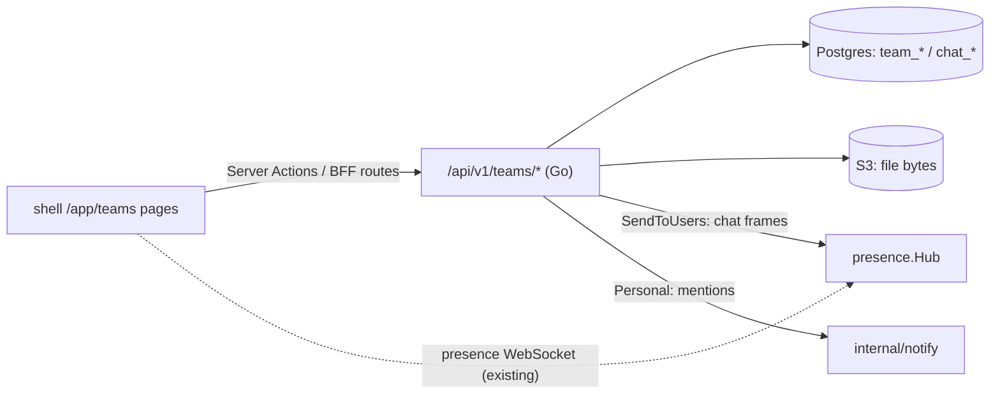

# Teams app — design

Status: approved to build (2026-11-09). The parts the user chose are marked **(user)**. Everything else was my call, marked *(call)*.

## Intent

Internal staff need one everyday workspace where they chat all day and pass files around **(user)**. Website visitors and outside people never get in **(user)**. Teams is that workspace inside the ERP, so people don't need a separate chat tool or file share.

## Goals

- A **dashboard** with one tile per team the user belongs to, plus a **Create team** button **(user)**.
- A **full-screen team view**. The left sidebar lists the team's members with their live presence status. Below them come the team's channels, its folders, and *Shares* (files shared with me) **(user)**. The main area shows either the chat or the file manager.
- **Chat**: several channels per team, plus private one-to-one messages that live outside any team **(user)**. Must-haves at launch: file attachments, @mentions that notify, unread counts, emoji reactions **(user)**.
- **Roles per team (user)**: an *owner* manages everything (members, roles, channels, all files), a *member* chats and uploads, a *guest* reads only.
- **Files**: each team has folders and files that users can create, rename, move and delete within their role **(user)**. Files can be shared with specific people **(user)**.

## Non-goals

- A Collabora or online editor connector **(user)**. Files are stored and downloaded only.
- Editing or deleting messages, threads, message search *(call: not in the must-have list)*.
- Admin-level permissions on Teams. Team roles are the only access control (see Authorization).
- Scaling to several `core-back` replicas. Live delivery uses the existing single-instance presence hub, whose limits are documented in ADR-019.

## Anti-goals

- Anyone outside a team reading its channels or files. Every read and write checks team membership server-side.
- A private conversation visible to anyone but its two participants.
- Website accounts reaching anything. The JWT middleware already rejects the website audience.

## Architecture

### Backend

- **`core/internal/teams`** holds the logic (models, repository, handlers). **`core/modules/teams`** is the module (`type: go`, `app_mode: true`, `menu_icon: "users"`, `depends: []`). It registers the tables with `orm.WithExcluded()`, keeping them off the generic CRUD surface like chatter and notebook, and hand-writes the unique indexes in `Migrate()`.
- **Tables** (each has `tenant_id` and soft-delete via `BaseModel` unless noted):
  - `team`: name, description.
  - `team_member`: team_id, user_id, role (`owner|member|guest`). Unique live `(team_id, user_id)`.
  - `chat_channel`: team_id (NULL for a direct conversation), kind (`channel|direct`), name (empty for direct), direct_key. For a direct conversation, direct_key is the two user ids sorted and joined. Unique live `(tenant_id, direct_key)` where kind = direct, so a pair has at most one conversation.
  - `chat_channel_member`: channel_id, user_id, last_read_at. One row per participant of a direct conversation. For team channels, rows are created lazily and only carry the read cursor *(call: membership of a team channel comes from `team_member`)*. Unique `(channel_id, user_id)`.
  - `chat_message`: channel_id, author_id, body (≤ 4000 characters, may be empty when there is an attachment), created_at. Hard append-only, no edit or delete.
  - `chat_attachment`: message_id, filename, mime, size, object_key.
  - `chat_reaction`: message_id, user_id, emoji (≤ 16 bytes). Unique `(message_id, user_id, emoji)`. Posting again toggles the reaction off.
  - `team_folder`: team_id, parent_id (nullable), name.
  - `team_file`: team_id, folder_id (nullable = root), name, mime, size, object_key, uploaded_by.
  - `team_file_share`: file_id, user_id. Unique `(file_id, user_id)`.
- **Authorization** *(call)*: the routes are mounted with **JWT only, no `permMw`**, plus a middleware that returns 404 while the `teams` module is inactive (`Registry.IsActive("teams")`). Notifications already work this way. Every staff user may use Teams and create teams. The per-team role decides the rest:
  - **guest**: read channels, read and download files.
  - **member**: guest rights, plus post messages, react, and upload files. Creates folders, renames, moves and deletes only the files and folders they created themselves *(call)*. Shares files.
  - **owner**: everything, including team rename and delete, members and roles, channels, and any file or folder. The creator becomes the owner. A team must always keep at least one owner (409 otherwise).
  - Shares: a recipient can see and download the shared file, nothing else. Recipients may be any staff user of the tenant.
- **Routes** under `/api/v1/teams`:
  - `GET|POST /` lists my teams with unread totals, or creates a team. `GET|PUT|DELETE /:id`.
  - `GET /directory` lists staff users (id, display name, email) for the member and share pickers. Website-kind users are excluded.
  - `GET|POST /:id/members`, `PUT|DELETE /:id/members/:user`.
  - `GET|POST /:id/channels`, `PUT|DELETE /:id/channels/:channel`. A new team gets a `general` channel.
  - `GET|POST /direct`: lists my conversations, or opens (gets or creates) one with `{user_id}`.
  - `GET /channels/:channel/messages?before=<ts>&limit=50` (newest page first). `POST` the same path as multipart (body, mentions[], files[]) or JSON. `POST /channels/:channel/read` moves my read cursor.
  - `POST /messages/:message/reactions {emoji}` toggles a reaction.
  - `GET /attachments/:id` downloads an attachment.
  - `GET /:id/files?folder=` lists folders and files. `POST /:id/folders`, `PUT|DELETE /:id/folders/:folder`. `POST /:id/files` uploads (multipart). `PUT|DELETE /:id/files/:file` renames or moves, and deletes. `GET /files/:file/download`.
  - `GET|PUT /files/:file/shares` (PUT replaces the whole list of user ids). `GET /shared` lists files shared with me.
- **Uploads**: the upload routes join `BodyLimitExempt` and take `upload_body_limit`, as attachments do. Bytes go through `pictures.ObjectStore` under `<tenant>/teams/<uuid>`. Without `s3_*` configured, file and attachment routes are not mounted and the UI hides the Files pane and attachment button. Chat still works.
- **Deletes**: deleting a folder deletes its subtree (files and their objects) recursively, in one transaction for the rows, then deletes the objects. Deleting a team does the same for all of its data.
- **Live**: after a message or reaction is written, the handler pushes `{type: "chat_message"|"chat_reaction", channel_id, …}` to the channel's audience (team members, or the two participants) through `presence.Hub.SendToUsers`. Never `Broadcast`.
- **Mentions**: the client sends the mentioned user ids alongside the body, which shows `@Display Name`. The server keeps only ids that can read the channel and sends each one `notify.Personal` under a new `teams` category ("Teams"), linking to `/teams/<team>/channels/<channel>` or `/teams/direct/<channel>`.
- **Unread**: the count of messages newer than my `last_read_at` and not written by me, computed per channel in the channel and direct lists. A user with no cursor row counts everything.

### Frontend (`core-front`)

- `core/modules/teams/views/TeamsViews.ts`: a `FrontModule` whose one route `/teams` declares a `dashboard` descriptor with no permission. That descriptor exists only so the app launcher shows a tile. The real pages are hand-built under `core-front/apps/shell/app/app/teams/`, which Next prefers over the catch-all, the same pattern as the Website app's workflows page.
- Pages:
  - `/teams`: dashboard. A tile per team (name, description, member count, unread badge), a *Create team* button with a dialog, and a *Direct messages* tile.
  - `/teams/[id]`: redirects to the team's first channel.
  - `/teams/[id]/channels/[channel]`, `/teams/[id]/files`, `/teams/direct/[channel]`, `/teams/shared`: one full-screen layout. The left sidebar holds members with presence dots (from `usePresenceStore`), channels with unread badges, folders (a tree), Shares, and direct messages. The main pane holds the chat or the file manager.
- **Chat pane**: a message list with infinite scroll upward, a composer with an @mention autocomplete over channel members, an attach button, emoji reactions (a small fixed picker), and download links for attachments. Live frames come through a `handleChatFrame` hook on the presence socket's `onmessage`, mirroring `handleNotificationFrame`. Opening a channel marks it read.
- **File manager**: breadcrumbs, a table of folders and files, new folder, upload, rename, move (a folder picker), delete with confirm, download, share (a staff picker). Buttons are hidden when the caller's role can't use them. The server still enforces every rule.
- Data goes through Server Actions plus BFF routes for multipart and downloads, like `app/api/attachments`. The browser only talks to Go directly over the existing presence socket.
- Every user-visible string goes through `<T>` / msgids in the module's `i18n/`.

## Testing

Go: handler tests with the role matrix (guest, member, owner, non-member, which gets 404) for every route, DB tests via `testdb` (`MigrateModules(t, app, "auth", "notify", "teams")`), direct-conversation uniqueness, recursive folder delete, a mention reaching only readers, unread counts. Frontend: vitest for the stores and components (chat frame handling, unread updates, role-gated buttons). Coverage floors as in CLAUDE.md.

## Docs

A new ADR (`ADR-035-teams.md`), a `CLAUDE.md` architecture entry for `internal/teams`, and a `core-front/CLAUDE.md` row for the Teams pages and the chat frame hook.

## Left to the builder

Visual styling within the existing MUI theme, the emoji set, page sizes, and how the sidebar collapses on phone.
