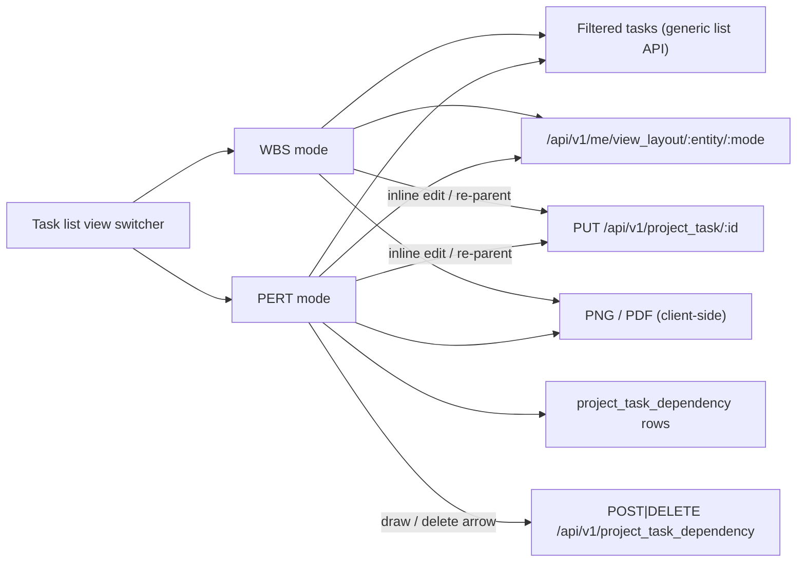

# Project — WBS and PERT diagram views

Date: 2026-11-12 · Status: approved design, ready for planning

## Why

Project reviews need two pictures the task lists can't give today:

- **WBS** (Work Breakdown Structure): how the work breaks down. The "type" of a task is
  its parent task, so the tree is the existing parent/subtask hierarchy. Type tags come
  later and must fit in without a redesign.
- **PERT**: the order the work must happen in, and the **critical path**, the chain of
  tasks with zero slack that sets the end date.

Both must be live views of the tasks, not drawings: editing a box edits the task. The
diagrams must also be exportable (PNG, PDF) for review decks and notes.

## Goals

1. Two new display modes, **WBS** and **PERT**, in the task lists' view switcher (next to
   List / Kanban / Calendar / Graph / Gantt), working on the tasks the search bar
   currently filters to.
2. WBS: a top-down tree from `parent_id`. Each parent box has a **chevron** that folds or
   unfolds its subtree.
3. PERT: one box per task, arrows from `project_task_dependency` (the same rows the
   Gantt draws). Each box shows ES / EF / LS / LF and slack, and the critical path is
   highlighted.
4. **Inline editing** of task values in both diagrams, saved through the normal task
   save. A double-click opens the task form.
5. **Structure editing**: in the WBS, dropping a box onto another box re-parents it. In
   the PERT, drawing an arrow creates a dependency and deleting one removes it.
6. **Free layout**: boxes can be dragged, with **collision handling** like the website
   workflow map, plus a "Re-arrange" button that re-runs the auto-layout.
7. Layout (positions, folded nodes) is kept **per user**.
8. **Export** of the current diagram as it's laid out to **PNG** and **PDF**.

## Non-goals

- Type tags (later).
- Shared or team layouts.
- Working calendars (weekends, holidays, per-user capacity) in PERT math.
- Server-side PDF rendering through `internal/reports`.
- Probabilistic PERT (three-point estimates).

## Anti-goals (failure even if it "works")

- A diagram that edits data any other way than the task's normal save path, and so
  skips its validation, row scope or rights.
- Overlapping boxes after a drag or a re-layout.
- A critical path that silently ignores tasks with no estimate.
- One user's drag moving another user's layout.

## Decided by the user

- **Duration** = `planned_hours` when > 0, otherwise days from `date_start` to
  `deadline`.
- Every value shown in a box can be edited where it's stored, and the edit writes the
  task.
- Boxes can be dragged, with automatic placement and collision handling like the website
  workflow map (`core-front/apps/shell/src/website/workflow-collide.ts`).
- WBS nodes fold and unfold with a chevron.
- Layout is per user.
- Export to PNG and PDF.
- The scope above, structure edits included.

## Design calls made by Claude (open to override)

| Topic | Call |
|---|---|
| Hours → days | 8 h = 1 day. Durations are in days, fractions allowed. |
| No estimate | No hours and no usable dates → 1 day, with a "No estimate" badge on the box and in the legend. |
| Date math | Calendar days, no weekends. Time zero = the earliest `date_start` among the shown tasks, else today. ES/EF/LS/LF are shown as dates. |
| PERT nodes | Every filtered task is a node, parents included. Parent → child is **not** a PERT edge, only dependency rows are. Users filter (e.g. to leaves or one project) to choose the view. |
| Edges outside the filter | A dependency whose other end is filtered out is not drawn and not counted. A small "n hidden links" note is shown. |
| Closed tasks | Shown greyed. Their duration still counts, so the path stays honest. |
| Critical path | Forward/backward pass. Every task with slack ≈ 0 (< 1e-6) is critical. Several critical chains can coexist. Critical boxes and arrows are red, and the legend says so. |
| Cycles | The backend already refuses dependency cycles (422). The client still detects them, shows an error, and skips the critical path rather than looping. |
| WBS roots | One root per project when the filter spans several projects (config `wbsGroupField: 'project_id'`). Under each root, the top-level tasks are the "types". |
| Fold | Folding hides the whole subtree. A folded box shows a count of hidden tasks and their summed planned hours. Fold state is saved with the layout. |
| Inline-editable values | `name`, `stage_id`, `date_start`, `deadline`, `planned_hours`. Computed values (ES/LS, slack, spent hours, counts) are read-only. Everything else goes through the form (double-click). |
| Structure edits | WBS re-parent = a task PUT of `parent_id` (cross-project → the backend's 422 is shown). Dropping on a project root clears `parent_id`. PERT arrows = generic create/delete on `project_task_dependency`. Errors are shown with the existing error alert, and the box snaps back. |
| Generic engine | WBS and PERT are **generic view modes in `packages/core-front`**, configured per descriptor like Gantt: `wbsParentField`, optional `wbsGroupField`, and `pertDependencies` (same shape as `ganttDependencies`, which the project task lists reuse). Other apps can turn them on later. |
| Diagram library | `@xyflow/react` (already used by the shell's workflow map), added to `packages/core-front`. The collision helpers move from `apps/shell/src/website/workflow-collide.ts` into the engine package, and the shell imports them from there. |
| Auto-layout | Hand-written, no layout library. WBS: a top-down tidy tree. PERT: columns by longest-path rank (left → right), rows ordered to reduce crossings by a simple barycenter pass. `separateBoxes` then guarantees no overlap. |
| Saved positions vs. new tasks | A saved position wins. A task without one is placed by the auto-layout, then pushed clear by `separateBoxes`, with saved boxes held `fixed`. Positions of tasks no longer present are dropped on the next save. |
| Layout storage | New table `user_view_layout` (`tenant_id`, `user_id`, `entity`, `mode`, `layout` JSON = `{positions: {id: {x,y}}, folded: [id]}`), off the generic CRUD surface, unique live `(tenant_id, user_id, entity, mode)` hand-written in `Migrate()`, written by `Repository.Upsert`. Routes `GET|PUT /api/v1/me/view_layout/:entity/:mode` (JWT only, caller's own row, same posture as `/me/preferences`). Nothing saved → `{positions: {}, folded: []}`. Limits like the website workflow layout: ≤ 2000 ids, ids ≤ 300 chars, finite coordinates within ±10⁶, `mode` ∈ {`wbs`, `pert`}. The PUT is debounced (~500 ms after a drag ends). |
| Export | `html-to-image` captures the React Flow viewport fitted to all nodes → PNG. `jspdf` places that image on a landscape A4 page (A3 if the diagram is wide) with the project/filter name, date and legend → PDF. Both are client-side, one click, and keep the user's layout and folds. |
| Loading | The mode pages through the filtered list until an empty page (never trusting an estimated total, ADR-032), capped at 2000 tasks. Above the cap it shows a "narrow the filter" notice instead of a partial diagram. |
| Permissions | Read = the task list's own read. Edits go through the generic task / dependency endpoints, so row scope, manager rules and 403/404/422 apply unchanged. Layout endpoints need only a signed-in staff user. |

## How it fits

Pure logic lives in its own unit-tested files: `pert.ts` (durations, passes, slack,
critical set, cycle detection), `wbs.ts` (tree build, fold, rollups) and the two
auto-layouts. The React Flow components stay thin, like `WorkflowMap.tsx`.

## Left to the builder

- Box visuals, toolbar placement, the exact inline-edit interaction (click-to-edit vs.
  pencil) and keyboard handling, within the existing MUI / engine style.
- Whether the WBS and PERT components share one canvas wrapper.
- Export image resolution (≥ 2× pixel ratio recommended).

## Done means

- Both modes appear on the Project task lists (All tasks, My tasks, a project's tasks)
  and nowhere else until another descriptor opts in.
- Unit tests: PERT math (chain, diamond, parallel critical chains, no estimate, hours vs.
  days, cycle), WBS build and fold, auto-layouts produce no overlap, layout handler
  (own row only, limits, empty default, upsert).
- `make test` green, with coverage floors kept (Go 85 %, engine and shell 80 %).
- i18n msgids added to the `.po` files. `core-front/CLAUDE.md` documents the new
  descriptor keys. Root `CLAUDE.md` documents `user_view_layout` and its routes. A short
  ADR covers per-user diagram layouts and client-side export.
