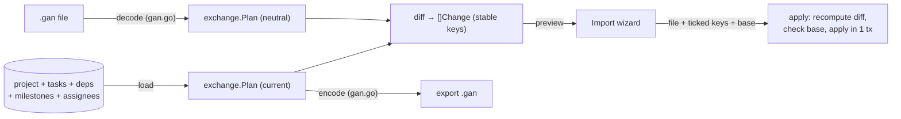

# Project — Gantt exchange with GanttProject (.gan)

Date: 2026-11-18 · Status: design, awaiting approval

## Why

Project managers plan in EERP, but **partners plan in GanttProject**. Today the only way
to share a plan is a PNG/PDF export, and the partner's edits come back as a picture or
an email to retype. We want a **round trip**: export the pinned project as a `.gan`
file, the partner edits it in GanttProject and sends it back, and the manager imports
it, seeing **every change the file would make, before → after, one checkbox each**, and
applying only the ones they accept.

A second plan (MS Project, MSPDI XML) follows. It reuses everything here except the
file reader and writer, so this design keeps the exchange **format-neutral**.

## Goals

1. **Export .gan** from the task lists' Gantt mode while one project is pinned: tasks
   (hierarchy and order), dates, planned hours, completion, finish-to-start
   dependencies, milestones, assignees (as resources and allocations).
2. **Import .gan** in a wizard: pick a file, review the changes it would apply, tick
   all or some, apply them.
3. Each change row shows **what it is** (create / update / move / delete / dependency /
   assignee), **the task**, and **before → after**.
4. Applying is **all or nothing** (one transaction). A project edited since the preview
   is refused, and the user previews again.
5. Round-trip **stability**: exporting and re-importing a file that was not edited
   shows **no changes**. That covers a file that was never opened. It also covers one
   opened and saved in GanttProject without edits, except where GanttProject's own
   scheduling moved a task (see "Values GanttProject recalculates").

## Non-goals

- Three-way merge or conflict detection against the exported version. "Before" is the
  project as it is in EERP **now**. A concurrent EERP edit shows up as a normal row,
  and leaving it unticked keeps the EERP value.
- Writing data EERP doesn't have: dependency types other than finish-to-start, lags,
  resource costs, calendars and holidays, task notes, colors, custom columns other than
  ours.
- Importing a `.gan` as a brand-new project. Import always targets the pinned project.
  (Later, if ever: it's the same pipeline with an empty "before".)
- Stages, tags, color groups, timesheets, risks, RACI, PBS and OBS are not exported.

## Anti-goals (failure even if it works)

- One "select all" silently deleting tasks with their timesheets, risks or subtasks.
- A half-applied import.
- Spurious change rows on an untouched round trip (weekend deadlines, undated tasks,
  rounding). People stop reading the list and tick everything.
- Bypassing the project's own write rules (row scope, cycles, read-only aggregates,
  manager-only operations).

## Decisions taken with the user

- **Round trip with partners** is the use case, so matching is by **EERP id**.
- **Removals are offered unticked by default** (tasks, dependencies, assignees).
  Everything else is ticked by default.
- **Approach A**: server-side, format-neutral (below).
- **Import: the project's manager or an admin only** (same rule as Save baseline).

## Approaches considered

| | How | Trade-off | Verdict |
|---|---|---|---|
| **A. Server, neutral plan model** | Go reads and writes the files. preview → diff with stable change keys, apply → recompute the diff and apply the ticked keys in one transaction. | The file is uploaded twice (negligible). | **Chosen.** Atomic, the project's validation is reused, and MS Project is a second adapter. |
| B. Browser only | Parse, diff and apply through generic CRUD calls. | Hundreds of requests, no transaction, fragile ordering of creates/deps. | Rejected: half-imports. |
| C. Browser parse, server apply | The changeset is built in TS and applied in Go. | The diff lives in TS and the rules in Go, so there are two places to keep right. | Rejected. |

## Design

### Architecture



New code lives in `core/modules/project/` (an `exchange*.go` set: neutral model, load,
diff, apply, and `gan.go` for the format). The format is an interface:

```go
type Format interface {
    Key() string                                       // "gan"; "mspdi" in plan 2
    Encode(w io.Writer, p Plan) error
    Decode(r io.Reader) (Plan, []Warning, error)       // warnings: things EERP can't hold
}
```

`Plan` holds the project name and default calendar (working weekdays), **tasks** (EERP
id or a file-local id for new ones, name, parent, position among siblings, start,
duration in working days, planned hours, completion %, isMilestone), **dependencies**
(predecessor → successor, type, lag), and **resources/assignments** (email, display
name).

### Routes (manager/admin rules as in `baseline.go`)

| Route | Who | Does |
|---|---|---|
| `GET /api/v1/project/:id/exchange/:format/export` | anyone who sees the project (404 otherwise) | the file, `Content-Disposition: attachment; filename="<project name>.gan"` |
| `POST /api/v1/project/:id/exchange/:format/preview` (multipart `file`) | manager/admin (404 invisible, 403 others) | `{base, changes: [...], warnings: [...]}` |
| `POST /api/v1/project/:id/exchange/:format/apply` (multipart `file`, `base`, `keys[]`) | manager/admin | 200 `{applied: n}`. 409 `PROJECT_CHANGED` when `base` differs. 422 for an inconsistent selection or a validation failure, naming the keys. |

`base` is a hash of the loaded current `Plan`. Apply reloads, re-hashes, and refuses on
mismatch. Unknown `:format` → 404. **Body size** *(builder check, my call)*: the
preview and apply routes are upload routes. They go in `BodyLimitExempt`
(`/api/v1/project/*/exchange`) and take `upload_body_limit` (20 MB by default), so the
**5000-task cap** (422) is the limit that actually applies, not the 1 MB JSON limit. An
oversized body still gets a 413, which the wizard explains.

### Matching and change keys

- **Export** adds two GanttProject custom task columns: `eerp_id` (the task's uuid, or
  `milestone:<uuid>` for a milestone) and `planned_hours` (number). GanttProject keeps
  custom columns on save.
- **Import**: a file task whose `eerp_id` names a task **of this project** is an
  update. One with no `eerp_id` (added by the partner) is a create. An `eerp_id` naming
  something not in this project (another project, deleted, or invisible) is a
  **warning** ("unknown EERP task, imported as new" → create). Two file tasks with the
  same `eerp_id` (copy-paste in GanttProject) → the first matches, the others are
  creates, with a warning.
- **Keys**, stable for the same file and the same project state:
  `task:<uuid>:<field>`, `task:<uuid>:move`, `task:<uuid>:delete`, `new:<file id>`,
  `dep:<pred>:<succ>[:delete]`, `assign:<task>:<email>[:delete]`,
  `milestone:<uuid>:<field>` / `new-milestone:<file id>` / `milestone:<uuid>:delete`.
  In dependency and assignment keys, a new task is referred to by `new:<file id>`.

### Comparing in the file's terms (round-trip stability)

The diff never compares raw EERP values with parsed file values. It **encodes the
current EERP task the same way export does** and compares that with the file. A field
is a change only when the two differ, and only then is the file's value converted back
to EERP form. This removes the spurious rows:

- **Dates**: `.gan` stores start + duration in working days (Sat/Sun off by default,
  per the file's calendar). An EERP deadline on a weekend exports as some duration.
  Re-importing the same duration is "no change", even though converting it back would
  land on a Friday.
- **Undated tasks** (no `date_start`/`deadline`) export with a deterministic
  placeholder: start = the project's `date_start`, else the task's `created_at` day,
  duration 1. The same placeholder computed at import means "no change". If the
  partner moves the task, it gets real dates.
- **Hours** compare at 0.01 precision. **Completion** compares as exported (below).

### Values GanttProject recalculates *(builder check, my call)*

When GanttProject opens and saves a file, it rewrites some values that EERP doesn't
constrain:

- **Summary (parent) tasks**: their dates and completion are derived from their
  children. On import, a task that has children in the file has its **dates and
  completion ignored** (no row). EERP parents keep their own dates.
- **Successors pushed by a finish-to-start dependency**: shown as **normal date rows**.
  They reveal a real conflict in the EERP plan (a successor starting before its
  predecessor ends), so the manager should see them. Export exports dependencies with
  GanttProject's weakest hardness (the builder checks which one, likely `Rubber`, keeps
  this to genuine conflicts). The round-trip fixture "opened and saved, no edits"
  asserts that only such rows appear.
- **Undated tasks with a dependency**: the placeholder start is pushed after the
  predecessor. These rows show as date changes on a task EERP has no dates for. The
  wizard labels a change on an undated task "(was unscheduled)" so it reads as what it
  is.

### Milestone links *(builder check, my call)*

A task's `milestone_id` (the deliverable it produces) exports as a **finish-to-start
dependency from the task to the milestone**, which is how GanttProject users draw a
deliverable. Milestones are exported at the top level, after the tasks. On import:

- A dependency whose successor is a milestone sets the predecessor task's
  `milestone_id`: an update row "Deliverable: — → M". A removed one clears it
  (unticked, like other removals). If a task has several milestone successors, the
  first one is used and the others get a warning.
- A dependency with a milestone as predecessor → warning, not applied (EERP has no
  such link).
- A milestone nested under a task → read at the top level, **no warning** (that's how
  EERP's WBS shows it).
- Deleting a milestone clears the `milestone_id` of the tasks that pointed to it, in
  the same transaction, the same way a milestone delete already does in EERP (the
  builder checks this and adds it if missing).

### Moves *(builder check, my call)*

A move row appears only when a matched task's **parent** changes, or when its **order
relative to the other matched siblings** changes. The minimal set is the siblings
outside the longest run kept in order, so inserting one task near the top creates no
rows for the tasks below it. A move row says "under X, after Y". The absolute position
is computed **at apply time** from the rows actually ticked. New tasks are placed after
their file predecessor among the ticked siblings, else last.

### Field mapping

| EERP | .gan | Import rule |
|---|---|---|
| `name` | `name` | update (≤ 200 chars, else warning and truncated) |
| `parent_id` + `sequence` | task nesting and order | one **move** row (parent and/or position), applied by writing `wbs_number` through the task's own validation (`taskOrder`), after creates |
| `date_start` / `deadline` | `start` / `duration` | update: start day and end = start + duration working days − 1 |
| `planned_hours` | custom `planned_hours` | update |
| `closed` (stage) | `complete` (100 when closed, else 0) | to 100 → the project's first closed stage; from 100 to < 100 → its first open stage; other values are ignored without a row |
| `project_milestone` | task with `meeting="true"`, custom `eerp_id = milestone:<uuid>` | name and deadline update / create / delete (unticked). A milestone moved under a task is flattened, with a warning. |
| `project_task_dependency` (both ends in the project) | `<depend type="2" difference="0">` (finish-to-start) | create / delete (unticked). Another type, or a lag, → warning, not applied (a lagged FS imports as plain FS, with a warning saying the lag was dropped). Cross-project deps are never exported, so they are never "removed". |
| `project_task_user` | resource (`contacts` = user email) + allocation | create / delete (unticked). An email with no staff user in EERP → warning, not applicable. |

The builder confirms the exact `.gan` tags, dependency type codes and calendar element
against a file saved by GanttProject 3.x, and commits it as `testdata/` fixtures
(export, partner-edited, and odd cases).

### Applying

- One transaction, in this order: task creates (parents first), moves, field updates,
  milestone changes, dependency and assignee creates, then deletes (dependencies,
  assignees, then tasks deepest-first, then milestones). Every write goes through the
  **same validation the generic CRUD uses** (`validate.go` guards: visibility,
  cycles, stage/milestone belonging, manager rules) so an import can never do what the
  form can't. **Implication** *(builder check)*: those guards currently run as Echo
  middleware and query through the pool. The checks they share must be extracted so
  they run on the import's transaction, so they see the tasks it has just created. The
  middleware must keep calling the same functions, with no second copy of the rules.
  This refactor is the plan's first step. Read-only and trigger-maintained columns (`wbs_number` except as a move,
  `blocked`, the hour totals, `closed`) are never written directly.
- **Selection consistency** (server-enforced, also helped by the UI): a dependency or
  assignee on a new task needs that task's create ticked. A create under a new parent
  needs the parent's create. Deleting a task whose subtasks are not deleted (unticked)
  → 422 naming both keys. A dependency that would close a cycle → 422 naming it.
- Deletes are the normal soft deletes, so they can be restored.
- After apply: a `kind: "log"` chatter message on the project ("Imported <file>: n
  changes"). The Gantt reloads.

### Frontend (engine + project descriptor)

- A new descriptor key, generic like `ganttBaseline`:
  `ganttExchange: { scopeField: 'project_id', scopeEntity: 'project', formats: [{ key: 'gan', label: 'GanttProject (.gan)', accept: '.gan' }], canImport: 'project.canEditStages' }`.
  Plan 2 adds a format entry and nothing else.
- Gantt toolbar, only while the scope is pinned (like Critical path and Baseline):
  **Export** (menu of formats; a plain download) and **Import** (shown when the
  `canImport` guard passes). On phone both go in the existing More menu.
- **Wizard** (MUI Dialog, full screen on phone), three steps:
  1. **File**: file picker (accept by format), with the format chosen in the menu.
  2. **Review**: the warnings first (collapsed, with a count), then the changes
     **grouped by task** in WBS order, each row: checkbox · kind chip · field ·
     `before → after` (dates formatted with the workspace date format, hours with
     the number format). The header has Select all / none and "n of m selected".
     Removal rows are unticked. *(Builder check, my call)*: **Select all leaves
     removals alone**. A separate "Select all removals" checkbox ticks them, and a
     removal row says what goes with it ("has 2 timesheets, 1 risk link, 3
     subtasks"). The preview returns those counts per removal. Ticking a row also ticks the rows it needs (its new
     parent or new task), and unticking a create unticks the rows that need it.
     "No changes" when the list is empty.
  3. **Apply**: the result. 409 → "The project changed since the preview" with a
     **Preview again** button. 422 → the message, with the named rows highlighted
     back in step 2.

```
┌ Import GanttProject file ─────────────────────── ✕ ┐
│ ⚠ 3 warnings (show)                                 │
│ [☑ Select all]                      14 of 17 selected│
│ 2.1 Design review                                    │
│   ☑ Update  Deadline     12/03/2026 → 19/03/2026    │
│   ☑ Update  Planned h.   16 → 24                     │
│ 2.3 Supplier audit (new)                             │
│   ☑ Create  under 2 · Design, 05/03 → 07/03, 8 h     │
│   ☑ Depends on  2.1 Design review                    │
│ 3.4 Legacy migration                                 │
│   ☐ Delete  task (has 2 timesheets)                  │
│                         [Back]  [Apply 14 changes]   │
└──────────────────────────────────────────────────────┘
```

- The browser calls go through the BFF like every other route. The upload is small
  (≤ 1 MB), so it is well under `proxy.ts`'s 10 MB buffering.

### Labels and i18n

Every new label (buttons, step titles, change kinds, warnings) gets a `.po` entry in
the project module's `i18n/` and the shell's catalogs where it shows there.

### Testing

- Go: encode/decode against the committed GanttProject fixtures, round-trip stability
  (export → import → zero changes, including weekend deadlines, undated tasks and
  milestones), every change kind, selection consistency (422s), the stale `base`
  (409), permissions (404/403), the 5000 cap, and an XML that isn't a `.gan` (422).
  This must keep core above its coverage floor.
- Frontend: the wizard (ticking dependencies, removals unticked, the 409/422 paths),
  and toolbar visibility (pinned only, guard).

### Documentation

A new ADR (ADR-042, project plan exchange): the neutral model, matching by id, the
"compare in the file's terms" rule, and why MSPDI rather than `.mpp` for plan 2. The
project module's bullet in `CLAUDE.md` and the wiki's Project pages get the routes and
the pitfalls (dependency types and lags are dropped; "before" is current EERP, not
the export).

## Calls made without the user (check these)

1. Summary-task dates and completion are ignored on import. Successors pushed by a
   dependency show as normal rows.
2. A task's milestone link is exported as a task → milestone dependency, and
   milestones are exported at the top level.
3. Moves are minimal (parent or relative order changed), with the position computed
   at apply time.
4. Select all never ticks removals. They have their own "Select all removals"
   checkbox and show what goes with them.
5. The exchange routes are upload routes (20 MB). The real limit is the 5000-task cap.
6. The import is limited to the 4 entities above. Stages, tags, colors, timesheets and
   risks are untouched.
7. Completion maps only 100% ↔ closed.

## Left to the builder

- The exact `.gan` XML shape (from real GanttProject files), including the default
  calendar and holidays (holidays can be ignored: weekends only, with a warning when
  the file defines holidays).
- How dates map to the `TIMESTAMPTZ` columns: follow what the task form writes for a
  date field.
- Shape of the `changes` JSON (include `key`, `kind`, `task` label and WBS number,
  `field`, `before`, `after`, `default_selected`, `requires: [keys]`).
- Route mounting and the derived permission: mirror `/project/:id/baseline`.
