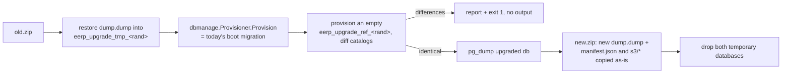

# Database upgrade tool (`tools/eerp-upgrade`) — design

## Intent

Bring a database extracted from an old EERP release (floor: **v0.108.0**) up to
the current release in **one step**, without installing every release in between.
It is the local engine of an upgrade service shaped like upgrade.odoo.com: an old
database goes in, an upgraded copy comes out, the live database is never touched.
The upgrade *site* (upload, test/production runs, notifications) comes later and
will wrap this tool; it is out of scope here.

## Goals

- A standalone Go program in `tools/eerp-upgrade/`, run locally:
  `eerp-upgrade -config ../../eerp-config.json -in old.zip -out new.zip [-to v0.150.0]`
  — the target defaults to the tool's own version (latest); `-to` picks an
  older release.
- Input and output are the extract zip of `/database/management`
  (`dump.dump` + optional `manifest.json` + `s3/<key>`). v0.108.0 already wrote
  this format, so a v0.108.0 extract is a valid input, and the output restores
  through `/database/management` like any extract.
- The upgrade runs **today's core upgrade code**, never a copy of it.
- Every run proves its result: the upgraded schema is compared with a freshly
  provisioned current database, and any difference is reported and fails the run.
- A `CLAUDE.md` rule says when the tool needs a new version and what to add.

## Non-goals

- The upgrade website, test vs production modes, notifications.
- Upgrading a live database in place (starting the current core already does it).
- Downgrades (refused, see Versions), or inputs older than v0.108.0.
- Touching S3: object bytes pass through untouched.

## Anti-goals

- A second, hand-maintained copy of the schema SQL that drifts from `Migrate()`.
- Any write to the database named in the config, or to the S3 bucket.

## Constraints

- **Go `internal` rule**: code outside `core/` cannot import `core/internal/...`.
  The tool's module is named `core/tools/eerp-upgrade` (own `go.mod`,
  `replace core => ../../core`), which the rule accepts.
- **Dead code gate**: a `core` function reachable only from the tool counts as
  dead for CI. Any helper exported from `dbmanage` for the tool must also be used
  by `dbmanage` itself (refactor `Restore`/`writeBundle` onto it).
- Needs a reachable Postgres with PostGIS (the dev stack's) and the
  `pg_dump`/`pg_restore` client tools, same as `/database/management`.
- Go modules register through `init()`: the tool blank-imports `core/modules/all`.

## Approaches considered

| | Approach | Trade-off |
|---|---|---|
| **A (picked)** | Use a Postgres the user points at (config / `-dsn`), temporary database there | Least code: reuses `dbmanage` restore/dump and `dbmanage.Provisioner`. Needs the dev stack's Postgres and the pg client tools. |
| B | Tool starts its own throwaway `postgis/postgis:18-3.7` container | Fully self-contained, but needs Docker, container lifecycle code, slower. |
| C | Upgrade a live database in place | What the core's boot already does; exactly the risk the Odoo-style copy flow avoids. |

A was chosen by the user.

## Why one jump works today

The core's boot (`module.Registry.Boot`: auto-migration + each module's
`Migrate()`) is cumulative: it compares the database with today's code and adds
what's missing. No commit between v0.108.0 and now removed or replaced an upgrade
step (checked over the 374 commits), so running today's boot once covers the
whole range — including the new `project` and `teams` modules, the
`project_risk_history.recorded_on` type change and the PostGIS extension upgrade.

## How it works

1. Open the input zip; refuse it without `dump.dump`. Refuse an existing `-out`
   unless `-force`.
2. Create `eerp_upgrade_tmp_<random>` and `pg_restore` the dump into it with
   `dbmanage`'s restore code (it already skips extensions the server lacks).
3. Run `dbmanage.Provisioner.Provision` on it (boot migration + default-admin
   seed + notification catalog sync — exactly what a core start does), always
   with `Environment: "production"` whatever the config says *(builder-check
   call)*: the admin seed only inserts when the fixed-id admin row is absent, and
   in production it is forced to change its known password at first sign-in —
   the same outcome a production boot of the copy would give, never a usable
   default credential in a customer database.
4. **Verify**: provision an empty `eerp_upgrade_ref_<random>` the same way and
   compare the two catalogs: tables, columns (name, type, nullability, default,
   generated expression), indexes (definition), constraints, triggers, functions.
   Column order is ignored (added columns land at the end). **One-directional**
   *(builder-check call)*: only what the reference has and the upgraded copy lacks
   or defines differently fails the run — that means today's boot no longer
   reaches the current schema from this input → the tool needs a new step
   (below); print the differences and exit 1. What the upgraded copy has *in
   addition* is expected on a real database (`trgm_*` search indexes built from
   row statistics, columns/tables of fields or modules dropped without a SQL
   `DROP`, server-dependent extensions) and is listed as a warning only.
5. `pg_dump` the upgraded database into `dump.dump` of the output zip; copy
   `manifest.json` and every `s3/*` entry raw from the input zip.
6. Drop both temporary databases on every exit path (deferred, also on error and
   Ctrl-C via the context).

Output: a short report — input/output paths, the target version, tables
restored, the migration log lines, verification result (failures and warnings),
S3 objects carried over.

## Versions: recorded source, chosen target (user decision)

**Every zip records its version.** A `version.json` entry (`{"version":
"0.170.0"}`) is written into the tool's output zip and, from now on, into every
`/database/management` extract and automated backup (`dbmanage.writeBundle`, the
one place all three go through; the value is `core/internal/version.Version`).
Restore ignores the entry. An input without it is treated as "older than this
change, at least v0.108.0".

**Forward only, enforced.** The tool refuses (exit 1, nothing written) an input
whose recorded version is newer than the target, and a target older than
v0.108.0. Equal versions are allowed (re-verifies, rewrites the zip). `dev`
(an untagged local build) compares as newer than every release.

**Target — default: the tool's own build ("latest").** The in-process flow
above: the tool upgrades to the schema of the checkout it is built from
(compiled-in Go modules + the config's `module_root`), its version stamped at
build time (`-ldflags -X …version.Version=$(git describe --tags)`, `dev`
otherwise) and printed in the report.

**Target — `-to v0.150.0` overrides it.** The tool runs *that release's* own
boot instead of its compiled-in code:

1. `git worktree add --detach <tmp> v0.150.0` (from the repo the tool runs in;
   refuse an unknown tag), `go build` that tree's `core/cmd/app`.
2. Write a temporary config: the user's config with `db_name` = the temporary
   database, `environment: "production"`, a free local port, and every optional
   integration emptied (`s3_*`, `nats_url`, `redis_url`, `smtp_host`,
   `pdf_service_url`, `backup_dir`, MCP/OAuth) so the old binary only migrates.
   Older cores ignore unknown config keys (plain `json.Decode`, checked at
   v0.108.0).
3. Start the binary, wait for `GET /health` = 200 (the boot migration finishes
   before the server listens), then SIGTERM it. Timeout → fail with its log.
4. Verification uses the same binary on an empty reference database, so the
   check compares against *that* release's fresh schema.
5. Remove the worktree and the build on every exit path.

`-to` needs `git` and the Go toolchain and takes a few minutes per run (two
boots + one build); the default path needs neither. A `-to` equal to the tool's
own version takes the in-process path. The output `version.json` carries the
target version either way.

## Future versions of the tool (the `CLAUDE.md` rule)

The tool needs a new version when a change makes today's boot unable to upgrade a
v0.108.0 database on its own: a column/table **rename**, a **drop**, a type change
the auto-migration can't do, or the removal of a one-time backfill from a
`Migrate()`. The verification step is what reveals it. The fix is an idempotent
step in the tool (`steps.go`: `pre` steps before `Provision`, `post` steps after),
each detecting by schema whether it applies — the database records no version,
same convention as `Migrate()` today. Each step names the release it belongs to,
and only steps at or below the target run (a rename shipped in v0.180.0 must not
run on a `-to v0.150.0` upgrade). v1 ships with no steps.

Rule to add to `CLAUDE.md` (Commands + a short section): when a change renames,
drops or retypes a column or table, or removes a one-time backfill, add a step to
`tools/eerp-upgrade` in the same change and run `make test-upgrade`.

## Testing

- **Fixture**: `tools/eerp-upgrade/testdata/v0.108.0.zip`, a v0.108.0 extract with
  data in every table that has data-dependent migrations, produced once by a
  committed script (`make-fixture.sh`: `git worktree` at `v0.108.0`, boot it on a
  scratch database, seed, extract, clean up). Kept small (no S3 objects, or one).
- **Test** (skips without `TEST_DSN`/`CONFIG`, like `testdb`): run the tool on the
  fixture → verification passes, output zip restores, rows survive, temporary
  databases are gone. Plus unit tests for the catalog diff and the zip copy.
- **Not in the default checks (user decision).** Its own `make test-upgrade`
  target, outside `make test`. In CI, its own workflow
  (`.github/workflows/upgrade-tool.yml`), triggered only when
  `tools/eerp-upgrade/**` changes (plus manual `workflow_dispatch`), with a PostGIS
  service, the PG 18 client tools and Go. It is never a dependency of
  `test-check.yml`/`test-build.yml`: a red run never blocks the front, back or
  pdf-service image builds. No coverage floor or badge.
- Consequence: a schema change elsewhere does not trigger this test by itself, so
  the `CLAUDE.md` rule tells whoever renames/drops/retypes a column to run
  `make test-upgrade` (or dispatch the workflow) in that change.

## Docs

- `tools/eerp-upgrade/README.md`: why, usage, what the verification means,
  how to add a step.
- `CLAUDE.md`: command line + the rule above.
- Developer Guide deployment page: "Upgrading from an old release" pointing at
  the tool.

## Left to the builder

- Names of the exported `dbmanage` helpers (restore-from-path, dump-to-writer).
- Exact catalog queries for the diff.

- Fixture seed contents and size.
