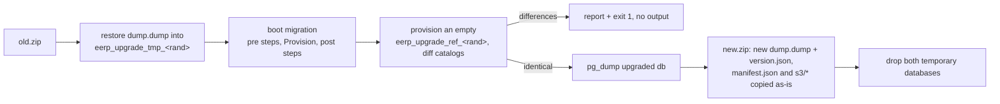

# eerp-upgrade

Upgrades a database extracted from an old EERP release (v0.108.0 or later) to a
newer release **in one step**, without installing every release in between.

## Why

It works like an Odoo upgrade service: an old extract goes in, an upgraded copy
comes out, and the live database is never touched. The upgrade runs the core's
own boot migration (`module.Registry.Boot`, cumulative by design), never a copy
of it, so the tool cannot drift from the schema code. Every run then proves its
result by comparing the upgraded schema with a freshly provisioned one.

## Usage

```bash
make build-upgrade   # -> bin/eerp-upgrade, stamped with the git tag (`dev` when untagged)

bin/eerp-upgrade -config eerp-config.json -in old.zip -out new.zip            # to this build's version
bin/eerp-upgrade -config eerp-config.json -in old.zip -out new.zip -to v0.150.0
```

| Flag | Meaning |
|---|---|
| `-config` | Config whose database server is used as scratch space (the named database is never written) |
| `-in` / `-out` | The `/database/management` extract (or automated backup) zip, and the upgraded zip |
| `-to` | Target release. Default: the tool's own version |
| `-force` | Overwrite an existing `-out` |
| `-debug` | Debug logging |

The output restores through `/database/management` like any extract.



`-to <tag>` runs *that release's* boot instead of the compiled-in one: the tool
checks the tag out in a git worktree, builds its `core/cmd/app`, and starts it on
the temporary database (integrations emptied, `production` environment) until
`/health` answers, which happens after the migration. The verification reference
is provisioned by the same binary, so it compares against that release's fresh
schema. Unlike the in-process path, `-to` runs the release's full startup before
stopping it, so its background jobs start briefly (quote expiry, search index build,
rates fetch); harmless, a normal boot does the same. A `-to` equal to the tool's own
version takes the in-process path.

Forward only: an input recorded as newer than the target, or a target older than
v0.108.0, is refused.

## Requirements

- A reachable Postgres with PostGIS (the dev stack's: `docker compose up -d --wait db`).
- `pg_dump` / `pg_restore` 18 on `PATH`, same as `/database/management`.
- For `-to`: `git` and the Go toolchain (cgo, wasmtime); run the CLI from inside the EERP checkout.

## What a verification failure means

The upgraded copy lacks, or defines differently, something a fresh database has
(tables, columns, indexes, constraints, triggers, functions). Today's boot
alone no longer reaches the current schema from this input, so **the tool needs
a new step** (below). Extra objects in the upgraded copy (`trgm_*` search
indexes, columns of dropped fields, server-dependent extensions) are expected
and only printed as warnings.

## Adding a step

When a change renames, drops or retypes a column or table, or removes a one-time
backfill from a `Migrate()`, add a `Step` to `steps.go` in the same change:

```go
var steps = []Step{{Release: "0.180.0", Pre: true, Name: "rename x to y", Run: renameXToY}}
```

- `Release` is the release that introduced the need; the step runs only for targets at or above it.
- `Pre` steps run on the restored database before the migration, others after it.
- It must be **idempotent** and detect from the schema whether it applies: the database records no version, and the input's own version may be unknown.

Then run `make test-upgrade` (not part of `make test`; CI runs it through
`.github/workflows/upgrade-tool.yml` when this folder changes). Its test upgrades
`testdata/v0.108.0.zip`; `EERP_MAKE_FIXTURE=1` regenerates it, `EERP_UPGRADE_SLOW=1`
enables the `-to` boot test.

## Pitfalls

- An input without `version.json` (extracts made before it existed) is trusted as v0.108.0 or later.
- S3 objects travel inside the zip and are never uploaded anywhere; restoring the output through `/database/management` puts them back.
- The default target is the version stamped into the build: for a release build, build from the target tag's checkout. An untagged build is `dev` and counts as newer than every release.
- `-to` builds a past release: expect minutes, not seconds.
- A crashed run can leave scratch databases: list them with `SELECT datname FROM pg_database WHERE datname LIKE 'eerp\_upgrade\_%'` and drop each with `DROP DATABASE "<name>" WITH (FORCE)`.
- A check a module left `NOT VALID` (an old row violates it) is reported as a warning, not a failure.
- The default admin is seeded in `production` mode, so its known password must be changed at first sign-in.
